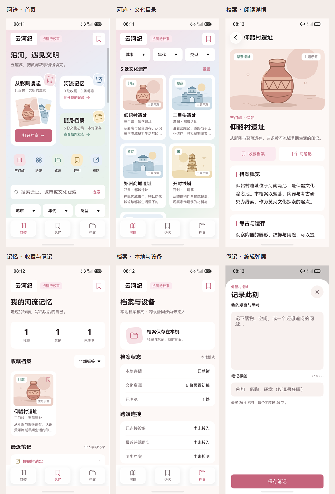

# Yi_Da 参考改版的真实界面截图

截图来自当前 HarmonyOS API 26 手机模拟器，原图均为 1256 × 2760 像素。通过 HDC、Hypium/UiTest 直接操作模拟器取得；使用独立测试档案，示例笔记是测试过程中实际输入、保存的内容。

当前最新的记忆、档案、我的与 AI 重访见 [page-hierarchy 图集](page-hierarchy/README.md)；上一轮首页、五城河洛和详情改版见 [ui-refresh 图集](ui-refresh/README.md)。本页保留早期目录、详情、深色与大字证据，不能代表 2026-10-18 改版后的页面。

`overview.png` 仅将六张原图缩放并排列，加上页名，便于整体检查。它没有补画、重排或修改应用页面。

| 文件 | 页面与状态 |
|---|---|
| [home.png](home.png) | 浅色首页，空测试档案 |
| [catalog.png](catalog.png) | 五条文化目录，双列卡片 |
| [detail.png](detail.png) | 仰韶村档案，尚未收藏 |
| [editor.png](editor.png) | 笔记编辑弹层，尚未输入 |
| [collection.png](collection.png) | 经真实 UI 保存的 1 处收藏、1 条笔记、1 处浏览 |
| [device.png](device.png) | 本地档案与尚未接入的跨端状态 |
| [home-dark.png](home-dark.png) | 深色首页，同一独立档案 |
| [detail-dark.png](detail-dark.png) | 深色详情，已收藏 |
| [home-large.png](home-large.png) | 浅色首页，应用字体倍率 1.5 |
| [editor-large-keyboard.png](editor-large-keyboard.png) | 1.5 倍字体、键盘展开，固定保存和关闭可见 |

最终截图对应 `ArchiveAppearanceTest` 的 `2026-10-13-201122-device.log`。对应包与图像哈希见 [captures.json](captures.json)；包验证与失败修复记录见 [测试报告](../TEST_REPORT.md) 第 9 节。

本轮只检查当前手机窗口。横屏、平板、分屏、其他字体倍率和真机光效仍需分别验证，不能从这些截图推定已经通过。
