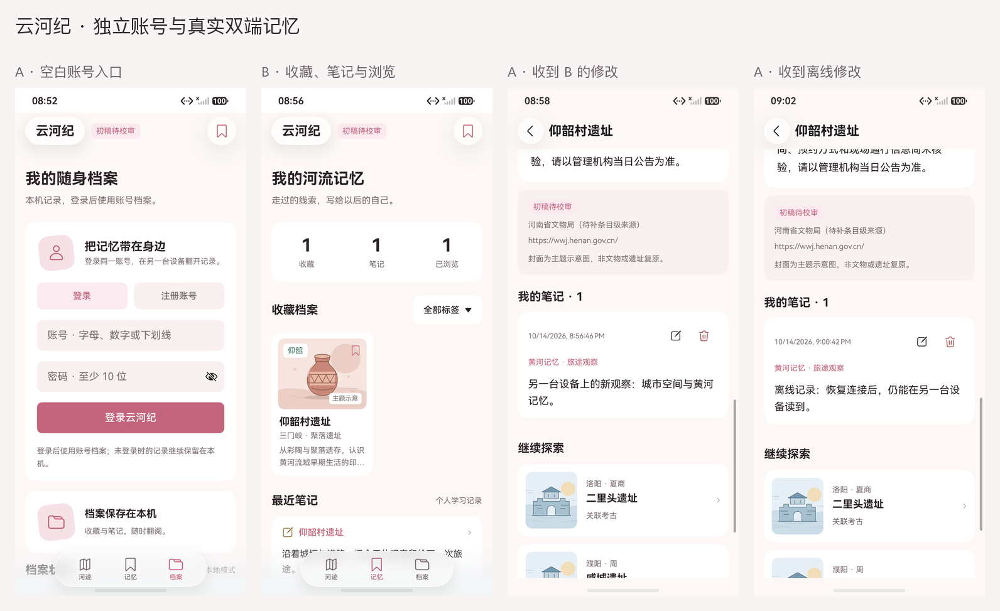
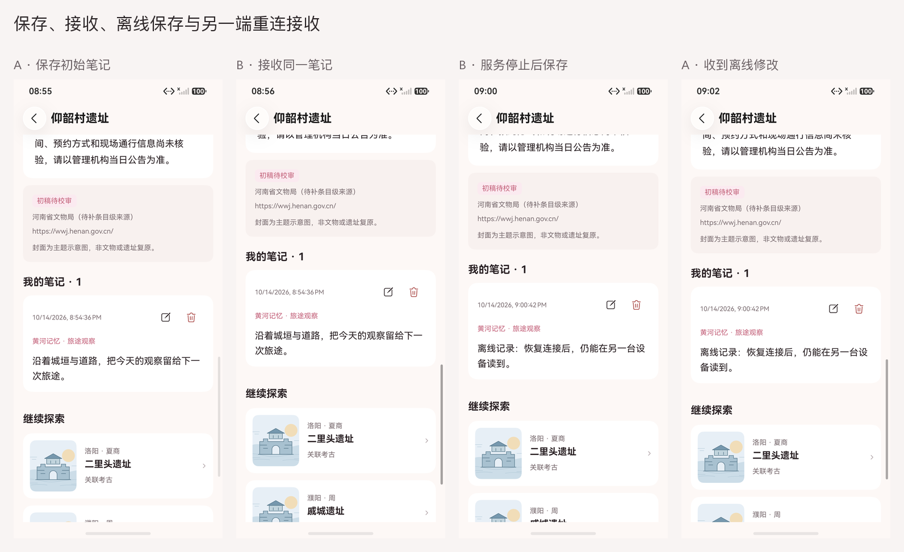
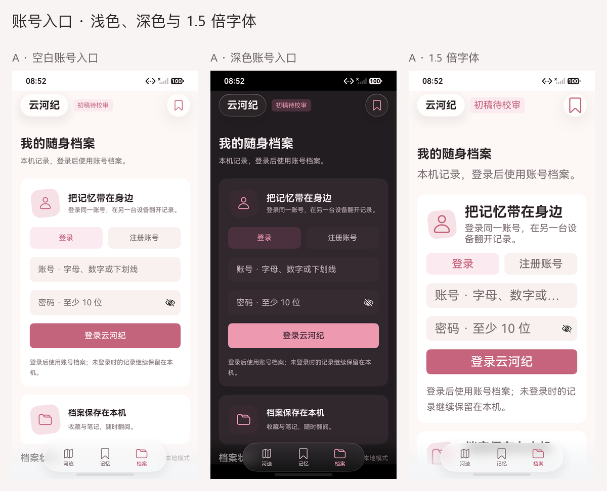

# 独立账号与双端记忆：真实原生截图

日期：2026-10-14。10 张原图来自同一主包、同一轮双模拟器账号测试。设备 A 为既有 Pura 90 Pro，设备 B 为本轮新建的 YunhejiSyncB；两者均为 HarmonyOS 7.0.0.107 / API 26，1256×2760，density 560。

| 原图 | 实际场景 | 原始设备报告 |
|---|---|---|
| [login.png](login.png) | A 端空白账号入口，浅色与原生顶部 / Dock | [205206](../../test-results/2026-10-14-205206-device.log) |
| [login-dark.png](login-dark.png) | 核对真实深色资源后的空白账号入口 | 同上 |
| [login-large.png](login-large.png) | 实际 1.5 倍应用字体；说明文字换行，提交按钮处于屏幕内 | 同上 |
| [device-a.png](device-a.png) | A 端经 UI 写入初始笔记和两个标签 | [205236](../../test-results/2026-10-14-205236-device.log) |
| [device-b.png](device-b.png) | B 端登录同账号后收到相同笔记与标签 | [205531](../../test-results/2026-10-14-205531-device.log) |
| [device-b-memory.png](device-b-memory.png) | B 端真实显示 1 个收藏、1 条笔记、1 处浏览 | 同上 |
| [device-a-updated.png](device-a-updated.png) | B 端修改后，A 端收到“城市空间与黄河记忆”正文 | [205652](../../test-results/2026-10-14-205652-device.log) |
| [offline-note.png](offline-note.png) | 本任务账号服务停止期间，B 端通过编辑器保存离线笔记并回读磁盘 | [205913](../../test-results/2026-10-14-205913-device.log) |
| [reconnected.png](reconnected.png) | 恢复同一服务后，A 端收到 B 的离线修改 | [210129](../../test-results/2026-10-14-210129-device.log) |
| [deleted.png](deleted.png) | A 端删除后 B 接收墓碑，笔记为 0、收藏与浏览记录保留 | [210250](../../test-results/2026-10-14-210250-device.log) |

10 张原图均已逐张查看。账号输入字段为空，详情与列表只含合成测试笔记；没有公开账号、密码、token 或正式用户记录。1.5 倍字体下账号输入提示会按原生单行控件显示省略号，登录说明可换行；这不是任意字号、窗口和键盘状态的完整验收。

图集只等比缩放、排列原图，在画面外标注设备与场景，没有裁切或补画 UI。原图、图集、设备报告和拍摄时两包的 SHA-256 见 [captures.json](captures.json)。8 个场景与两端清理报告已逐条核对，正确索引见 [阶段清单](../../test-results/2026-10-14-account-phases.json)；截图本身不能替代传输与落盘断言。

账号页继续使用原生 ArkUI、既有 Yi_Da 配色和 HDS 导航。当前传输由本机自建账号服务与 HTTPS 提供，原生 HTTP 客户端保持证书 / 主机名校验；不将这条网络路径称为华为账号登录、鸿蒙分布式数据库或可信设备发现。

测试使用独立 Preferences，最后只清理本轮测试库并恢复应用外观、字号与设备熄屏设置。测试记录不会预填正式档案，手动展示见 [双端记忆展示](../../DEMO.md)。当前限制和保留的失败见 [测试报告第 12 节](../../TEST_REPORT.md)。
