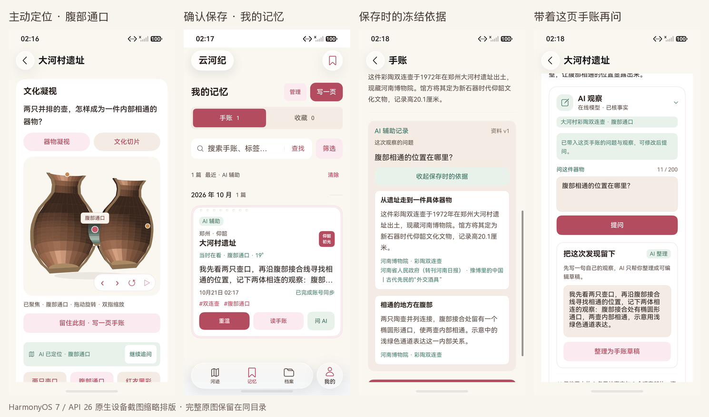
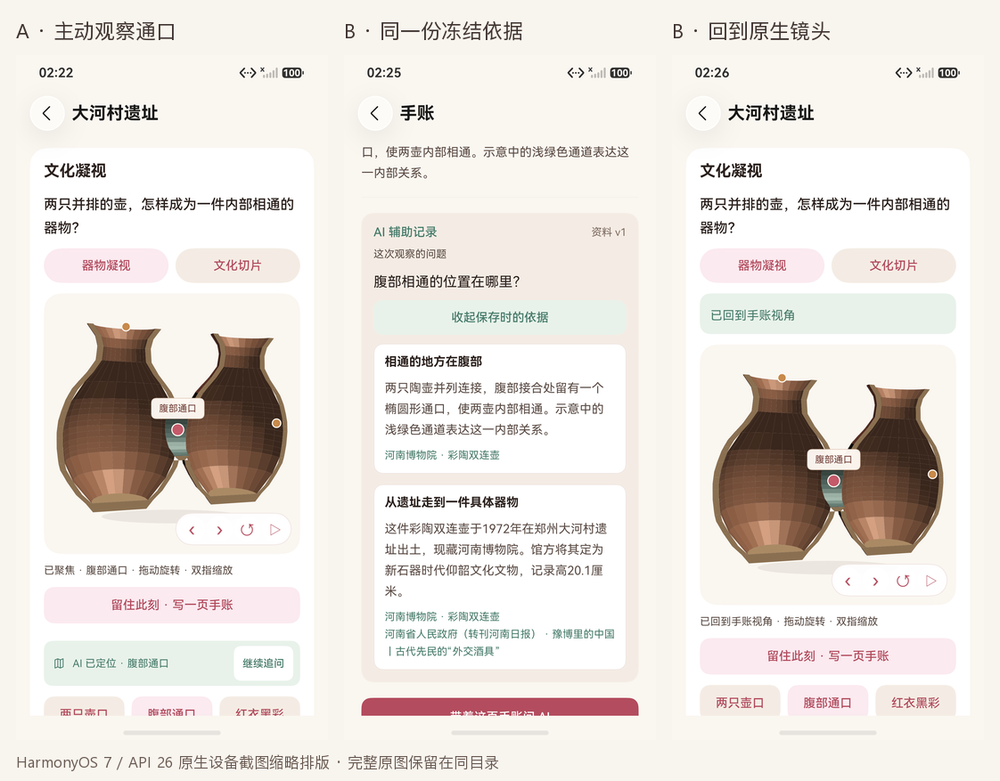

# 双对象 AI 与同账号记忆重访

日期：2026-10-21。工程为 HarmonyOS 7 / API 26 原生 ArkTS / ArkUI 应用。C08 本轮演示路径已完成，结果以[测试报告第 32 节](../../TEST_REPORT.md#32-双对象-ai-与同账号记忆重访2026-10-21)和[机器清单](../../test-results/2026-10-21-ai-dual-memory.json)的包绑定为准。

本轮把大河村彩陶双连壶的真实问答、腹部通口定位、资料依据、个人观察、AI 草稿、确认保存及同账号另一端重访连为一条可操作路径。方鼎保留独立真实回归。AI 白名单仍为两件，其余 20 条档案提供已有离线阅读、手动观察与手写手账。

新增契约发现并修复一个真实缺口：合法的双连壶热点动作曾可夹带方鼎事实。现在客户端与服务端共用校验规则，非空引用必须来自当前对象且不重复；合法空引用的定位动作继续可用。手账编辑器的参考依据改为冻结事实的中文标题，内部事实 ID 继续用于数据核验。

跨端使用自建账号 HTTPS 服务。A 必须经真实界面新注册、提问、请求草稿和确认保存；B 从本轮独立空库登录后经 App 同步接收，不把记录注入 B。保存后清缓存回读，并比较同一 note 的全部字段与嵌套内容。B 再问先恢复原问题、正文和视角，明确点击后才请求模型，原手账不得改变。

本地 122/122、报告解析 9/9、账号与 AI 服务 15/15；客户端 / 服务端 AI 契约联合 26/26，与前两组存在重叠，不累加。双连壶单端、A 保存、B 接收、B 主动再问和方鼎定向回归分别各 1/1，最终两端清理各 1/1，完整通过报告的 Failure / Error / Ignore 均为 0。主包统一为 M2，测试包按报告的 T5 / T6 / T7 / T8 分别绑定。

## 原生操作画面

下图为同一主包的设备原图缩略排版，未生成或修改 App 界面内容。

| 场景 | 原图 |
|---|---|
| 双连壶完整单端 | [聚焦](twin-focus.png)、[原始依据](twin-evidence.png)、[记忆](twin-memory.png)、[冻结依据](twin-saved-evidence.png)、[再问预填](twin-resume.png) |
| A 真实保存 | [腹部通口](a-opening-focus.png)、[回答依据](a-answer-evidence.png)、[确认保存前](a-editor-confirm.png) |
| B 收到与回放 | [冻结依据](b-frozen-evidence.png)、[实际回放](b-replay.png) |
| B 主动再问 | [发送前](b-resume-before-send.png)、[真实回答依据](b-active-answer-evidence.png) |
| 方鼎回归 | [四个折角](ding-focus.png)、[记忆](ding-memory.png)、[冻结依据](ding-saved-evidence.png)、[再问预填](ding-resume.png) |

完整 HiLog 分片还原后，[A / B / B 再问后深比较](../../test-results/2026-10-21-ai-memory-compare.json)通过：13 个顶层字段与全部嵌套内容一致。B 接收前后成功模型请求数均为 11，显式提问后为 12，新增一次真实请求；总 12 包含失败阶段，最终成功主线为 7 次。

A 聚焦和 B 正式回放的原始 Canvas 均为 1032×1050；按同次 layout 的真实 bounds 裁切后，1,083,600 像素只有 4 个不同，最大单通道差值 1，见[逐像素结果](../../test-results/2026-10-21-ai-dual-canvas-compare.json)及[A 画布](a-canvas.png) / [B 画布](b-canvas.png)。这里没有称为完全零差异，也没有把不同纵向位置的整张截图直接比较。

## 保留的首次失败

- [单端首次定位失败](first-twin-visibility-failure.png)：模型已聚焦腹部通口且完整可见，测试却直接等待视口下方的部位说明。改为先记录画布，再真实滚动核对说明。
- [A 首次误退导航](first-a-navigation-failure.png)：测试把“继续追问”后的返回键当作收起键盘，实际退回档案页。移除该无条件返回。
- [A 第二次滚动失败](second-a-keyboard-scroll-failure.png)：独立测试助手在目标仍位于下方时反向滚回模型顶部，键盘缩小了可用范围。详情搜索改为复用现有带页首 / 页尾锚点的滚动方法。
- [单端第二次名称断言失败](second-twin-associated-name-failure.png)：编辑器已经显示真实草稿与镜头，测试误把关联档案“大河村遗址”当作器物名“大河村彩陶双连壶”。关联关系继续使用稳定档案 ID；器物与热点另按保存记录核对。
- [B 首次再问滚动失败](first-b-ask-scroll-failure.png)：打开 AI 入口后停在面板，测试从中部向下查找上方的镜头说明。改为先真实回顶露出完整画布，再核对原回放文案；同 fixture、同 note 复跑通过。

原始失败报告与每次测试包在第 32 节分别记录；不能把这些失败改写成通过，也不能将测试假设问题称为产品故障。

## 使用边界

当前两端都是手机模拟器，没有平板布局结果。华为账号授权、系统可信组网与原生分布式跨端传输仍未完成；本机分布式 KV 版本库不等于已经实现平台跨端。自动化包含输入、定位、稳定等待、截图与回读，耗时不作为真人三分钟演示计时。未自动提交、推送或更新用户的 Word、视频与比赛压缩包。
