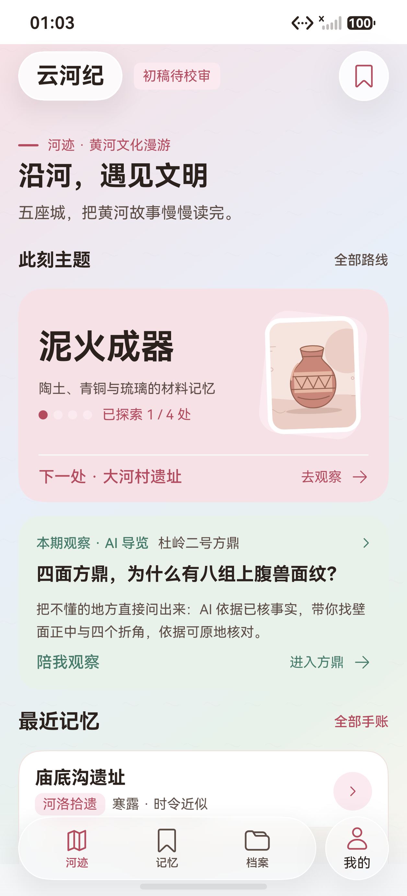
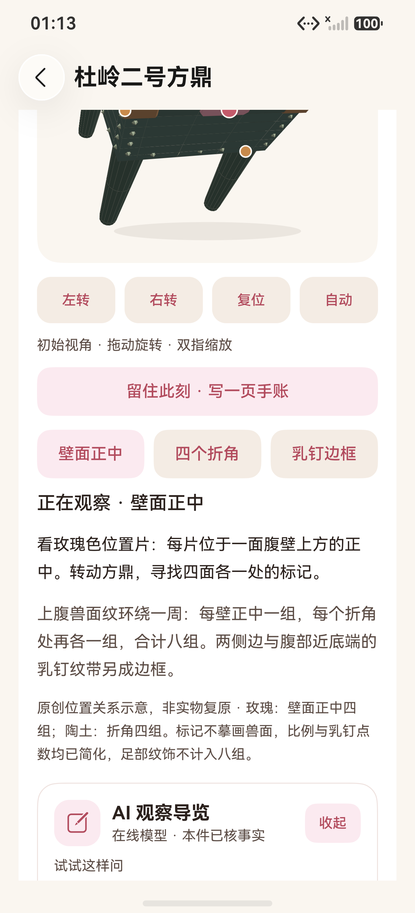
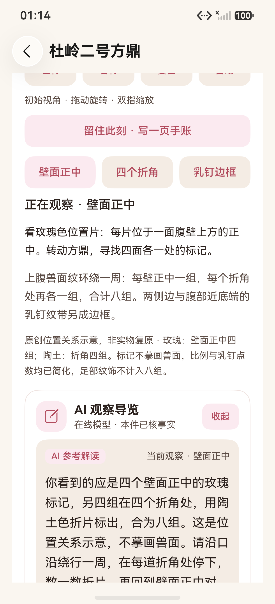
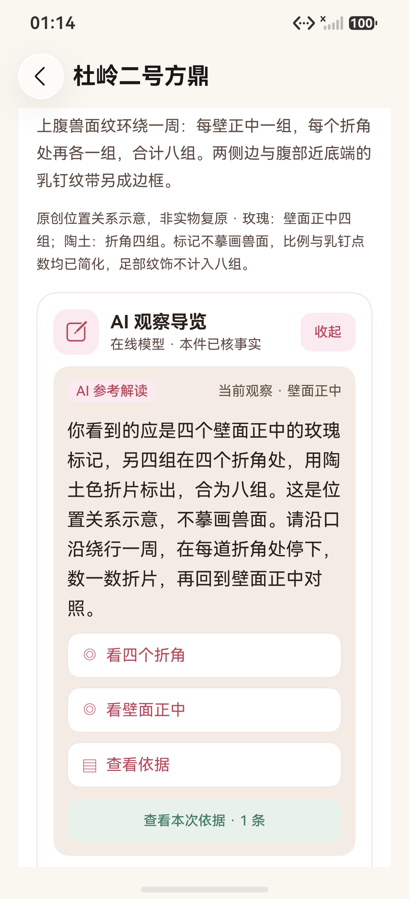
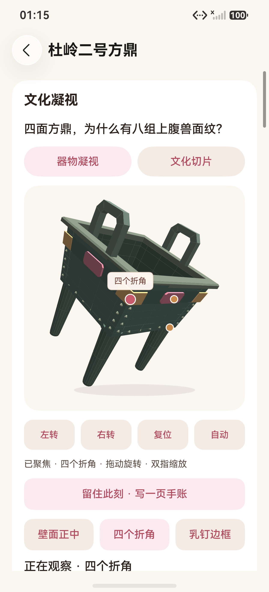
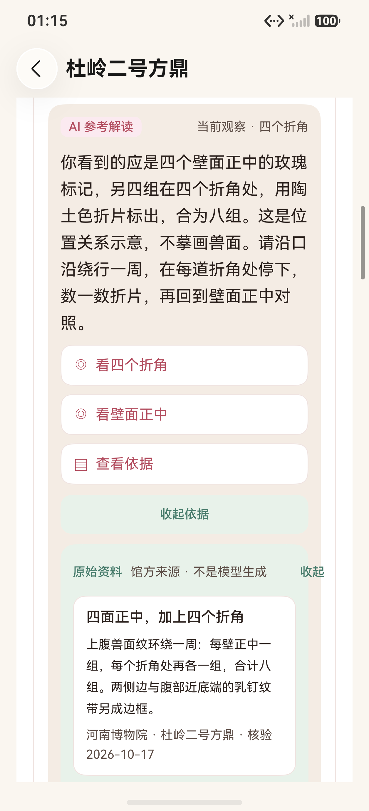
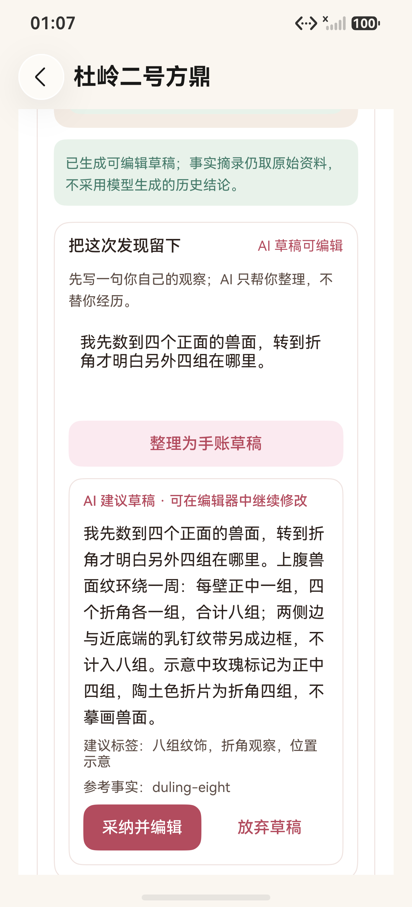
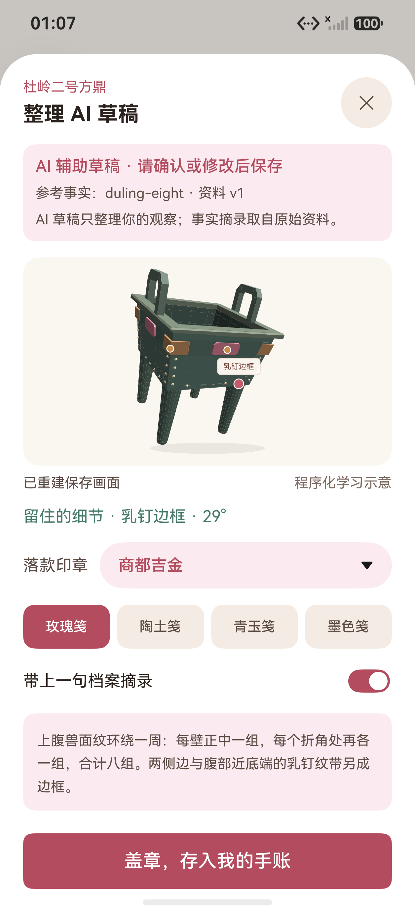
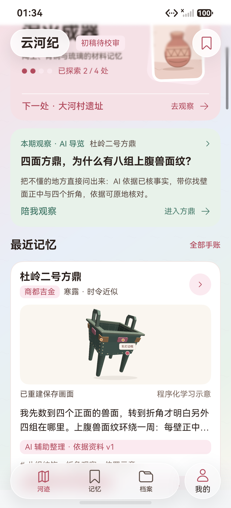
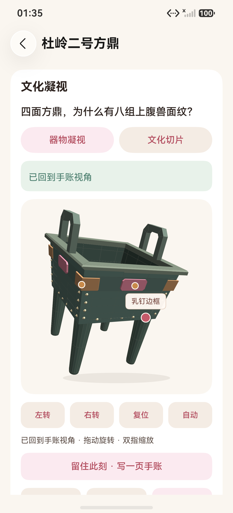

# AI 观察导览与 AI 辅助手账图集

记录日期：2026-10-18。设备：Pura 90 Pro 契约模拟器，HarmonyOS 7.0.0.107 / API 26，1256×2760，density 560。A 端 `127.0.0.1:5555`，B 端 `127.0.0.1:5557`。两端使用一次性随机测试账号，图中不包含账号、密码或密钥。

这些图片来自实际安装的原生 HAP，不是网页预览或设计稿。AI 回答与依据属于原生 ArkUI 文本和卡片，不参与 Canvas 像素比较。

2026-10-18 晚些的 UI/UX 改版调整了视角工具位置、游客 AI 面板默认收起、证据按钮去重和页面文案；AI 请求 / 回复契约、`aiAssist` 数据与 A/B 同步没有变化。最新画面见[UI/UX 改版图集](../ui-refresh/README.md)，本图集保留 AI 接入当轮的实际证据。

## 1. 首页入口



首页在“泥火成器”主题之后增加“本期观察 · AI 导览”入口，保留原来的主题下一节点、最近记忆、纸页入口和底部 Dock。点击“陪我观察”直接打开杜岭二号方鼎。

## 2. 进入方鼎与面板



从首页入口进入后，页面自动把 AI 面板带入视野；上方方鼎、热点按钮和“留住此刻”仍可手动使用。面板标题下标注“在线模型 · 本件已核事实”，收起按钮保留。

## 3. 自由提问与回答



本次实际输入“我只看到四个，带我看看另外几个。”。回答标注“AI 参考解读”，旁边显示当前观察部位；内容围绕每壁正中四组与四个折角四组展开，并明确说明玫瑰、陶土色标记是位置示意，不摹画兽面。

## 4. 回答中的可执行操作



回答下方提供“看四个折角”“看壁面正中”“查看依据”等操作。操作按钮由服务端归一化后的动作生成，客户端执行前还会再次校验对象、场景修订和热点白名单。

## 5. 聚焦实际部位



点击“看四个折角”后，原生视口转到折角视角，标签变为“四个折角”，状态显示“已聚焦 · 四个折角”。这是实际 Canvas 绘制后的画面，不是静态回答或预设截图。

## 6. 原地查看依据



点击“查看依据”后，事实卡在面板内展开：标题、馆方事实正文、来源“河南博物院 · 杜岭二号方鼎”、核验日期 `2026-10-17` 和资料边界同时可见。依据不是模型生成的 URL 或自由文本。

## 7. AI 草稿



用户先写入“我先数到四个正面的兽面，转到折角才明白另外四组在哪里。”，再请求整理。草稿保留用户原意，补充与资料相符的八组位置关系；界面明确区分“AI 建议草稿”和“参考事实”。

## 8. 可编辑草稿与真实视角



点击“采纳并编辑”后，应用先从视口读取用户此刻真实相机参数，再打开现有手账编辑器。画面预览为“乳钉边框 · 29°”，编辑器显示“AI 辅助草稿 · 请确认或修改后保存”、参考事实 `duling-eight` 和资料 v1；正文、标签仍可编辑，资料摘录取自原始事实。

保存后的服务端记录（同一账号，已脱敏）：

```json
{
  "siteId": "zz-duling-fangding",
  "tags": ["八组纹饰", "折角观察", "位置示意"],
  "stampType": "商都吉金",
  "paperTheme": "rose",
  "aiAssist": {
    "version": 1,
    "question": "我只看到四个，带我看看另外几个。",
    "factIds": ["duling-eight"],
    "contentRevision": 1,
    "facts": [{ "id": "duling-eight", "sourceIds": ["museum-duling-two"] }]
  },
  "snapshot3DPose": {
    "hotspotId": "frame",
    "yaw": 0.5,
    "pitch": 0.42,
    "zoom": 1,
    "label": "乳钉边框 · 29°",
    "sceneRevision": 2,
    "viewFrame": { "width": 294.85714285714283, "height": 300, "textDensity": 3.5, "dark": false }
  }
}
```

正文与摘录的实际内容见[模型评估记录](../../test-results/2026-10-18-ai-observation-evaluation.md)或服务端数据库；本图集不复制私人全文。完整字段、包哈希和 B 端回放状态另见[AB 记录](../../test-results/2026-10-18-ai-observation-ab-record.json)。

## 9. B 端同账号接收



B 端使用同一账号登录，没有在本轮重新请求模型。首页“最近记忆”出现杜岭二号方鼎，预览按保存视角重建，显示“AI 辅助整理 · 依据资料 v1”、标签和“重返观察 / 阅读全文”入口。

## 10. B 端实际回放



点击“重返观察”后，详情显示“已回到手账视角”，原生模型恢复到保存的乳钉边框视角，热点标签和页面文案一致。A 端保存的参数与 B 端显示的部位、角度、场景修订一致；本轮没有做整屏像素差异断言。

## 11. 设备与边界

- A/B 均为模拟器；没有在真机、平板、横屏、分屏、深色模式或大字体矩阵下重新验收本轮 AI 面板。
- 设备交互使用 HDC / UiTest 和原生页面，不控制电脑桌面。
- 图 01—08 来自主包 `C132F7FB…`（重新打包前）；图 09、10 来自 B 端重新安装最终主包 `C8E2BF6CE8F251E55D4BFB9357D42529CF8A37CAB76606708FB3D9DB67ADDA21` 后重新登录、接收与回放。两者源码差异仅为一次注释增删回退，保存格式、相机参数和页面行为未变。
- 真实模型为 `deepseek-flash`，强制函数调用；响应约 1.9—2.4 秒，未做真人三分钟计时。
- 完整验证和保留失败见[测试报告第 25 节](../../TEST_REPORT.md#25-ai-观察导览与-ai-辅助手账2026-10-18)与[模型评估记录](../../test-results/2026-10-18-ai-observation-evaluation.md)。
