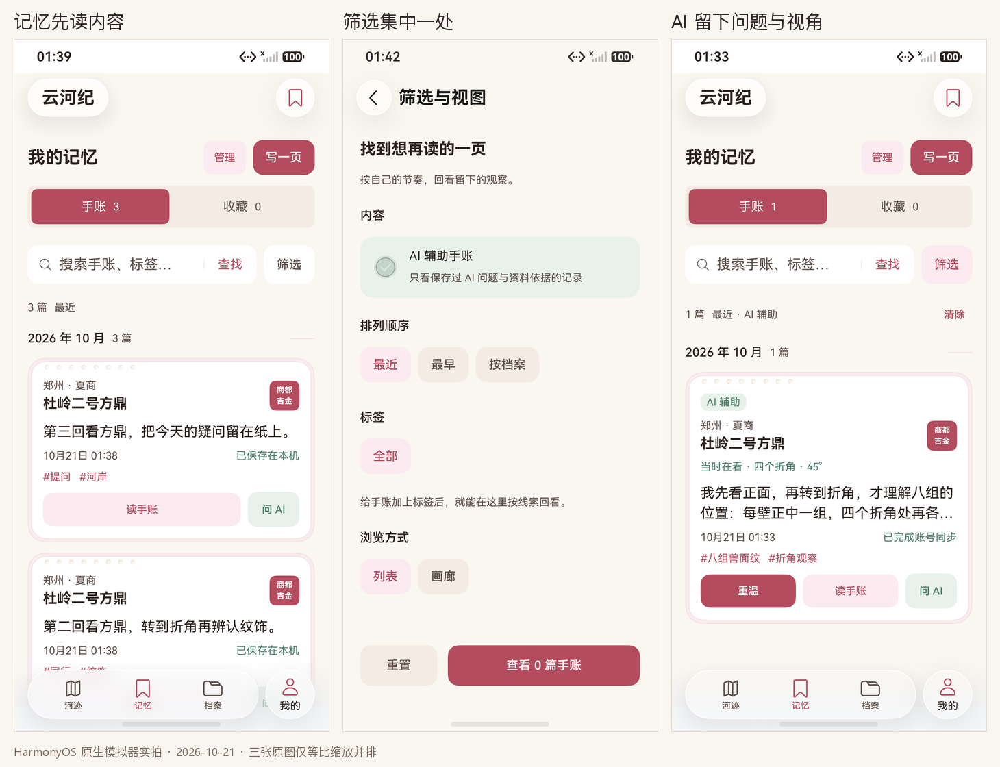

# 内容维度与记忆首屏（2026-10-21）

本轮对应任务书 C04 与 C07。目标是让资源维度有真实内容，让用户进入记忆后先读自己的记录，再按需要打开筛选；完整档案目录集中到档案页。此文档记录实现，最终验证与包绑定以[测试报告第 31 节](../../TEST_REPORT.md#31-内容维度与记忆首屏2026-10-21)为准。

## 原生画面

以上由三张原生模拟器截图等比缩放并排，没有重绘 App。M4 为本轮最终主包；本轮两个手机模拟器均为 API 26，不能把它写成平板已验收。

| 画面 | 原图 / 布局 | 包与取景 |
|---|---|---|
| 默认列表，三篇真实记录 | [原图](memory-list.png) / [原始布局](memory-list.json) | M4 / T8，进入首屏后直接核对标题、正文和操作 |
| 最近改最早 | [原图](oldest-first-screen.png) / [原始布局](oldest-first-screen.json) | M4 / T8，最旧 ID 位于第一张卡 |
| 标签筛选返回 | [原图](tag-return.png) / [原始布局](tag-return.json) | M4 / T8，保持 2/3 条与最早排序 |
| 筛选页 | [原图](filters-ai.png) / [原始布局](filters-ai.json) | M4，AI 条件与实际命中数 |
| AI 空态 | [原图](ai-empty.png) / [原始布局](ai-empty.json) | M4，动态标题已正确更新 |
| 全部档案选择 | [原图](write-all-before-cancel.png) / [原始布局](write-all-before-cancel.json) | M4，22 处真实目录；取消保留原条件 |
| 从 AI 空态写普通手账 | [原图](ai-empty-written.png) / [原始布局](ai-empty-written.json) | M4 / T9，选定王城岗后一次返回记忆，记录可见 |
| 画廊选择与重置 | [画廊高亮](filters-gallery.png) / [重置后列表高亮](filters-reset.png) | M4 / T9，两项背景在实际布局中互换 |
| 管理与批量墓碑 | [选择两篇](gallery-selected.png) / [删除后空态](batch-tombstones.png) | M4 / T9，真实磁盘保留两条墓碑 |
| 真实 AI 辅助手账 | [原图](ai-memory.png) / [原始布局](ai-memory.json) | M4 / T7，真实方鼎提问、折角定位与草稿保存 |
| AI 保存依据与重访 | [冻结依据](ai-evidence.png) / [带回原问题](ai-resume.png) | M4 / T7，未自动发起新追问 |
| 王城岗资料阅读 / 来源 | [阅读](zz-wangchenggang-reading.png) / [来源](zz-wangchenggang-source.png) | M2 / T4，停止本任务服务后验收 |
| 黄冶资料阅读 / 来源 | [阅读](zz-huangye-kiln-reading.png) / [来源](zz-huangye-kiln-source.png) | M2 / T4，保留多期遗存边界 |
| 新增两条真实收藏 | [原图](new-content-favorites.png) / [原始布局](new-content-favorites.json) | M2 / T4，回读磁盘后进入收藏分区 |

首次 AI 空态文案错误见[失败原图](first-ai-empty-failure.png)，测试误查描述字段时的真实高亮见[该轮原图](view-description-assert-failure.png)；失败与修复的实际摘要保留在测试报告。

## 文化档案

保留原 20 条档案的 ID、内容与顺序，末尾追加以下两条。现为 22 条，三门峡、洛阳、郑州、开封、濮阳分别为 4、4、6、4、4 条。

| 稳定 ID | 名称 | 组合筛选 | 录入边界 |
|---|---|---|---|
| `zz-wangchenggang` | 登封王城岗遗址 | 郑州 + 龙山 + 城址 | 龙山晚期大、小城址；更晚的二里头文化夯土群另述，不确认“禹都”身份 |
| `zz-huangye-kiln` | 黄冶唐三彩窑址 | 郑州 + 汉唐 + 窑址 | 以唐三彩生产作为检索主线，正文保留隋末唐初至金代的多期遗存 |

两条均采用已打包的原创插画，没有借用其他遗址照片，也没有填入未经核实的诗词、票价或预约规则。来源访问日期、原页与事实短摘录见[条目研究](../../research/content-coverage-20261021.md)，许可与全部条目来源见[图片与内容来源](../../IMAGE_CREDITS.md)。全部档案继续保留“初稿待校审”。

新增 `generic_site_study` 原生与兼容场景，只画三张抽象资料卡。详情明确显示“通用资料学习示意，不表示本遗址平面、窑炉结构或出土器物。”三个交互为“看概览 / 读遗存 / 寻线索”；没有将这两条加入 AI 白名单。场景 revision 1、原热点 ID 与手账格式不变，旧手账仍按保存的场景修订解析。

## 记忆页

首屏保留“我的记忆”、管理、写一页、手账 / 收藏分区、搜索与筛选入口。分区按钮显示真实数量，结果行显示当前结果数与生效条件；不再常驻展开排序、AI、标签和画廊控件。

“筛选与视图”为独立原生导航页，承载 AI 辅助手账、最近 / 最早 / 按档案、全部真实标签及列表 / 画廊。条件实时回写原页面，底部显示实际命中数量。返回保留条件；重置或清除恢复最近、全部内容、列表。筛选只影响视图，不改写手账。

设备验收曾发现：由普通空态切到 AI 空态时，结果与条件已更新，标题却仍保留普通文案。原因是动态值经普通 Builder 值参数捕获；已改为记忆空态内部直接读取状态。列表 / 画廊按钮使用包含选中态的键重建，保证当前高亮和“已选择”说明一起更新。首次失败原图与结果保留，最终复验另列。

默认列表保留档案名、正文摘要、日期、真实同步状态、两项标签与主要动作；纸面、主色、印章与局部打孔沿用现有设计。列表隐藏重复品牌、纸色名称、资料摘录与编辑 / 删除图标，编辑仍从全文页进入；画廊继续保留原操作。管理时隐藏卡片导航、可点预览及编辑删除，卡片只用于选择。

## 写一页

“写一页”先选择关联档案，再进入同一个正式编辑器。最近浏览最多四处，来自真实浏览记录；无历史时明确标为“从一处好奇开始”。全部档案选择保持在记忆 Tab 内，使用当前真实 22 条目录。

选择页被档案详情替换，保存并关闭编辑器后，一次返回直接回到记忆。只有选定档案时才清除旧 AI / 标签 / 关键词条件，避免新普通手账被筛选藏住；打开选择页或切到全部目录后取消，保留原条件。此行为也修复了旧“从全部档案选一处”跳到普通档案 Tab 而丢失新建上下文的问题。

数据继续使用原有 note 信封、时间戳、标签、装饰和墓碑，没有 schema 变更，不需要转换正式档案。

## 首页与档案页

首页保留主题、AI 问题、最近记忆、拾页纸页入口、沙盘、水情、文明连线的顺序。五城索引改为直达相应城市档案，并显示实际条目数；一个“浏览全部 22 处文化档案”入口进入完整目录。关键词与三维组合筛选集中在档案页。首页沙盘选择与档案城市仍为独立状态。

## 验收入口

`ContentMemoryTest` 针对新增档案组合检索、真实收藏、新建三篇手账、实际排序、标签、返回、首屏可见范围、画廊管理与墓碑；`EngineExperienceTest#native_river_five_cities_filter_matrix` 针对五城入口；真实 AI 保存重访沿用 `PageHierarchyTest#real_ai_focus_save_and_resume_from_memory`。测试使用独立库，经真实界面写入后清缓存回读，不向正式档案注入样例。

当前 M4 主包的真实 AI、三篇手账排序、AI 空态新建与画廊 / 管理三条路径分别各 **1/1**，使用 T7 / T8 / T9 测试包，完整报告的 Failure / Error / Ignore 均为 0。C04 两条资源与五城入口分别在 M2 / M1 阶段包通过；后续修改集中于记忆空态与筛选高亮，未把它们写成最终包重跑。选中颜色的同次原始布局核对见[颜色结果](../../test-results/2026-10-21-content-memory-view-colors.json)，首次失败与包绑定见第 31 节。

本轮未完成 C08 双连壶完整 AI 保存与跨端、平板布局、原生可信组网或华为账号。没有更新用户 Word、视频、比赛压缩包，也没有自动提交或推送。
