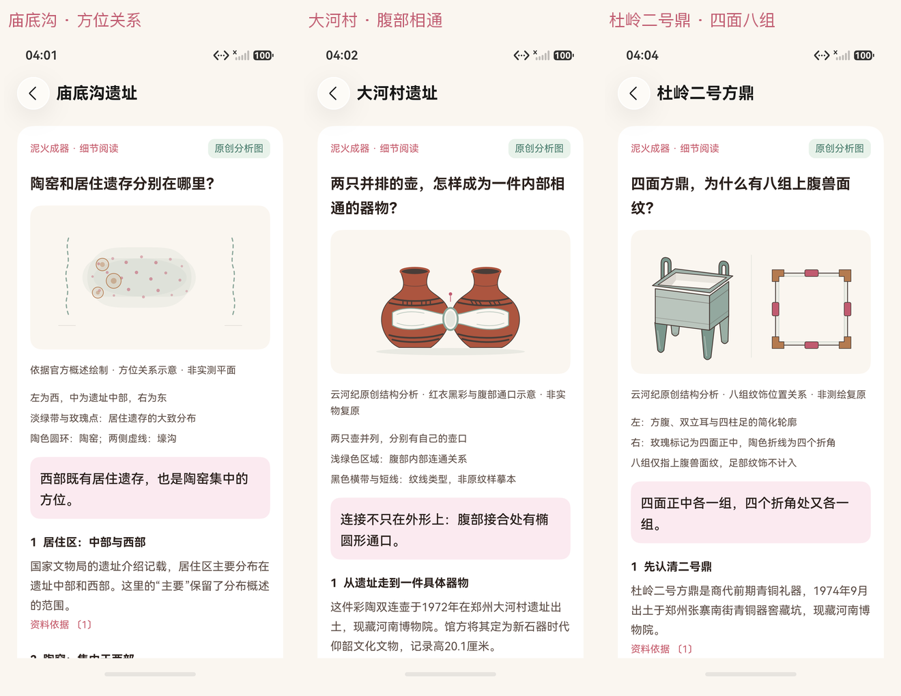

# 核心体验 T01—T03：实际内容页面

2026-10-17，HarmonyOS7/API26，HDC/Hypium直接连接模拟器。三张原图来自真实搜索和打开详情的同一核心用例，独立库没有私人账号。原始报告与两包见[阶段记录](../../test-results/2026-10-17-core-content-phases.json)，内容依据见[研究索引](../../research/core-experience/README.md)。

庙底沟的方位图表达西部同时涉及居住遗存与陶窑；大河村结构图表达双壶腹部椭圆通口；杜岭二号方鼎关系图用四处壁面正中和四处折角说明上腹八组。三图均为项目原创分析示意，非实物照片、实测平面或文物复原；图例和边界在实际页面常驻。

| 原图 | SHA-256 |
|---|---|
| [smx-miaodigou.png](smx-miaodigou.png) | `AAA4E4C4125E198B966E22AE0AE08F56B548B28C5F9D0C09FBD16FF98D796BD3` |
| [zz-dahecun.png](zz-dahecun.png) | `18C8DC56974E28ED93A8795D1D128C4400495C0A92E2A328FBF644BB3EC3732B` |
| [zz-duling-fangding.png](zz-duling-fangding.png) | `86909671F8709C14BA7D90CCD9362BB99300FC790A61A556188D00CEEA939BF3` |

本轮只验证内容与来源页面，热点联动、带画面手账和双端回放后续按[阶段规范](../../CORE_EXPERIENCE.md)推进，不能由这些截图推定已完成。
