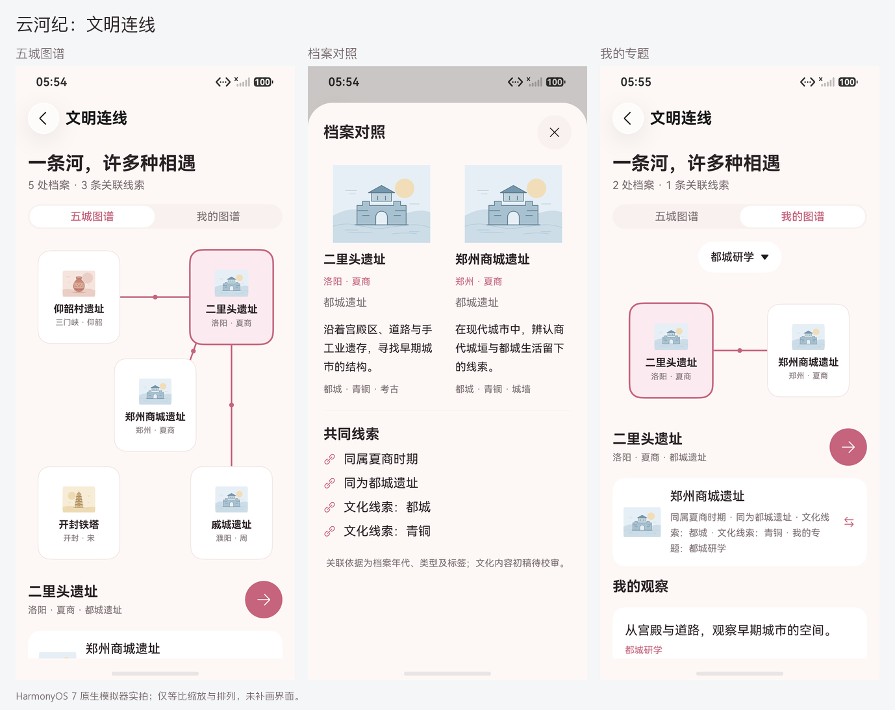

# 文明连线：真实原生截图

日期：2026-10-14。当前 7 张原图来自最终 `CultureAtlasTest` **2/2** 设备专项，原始报告为 [175431-device.log](../../test-results/2026-10-14-175431-device.log)。环境为 HarmonyOS 7.0.0.107 / API 26 手机模拟器，屏幕 1256×2760。

| 截图 | 实际场景 |
|---|---|
| [home.png](home.png) | 首页文明连线入口，既有原生标题栏与浮动 Dock |
| [graph.png](graph.png) | 五城图谱，选择二里头，显示其关联节点与连线 |
| [compare.png](compare.png) | 二里头与郑州商城并排对照，显示年代、类型和文化标签共同线索 |
| [personal.png](personal.png) | 两处遗址经真实 UI 写入同标签笔记后，“都城研学”显示 2 处档案、1 条关联线索和个人观察 |
| [personal-compare.png](personal-compare.png) | 个人图谱中的对照，增加“我的专题：都城研学”依据 |
| [dark.png](dark.png) | 窗口启动后实际切换深色并核对颜色资源的图谱 |
| [large.png](large.png) | 实际 1.5 倍应用字体，节点文字换行、高度增长；下方内容可滚动 |

7 张原图均已查看。图集只等比缩放、排列并在画面外标注页名，没有补画应用内容。完整截图、主包、测试包与报告的 SHA-256 清单见 [captures.json](captures.json)。

数据由真实收藏/笔记操作产生，使用独立测试 Preferences；不读取或改写正式用户档案。测试结束后清理测试库并恢复应用外观、字体与模拟器熄屏设置。测试记录不会保留在正常启动的正式用户库中，现场准备方法见 [90 秒演示](../../DEMO.md)。

图谱是属性与个人标签的关联示意，不是地理地图、历史因果证据或已校审知识库。文化内容仍为五条初稿，插画是主题示意。Canvas 线条与选中反馈不冒充原生沉浸光感；原生导航材质沿用已接入的 HDS 组件。

`initial/` 保留早期节点边框/对照留白截图及错误切换时序下的“dark”图，后者实际是浅色，不作为深色证据。测试修正、系统渲染服务崩溃和一次超时的边界见 [测试报告第 11 节](../../TEST_REPORT.md)；没有删除原始失败记录。
