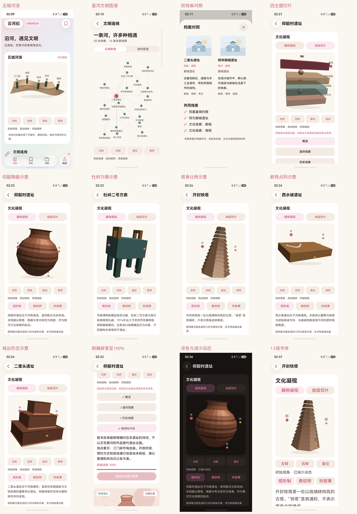

# 统一文化视口：真实模拟器图集

日期：2026-10-17。HarmonyOS 7 / API 26，直接通过 HDC / Hypium 操作 YunhejiSyncB 模拟器。这些是实际原生应用截图，没有浏览器预览、网页模型或私人账号数据。当前设备的绘制分支是 ArkUI Canvas CPU 软件投影与逐面光照，不能据此宣称 WebGL2 / GPU 或真实文物 GLB 已验收。

总览为原图缩放拼版，保留独立原图。四层切片是阅读主题示意，五种模型是学习用程序化几何；内容均为初稿待校审。

## 验证与包对应

按场景绑定三版包的设备六项 6/6，Failure / Error / Ignore 均为 0。首页 / 图谱对应初始页面包，进度 / 五形态对应热点配色包，外观 / 原收藏笔记对应大字修正后的当前包。完整表格见 [测试报告第17节](../../TEST_REPORT.md)，原图、报告、源码与每项实际主包 / 测试包 SHA-256 见 [阶段清单](../../test-results/2026-10-17-engine-phases.json)。

当前主包 `0649C11401A7C67F4CB4366A61252ACF1BF5D4333873FBF5EEA2D178551937AF`，测试包 `77BA1E8B5E636DF3767AC1B6F9A5635D82CE76FCFFAA41F32FA52E888F1B8CA8`。图集中首页 / 图谱三张原图对应初始包；进度与模型十三张对应热点配色包；外观五张对应当前包。不包含标签修正、失败超时或大字截断阶段的图片。

[像素核对](pixel-checks.json) 使用每次截图随附的实际 Canvas 布局范围，在排除边缘后比较视口内部。减少动态前后存在可见模型且逐像素一致，五模型主动转动后像素均改变。它验证这些具体画面的静止 / 转动，不代表帧率、功耗、后台调度或两套引擎像素一致性测量。

## 原图与报告

| 原图 | 对应报告 | SHA-256 |
|---|---|---|
| [river-home.png](river-home.png) | [2026-10-17-140850-device.log](../../test-results/2026-10-17-140850-device.log) | `36E5C99DE29DB186B43F8BA596349A9FE014A5C17CF180B35CF9250CC714128E` |
| [constellation-graph.png](constellation-graph.png) | [2026-10-17-141023-device.log](../../test-results/2026-10-17-141023-device.log) | `C49AE5FADE86AB3D909FB93CA21F462CA8661916109385578CFD68CA6F02DE90` |
| [graph-comparison.png](graph-comparison.png) | [2026-10-17-141023-device.log](../../test-results/2026-10-17-141023-device.log) | `F237733E30211D081FE95DFB9B03BEFD51398008A23F262476629D30C9FFF9CF` |
| [stratum-overview.png](stratum-overview.png) | [2026-10-17-142036-device.log](../../test-results/2026-10-17-142036-device.log) | `31F0A3A006B63BA99A8636125827397D6460C4BE66C38ADC33BF3C455F3F5A15` |
| [progress-complete.png](progress-complete.png) | [2026-10-17-142036-device.log](../../test-results/2026-10-17-142036-device.log) | `3126BBEA6413593A34055EEB201F7689CFE34E0CEBE82C9FD95E4E73B68104FA` |
| [progress-recreated.png](progress-recreated.png) | [2026-10-17-142036-device.log](../../test-results/2026-10-17-142036-device.log) | `F3297A8BDFAE45492674016B7706889F5EC0196840A8E9F766B8AE55FC5C2DA6` |
| [model-smx-yangshao-before.png](model-smx-yangshao-before.png) | [2026-10-17-142251-device.log](../../test-results/2026-10-17-142251-device.log) | `CF29092F2BF9464819A0E2C08C320455D89D07CA395F28CCF8C1160CF7CBFD3A` |
| [model-smx-yangshao-turned.png](model-smx-yangshao-turned.png) | [2026-10-17-142251-device.log](../../test-results/2026-10-17-142251-device.log) | `2F0145CAA895C7CB2A979C773A432169F4B01FBD6BFFC5766B50FEB6BCD72C39` |
| [model-zz-duling-fangding-before.png](model-zz-duling-fangding-before.png) | [2026-10-17-142251-device.log](../../test-results/2026-10-17-142251-device.log) | `ED9EA397677FC1409575565CE1B84765BF29E2FFFCF9C653FC4C2D837938A0F5` |
| [model-zz-duling-fangding-turned.png](model-zz-duling-fangding-turned.png) | [2026-10-17-142251-device.log](../../test-results/2026-10-17-142251-device.log) | `5E368FBBC2A34403A854FAE099F9C6FD7CE836231A461003CDB96002580FDBA2` |
| [model-kf-iron-pagoda-before.png](model-kf-iron-pagoda-before.png) | [2026-10-17-142251-device.log](../../test-results/2026-10-17-142251-device.log) | `76C75D6A05556359DBDA71F727F5B11EEB83D147BC2B0FAC55E4502E52355C47` |
| [model-kf-iron-pagoda-turned.png](model-kf-iron-pagoda-turned.png) | [2026-10-17-142251-device.log](../../test-results/2026-10-17-142251-device.log) | `CEF13F5C59DF29818561A6BC6F6253CA14C4334E1A2C310A27A3288FA20098E7` |
| [model-py-xishuipo-before.png](model-py-xishuipo-before.png) | [2026-10-17-142251-device.log](../../test-results/2026-10-17-142251-device.log) | `EB0493A125D0B8E154F4C682B59D70ECD412DB875D5D73A01EBD1B34387D3C87` |
| [model-py-xishuipo-turned.png](model-py-xishuipo-turned.png) | [2026-10-17-142251-device.log](../../test-results/2026-10-17-142251-device.log) | `7022B0243883C4ECFA166436FD31CF16565DCBDCBC00EC3B445546056F207BA6` |
| [model-ly-erlitou-before.png](model-ly-erlitou-before.png) | [2026-10-17-142251-device.log](../../test-results/2026-10-17-142251-device.log) | `10505203812E67786C86928764F1EB5F0653F09D59443446C420ECEB3C92DC0B` |
| [model-ly-erlitou-turned.png](model-ly-erlitou-turned.png) | [2026-10-17-142251-device.log](../../test-results/2026-10-17-142251-device.log) | `FE983EDA63C27D5576998738BAF302107985DEF40EC7B99FA154523033CE8BA0` |
| [reduced-before.png](reduced-before.png) | [2026-10-17-143541-device.log](../../test-results/2026-10-17-143541-device.log) | `BF7CB7CA092D0652AE39306CCA4B8EC5E188257EE8A7A1BC16B7B968379488F3` |
| [reduced-after.png](reduced-after.png) | [2026-10-17-143541-device.log](../../test-results/2026-10-17-143541-device.log) | `BF7CB7CA092D0652AE39306CCA4B8EC5E188257EE8A7A1BC16B7B968379488F3` |
| [dark-manual-turn.png](dark-manual-turn.png) | [2026-10-17-143541-device.log](../../test-results/2026-10-17-143541-device.log) | `D9036450CEE7558EBABCA1BDAD59D1BB80D67BFD8C9ECA0F4F8893BE2C62003F` |
| [large-home.png](large-home.png) | [2026-10-17-143541-device.log](../../test-results/2026-10-17-143541-device.log) | `355607208CFD46F9B5E33D6B2FDEC9CEF8B5CCCDACB545851E9B8934EF8295D1` |
| [large-detail.png](large-detail.png) | [2026-10-17-143541-device.log](../../test-results/2026-10-17-143541-device.log) | `12C3C4981AE1528F74EA72B759053BB40E9B5E12BE6F6BD1701A621669F4E907` |
