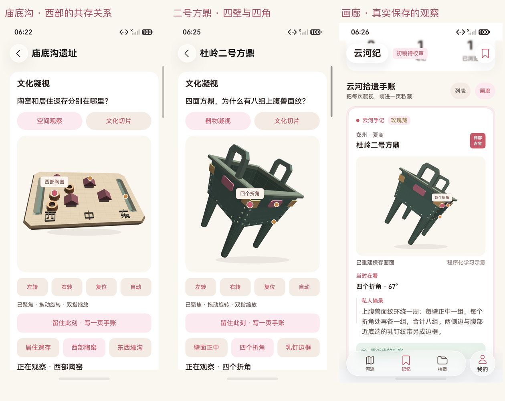
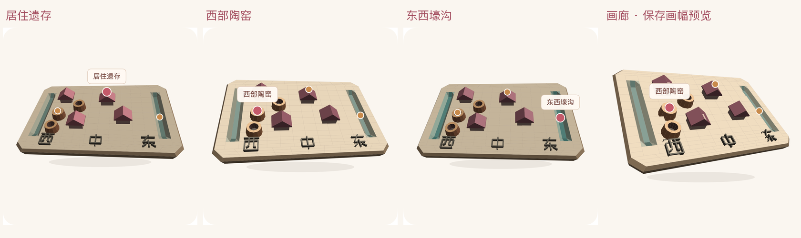
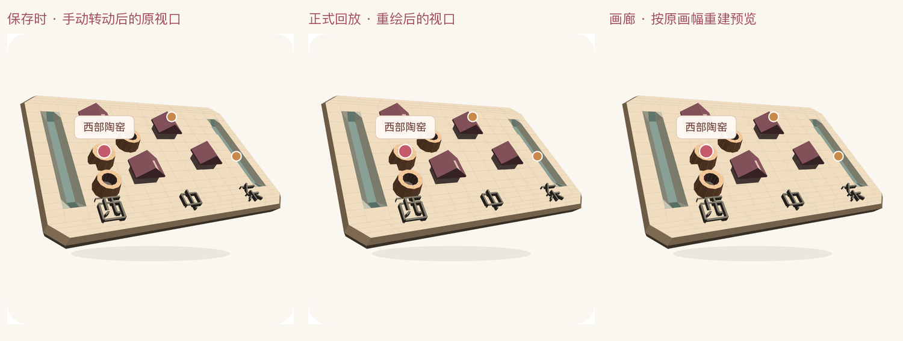
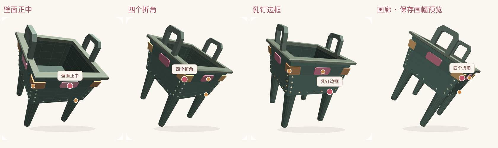
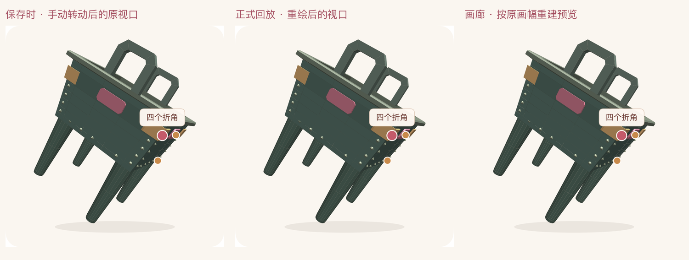

# 庙底沟与杜岭二号方鼎：原生观察、画面手账与回放

2026-10-17，HarmonyOS 7 / API 26，YunhejiSyncB。以下为 HDC / Hypium 直接连接模拟器获得的 ArkUI 原生应用截图，使用各自随机独立 Preferences 与离线入口，没有私人账号资料。主包与测试包均构建成功；本地 95/95、报告解析 9/9。两个最终设备核心路径共 2/2，Failure / Error / Ignore 均为 0。

## 庙底沟：西部同时有居住遗存与陶窑

三热点分别观察居住符号、西部陶窑和东西两侧的开放沟槽，连到三条官方概述事实。字标随沙盘转动；符号数量、间距、高低和槽深仅用于阅读，非实测平面或考古层序。实际经过手动转动后，以 kilns 保存正文、标签、当前事实摘录与原虚拟画幅，再从画廊的画面进入正式回放。

原始报告：[庙底沟核心路径](../../test-results/2026-10-17-182114-device.log)，1/1，155058ms。完整 Canvas 差异与热点变化见[像素核对](miaodigou/pixel-checks.json)；画廊按保存画幅去除 contain 留白后 RGB 相关系数 0.999042。

## 杜岭二号方鼎：四壁正中与四个折角

敞开的方口显示内壁与器底，双立耳和四根渐细柱足具有独立几何。玫瑰片标记四壁正中，陶片跨相邻两壁标记四折角；乳钉边框另行高亮。片、点和各部比例为位置学习示意，不是实际兽面纹拓本或精确乳钉数量，足部纹饰不计入上腹八组。保存 corners 手动转动后的真实视角，再从画廊正式回放。

原始报告：[二号方鼎核心路径](../../test-results/2026-10-17-182413-device.log)，1/1，155787ms。完整 Canvas 差异与热点变化见[像素核对](duling/pixel-checks.json)；画廊 RGB 相关系数 0.999522。

## 版本、证据与边界

两处均使用 revision 2，沿用 schema v1 / MemoryPose v1，无新增数据字段。revision 1 仍显示原形态与 form / pattern / story 热点；旧记录不补造观察画面。三处档案仍为初稿待校审，主事实的核对不等于全条目校审。大河村上一里程碑的设备结果另见[原图集](../observation/README.md)，未重复累计到本次两条用例。

主包 SHA-256：`4AF9FF393DE9124852AC52BF4F519188912F1AAADFBC627477E48B8CD3D725EA`。

测试包 SHA-256：`B6BBDDCD556A832907106B020FC6D97417EFA863D810BD3CE2E6F0029BA7ACC3`。

包、来源代码与原图绑定于[阶段清单](../../test-results/2026-10-17-expanded-observation-phases.json)。自动化定位、聚焦反馈、提示匹配、日志环缓冲与重复滚动超时，以及旧测试包分别通过的情况保留在[中间记录](../../test-results/2026-10-17-expanded-observation-intermediate.json)。最终验收保持全部业务断言与 240000ms 上限，减少重复滚动并持续采集 JSAPP 日志。

本机保存与重建已经通过本节路径；T09 / T10 首页、T11 新手账双端完整性与 T13 三分钟录像另行验收。现有账号通道仍为 HTTPS。

## 完整原图

| 截图 | SHA-256 |
|---|---|
| [expanded-miaodigou-living.png](expanded-miaodigou-living.png) | `0452E23F67E04FAD7E554E4EF9FA486675A5CA5BA619EEC617908BE6A41C0645` |
| [expanded-miaodigou-kilns.png](expanded-miaodigou-kilns.png) | `F3036B83C84D051BF16B7913DEE02610E2892F402F65676433CBA97500E91238` |
| [expanded-miaodigou-ditches.png](expanded-miaodigou-ditches.png) | `87772482F9E4911F9855E59FB9C24885C60A46052CCE2D1A1C520ADA1075E865` |
| [expanded-miaodigou-source.png](expanded-miaodigou-source.png) | `97864E4B881BEC0445AF5E81DBCCB04C8C93B89DEDAC11151F755A855AA294EE` |
| [expanded-miaodigou-gallery.png](expanded-miaodigou-gallery.png) | `663774B0041D06C60EB26E077743585B2BFA768D6BB67F573A0ADCFD2D4BCAF1` |
| [expanded-miaodigou-replay.png](expanded-miaodigou-replay.png) | `17BAE8EAB132B01B1A44D99A7173954D75D9F4CB0CD6F9293CA0875251E68B31` |
| [expanded-duling-centers.png](expanded-duling-centers.png) | `C85B08190C469FCE4D598AD4207EF660204FEB49DD028A96BAC5F243A88DDAC5` |
| [expanded-duling-corners.png](expanded-duling-corners.png) | `F595095F375ADA244086698F261AAF6867ECC9F85D2B52D61415E1F195BF8435` |
| [expanded-duling-frame.png](expanded-duling-frame.png) | `55CFC4C34FDFF363E6302C650139CC58874EF241CFDDF254E39627508C8359A9` |
| [expanded-duling-source.png](expanded-duling-source.png) | `47684A0071945AADA7F749B9D9FE4E9F47D729A6EB84ADD4F0B4762193376A6A` |
| [expanded-duling-gallery.png](expanded-duling-gallery.png) | `0DF495E98314EE9C2682A8C315C230537C4B56AEE78219556707BC88BAF8EA86` |
| [expanded-duling-replay.png](expanded-duling-replay.png) | `C2465ABCCCF458BF37780D8BA6BEF99765EBDEF06BB4696373F5F8022AD674DE` |
