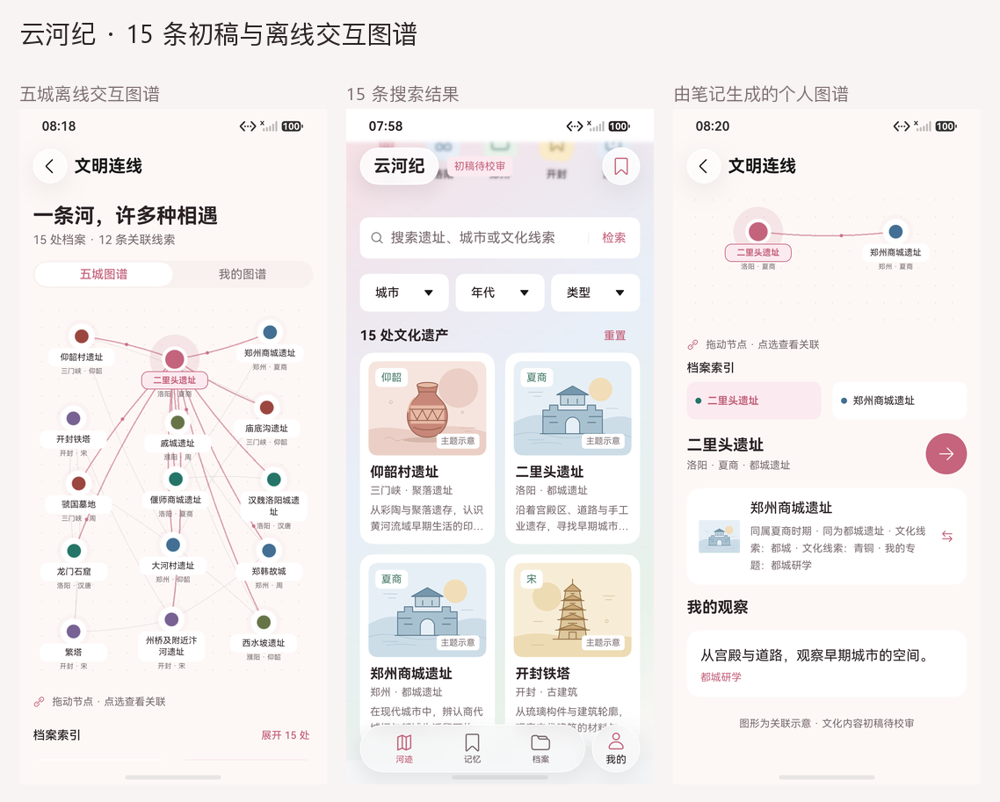
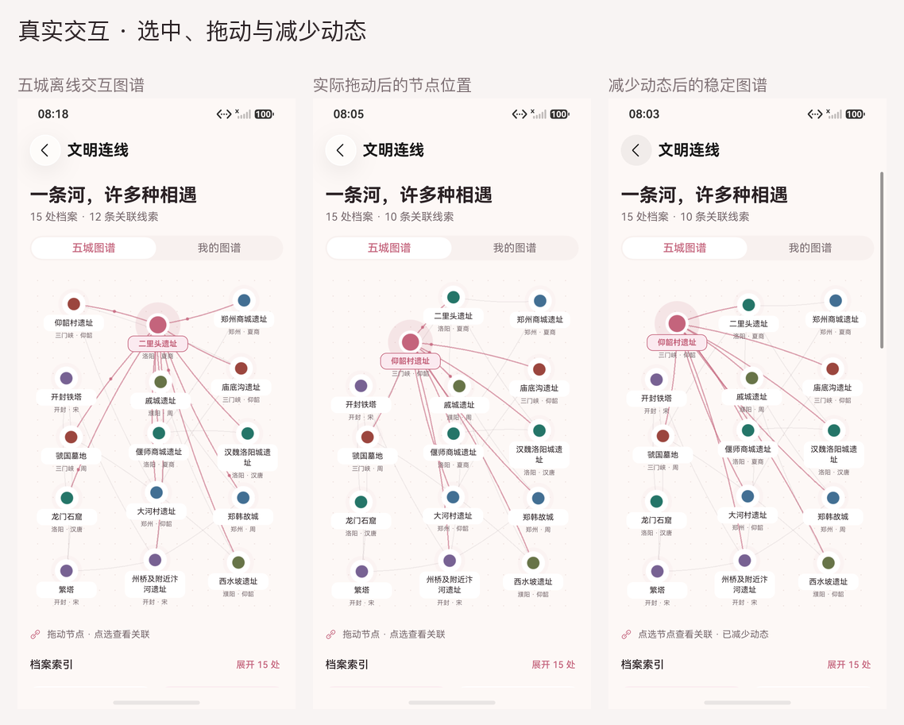
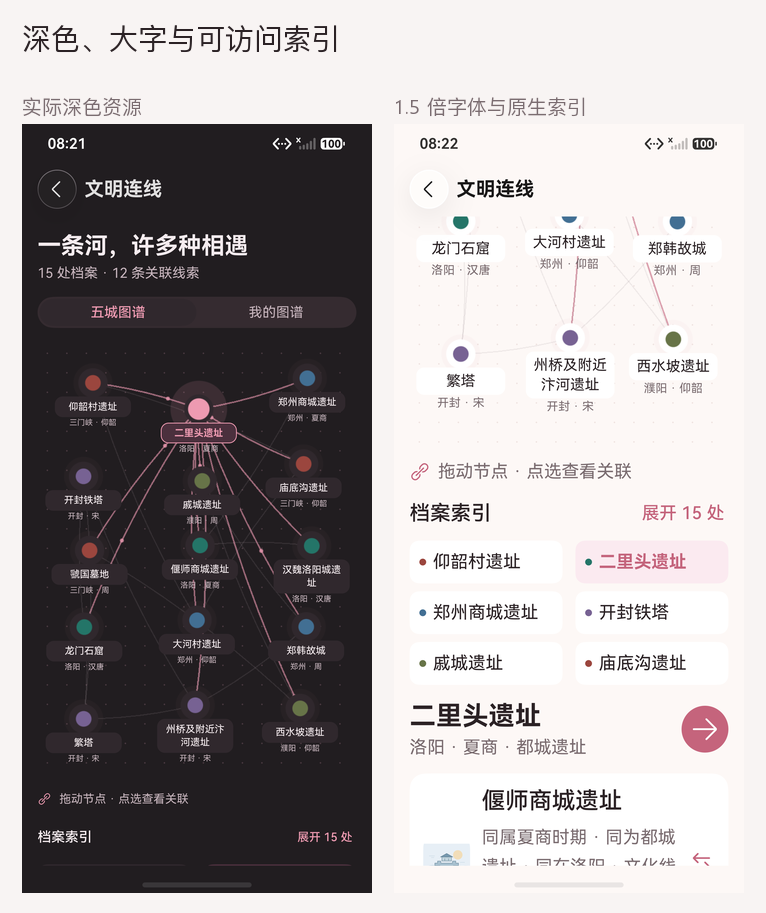
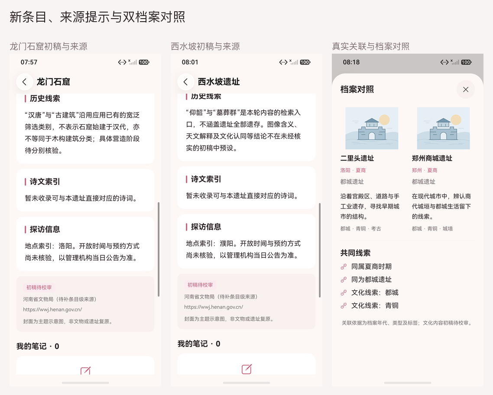

# 15 条初稿与离线交互图谱：真实截图

日期：2026-10-16。YunhejiSyncB，HarmonyOS 7.0.0.107 / API 26，1256×2760、density 560。以下是实际模拟器页面，不是网页预览或补画 UI。当前 ArkWeb 禁用 WebGL，因此图片均来自 Canvas 2D 降级。

| 原图 | 场景 |
|---|---|
| [home.png](home.png) | 15 条档案的首页 |
| [graph.png](graph.png) | 五城离线交互图谱 |
| [compare.png](compare.png) | 真实关联与档案对照 |
| [personal.png](personal.png) | 由笔记生成的个人图谱 |
| [personal-compare.png](personal-compare.png) | 自己的专题线索 |
| [dark.png](dark.png) | 实际深色资源 |
| [large.png](large.png) | 1.5 倍字体与原生索引 |
| [new-luoyang-detail.png](new-luoyang-detail.png) | 龙门石窟初稿与来源 |
| [catalog.png](catalog.png) | 15 条搜索结果 |
| [new-puyang-detail.png](new-puyang-detail.png) | 西水坡初稿与来源 |
| [catalog-final.png](catalog-final.png) | 扩充后的离线目录 |
| [reduced-motion.png](reduced-motion.png) | 减少动态后的稳定图谱 |
| [drag.png](drag.png) | 实际拖动后的节点位置 |

13 张原图已逐张检查，包含五城图谱、拖动后位置、减少动态、真实对照与个人专题、深色、1.5 倍字体、新增条目和来源说明。图集只等比缩放并在画面外排标题，未补画或覆盖原生 UI。笔记为独立测试库内的合成示例，没有账号、密码、大学或学号。截图不能证明帧率、功耗或 WebGL 能力。

主包始终相同，新增专项截图由第一版测试包驱动，旧图谱 / 外观截图由完成滚动适配的第二版驱动；各图与报告的包哈希见 [captures.json](captures.json)。七份最终报告与包版本见 [阶段索引](../../test-results/2026-10-16-graph-phases.json)，失败、超时和覆盖边界见 [测试报告第 14 节](../../TEST_REPORT.md)，页面说明见 [内容与图谱](../../CONTENT_GRAPH.md)。
