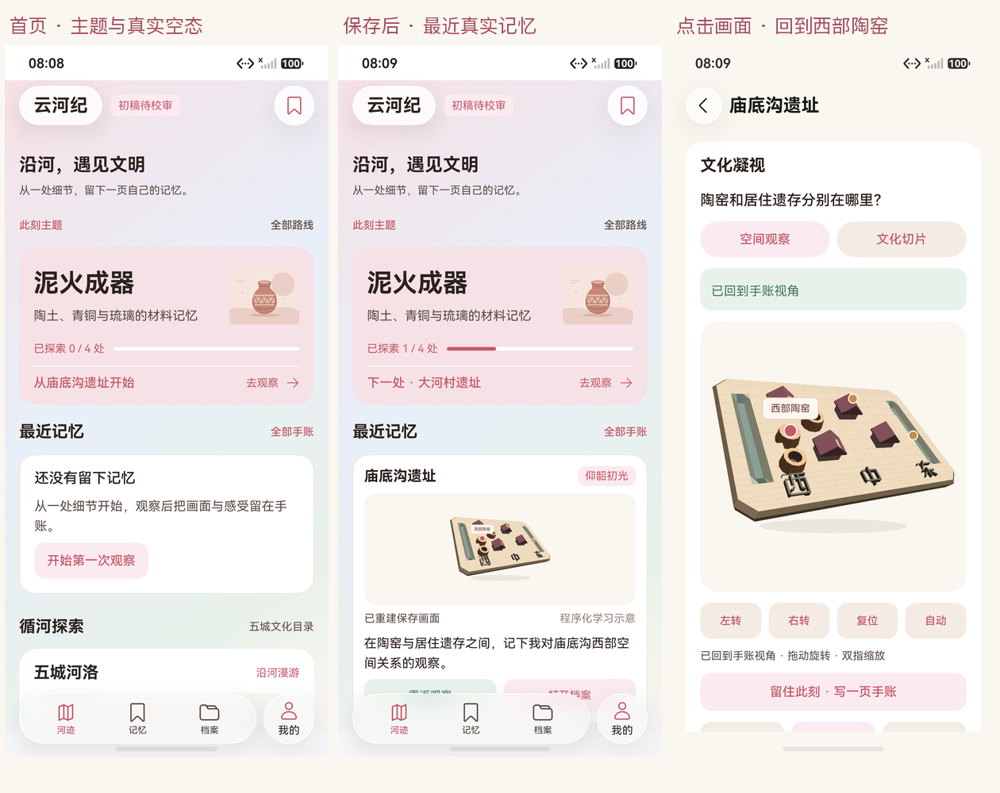
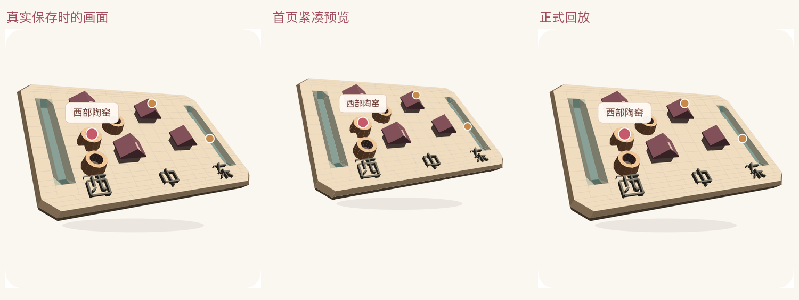

# 首页主题、最近真实记忆与正式回放

2026-10-17，HarmonyOS7/API26，YunhejiSyncB。HDC/Hypium直接连接模拟器获得ArkUI原生截图，独立随机Preferences，使用真实离线入口；图中没有私人账号资料。

首页首屏优先显示泥火成器和最近真实记忆；空态清楚提示第一次观察。保存后首页显示实际正文与1/4，下一处为大河村；完整路线仍有四节点。最近预览为124vp，按保存原画幅完整contain；点击画面进入正式详情，回到保存的西部陶窑与主动右转后的角度。

本地 **95/95**、设备报告解析 **9/9**，主包与测试包均 `BUILD SUCCESSFUL`。唯一首页核心设备路径 **1/1**，Failure / Error / Ignore 均为 0，耗时 **161021ms**，原始报告为 [2026-10-17-200742-device.log](../../test-results/2026-10-17-200742-device.log)。通过真实离线入口进入独立随机档案库，确认首页主题直接打开庙底沟、仅打开仍为0/4；选择西部陶窑并主动右转后，通过编辑器真实保存正文、标签、事实摘录和视角，清 Preferences 缓存后从磁盘回读。回首页后显示真实最新手账、预览及1/4，下一处变为大河村；点击首页画面正式回放，选中热点与实际绘制相机一致，并核对个人页完整四节点仅庙底沟点亮。

保存 / 回放整幅Canvas为1032×1050，变化像素0、最大通道差0，模型361127像素无差异。首页预览按磁盘原画幅去除contain留白后，RGB相关系数0.997163169、平均绝对通道差1.023252，见[完整核对](pixel-checks.json)。

## 实际原图与布局

| 原图 | SHA-256 | 同次布局 |
|---|---|---|
| [home-experience-empty.png](home-experience-empty.png) | `7F3A82F7924DE4F3F944485D54194492880BEF406D42D47AB679520D899D9DF4` | [home-experience-empty.json](home-experience-empty.json) |
| [home-experience-saved-view.png](home-experience-saved-view.png) | `16356C979BA7722DFE4B8B5981DD4283F555533623DA0AE85AF3DB18AD13E72A` | [home-experience-saved-view.json](home-experience-saved-view.json) |
| [home-experience-recent.png](home-experience-recent.png) | `5ED4EA6063815B811661E05A958C7352FE8914862E00853B831FD21F9A28112C` | [home-experience-recent.json](home-experience-recent.json) |
| [home-experience-home-preview.png](home-experience-home-preview.png) | `5ED4EA6063815B811661E05A958C7352FE8914862E00853B831FD21F9A28112C` | [home-experience-home-preview.json](home-experience-home-preview.json) |
| [home-experience-replay.png](home-experience-replay.png) | `F74AAF952CD73C13DF31EF22C581E4903357C8E0802EE856DE08429BA3E80D23` | [home-experience-replay.json](home-experience-replay.json) |

## 包与验收边界

主包 SHA-256：`00B1774C2D4F858C7F5F52738C16AC02FE5B39660A3C33B4672FE44263791D94`。

测试包 SHA-256：`485CE18969CF307465C15E7F7263E72C65A33F382A06709197C45C3A36F1BD18`。

[阶段清单](../../test-results/2026-10-17-home-experience-phases.json)绑定源码、测试、包、原图和布局；[中间清单](../../test-results/2026-10-17-home-experience-intermediate.json)保留一次启动中断、三次新测试定位错误及一次真实主题刷新缺陷，未累计到最终1/1。原始本地 / 构建输出与详细解释见[测试报告第22节](../../TEST_REPORT.md#22-首页主题与最近真实记忆2026-10-17)。

所有沙盘与器物均为程序化学习示意，非实物照片或考古复原；档案仍标记初稿待校审。本轮无字段或schema变化，旧笔记不补造观察画面。T11同账号另一端新手账实际预览 / 回放、T13三分钟脚本与真实录像仍待独立验收，当前传输继续称HTTPS。
