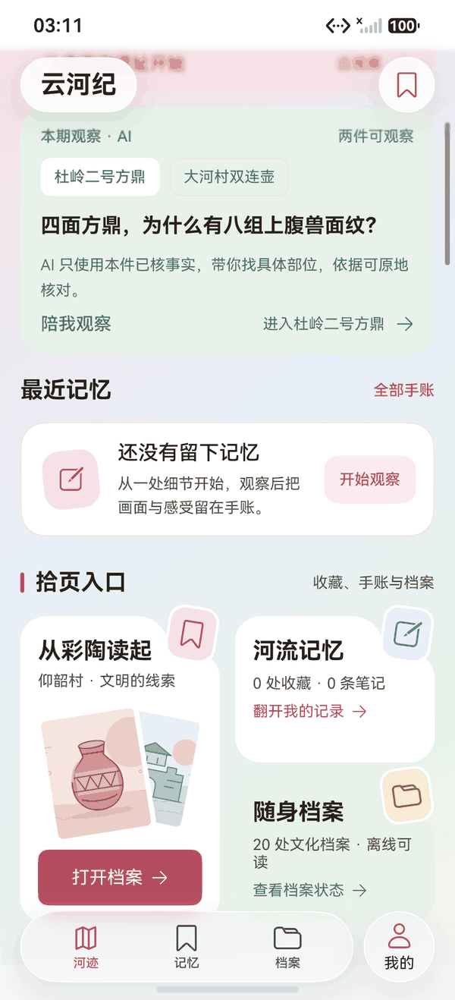

# 首页「拾页入口」上移

2026-10-20，HarmonyOS 7 / API 26 模拟器截图。

## 问题

「拾页入口」原来排在「循河探索」之后：首页要经过此刻主题、AI 观察、最近记忆、五城沙盘、黄河水情、文明连线六个模块，第三屏才看到三张入口卡。入口是导航，不应该埋在探索内容之后。

## 方案

把整段「拾页入口」上移到「最近记忆」之后、「循河探索」之前：

1. 此刻主题
2. 本期观察 · AI
3. 最近记忆
4. **拾页入口**
5. 循河探索（五城沙盘、黄河水情、文明连线）
6. 循城而入
7. 检索档案

入口从第 7 个模块提前到第 4 个；首屏仍保留主题与 AI，下一屏即可看到三张卡。

## 没有采用的两种做法

- **放到最顶部**：会把「此刻主题」和 AI 观察挤到首屏之外，演示主线变成导航卡。
- **插在主题与最近记忆之间**：主题卡与最近记忆被入口区隔开，首页体验用例在最近记忆处读不到主题进度；连续阅读也被打断。

## 截图

图中顺序为 AI 观察 → 最近记忆 → 拾页入口；三张卡完整可见，下一段才是「循河探索」。

## 验证

- 主包与测试包 `BUILD SUCCESSFUL`。
- `HomeExperienceTest#native_home_theme_recent_memory_route_replay` **1/1**（200.1 s，Failure / Error / Ignore 0），日志 `docs/test-results/2026-10-20-151832-device.log`；确认主题打开、最近记忆预览与路线进度未受顺序调整影响。
- 主包 6,380,602 字节，SHA-256 `BF2A4BE39A1F5AA0043BC5B74C60945DDA9761AC812F4666140CC0661EC49467`。
