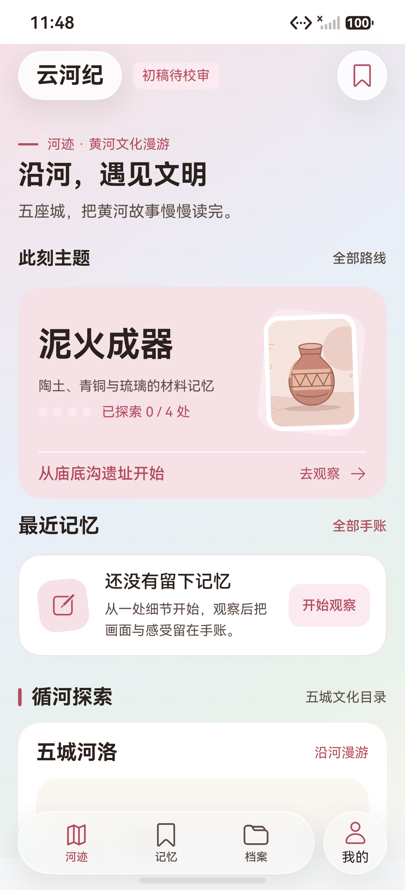
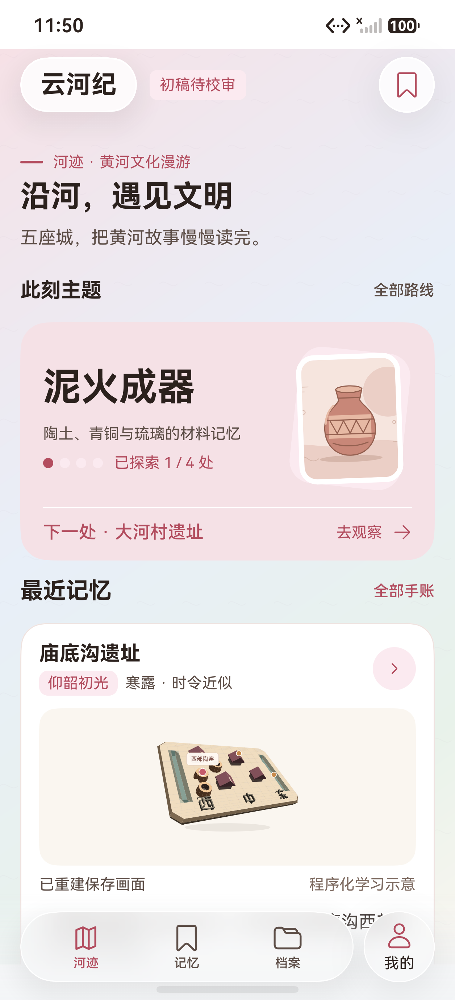
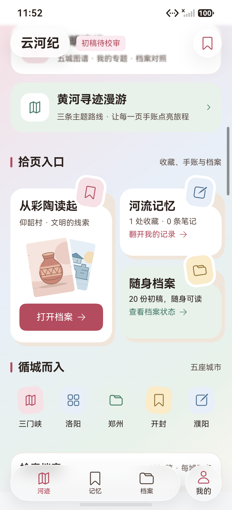
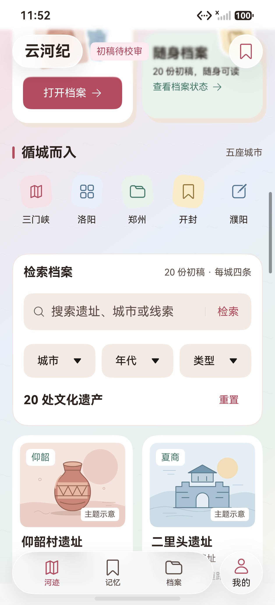
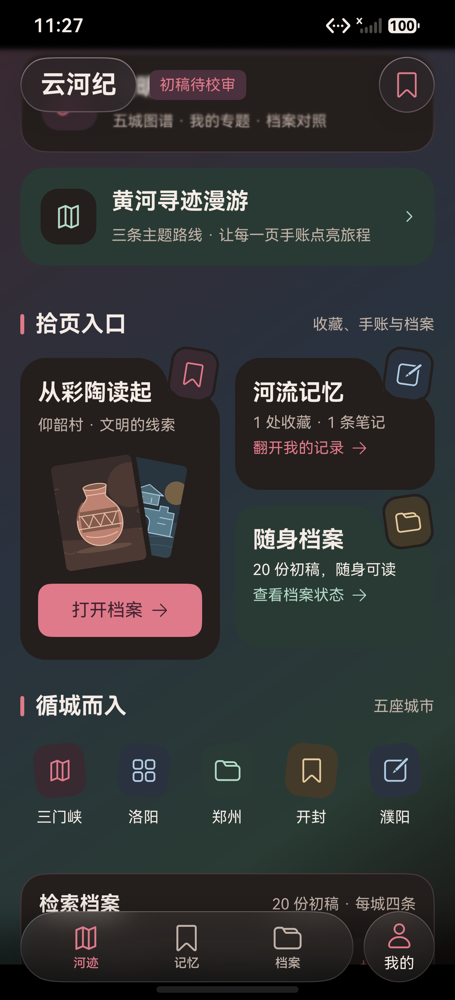
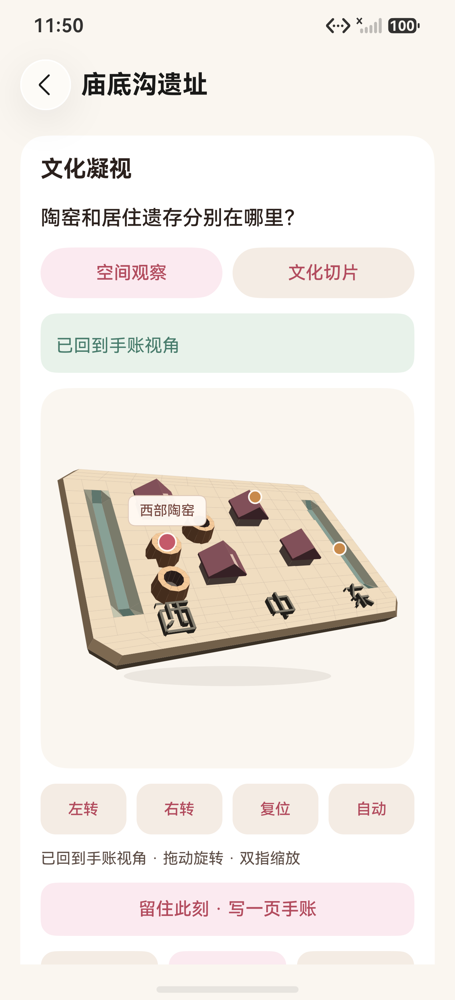

# 首页改版：恢复原结构并整体优化

2026-10-17 晚，HarmonyOS 7 / API 26，`Pura 90 Pro`（HDC `127.0.0.1:5555`，1256×2760、density 560）。以下全部为 HDC / Hypium 直接连接模拟器的 ArkUI 原生截图与同次布局，不是网页预览或补画界面。

本次按用户要求恢复此前更满意的首页结构（五城沙盘、文明连线、黄河寻迹漫游、纸质入口、城市索引、检索分区），再在原有语言上整体优化；同时保留“此刻主题”和“最近真实记忆”，没有退回只有主题卡与空记忆卡的简化版。

## 层次与配色强化

- 纸页入口的贴纸改为**白色厚描边 + 彩色贴纸 + 轻微旋转**，半凸出卡片上边缘，接近纸质手账贴纸的叠放效果。
- 三张纸卡下方各垫一张 `surface_sunken` 暖灰底纸，只露出右下边缘，形成纸片叠层；全部为实色叠放，没有阴影、渐变或伪材质。
- 主玫瑰色由 `#C45A6A` 收紧到 `#B24C5E`，小字灰棕由 `#96847B` 收紧到 `#7D6A60`，深色 `tertiary` 由 `#85756C` 提亮到 `#A08E83`；提高按钮白字与小字说明的对比度，同时保留暖白纸感与玫瑰主色。
- 五城沙盘的淡青、记忆卡的浅蓝、随身档案的浅黄继续作为分区识别色，不把粉色扩展到所有区域。

## 调整后的信息顺序

1. **标题区**：河迹眉题、`沿河，遇见文明` 大标题与副题。
2. **此刻主题**：单张“泥火成器”主题卡，含四节点进度圆点、真实进度、下一处内容与直达入口。
3. **最近记忆**：有手账时显示遗址、印章 / 时令、原画幅预览、正文、标签和“重返观察 / 阅读全文”；无记录时为紧凑引导，不再用大块空卡占据首屏。
4. **循河探索**：恢复五城河洛沙盘、文明连线与黄河寻迹漫游入口。
5. **拾页入口**：恢复纸质卡片与贴纸的“从彩陶读起 / 河流记忆 / 随身档案”。
6. **循城而入**：五座城市索引。
7. **检索档案**：搜索、城市 / 年代 / 类型筛选、结果数与重置收进同一张卡片。
8. 档案网格、“循迹而行”关联档案与页脚说明。

所有文化插画仍为主题示意，不是文物照片或考古复原；档案保持“初稿待校审”。本次没有新增平台材质、任意阴影或伪同步动画，官方 HDS 材质仍只用于顶部和 Dock。

## 原图与布局

| 原图 | 场景 | SHA-256 | 同次布局 |
|---|---|---|---|
| [home-empty.png](home-empty.png) | 空账号首页首屏 | `70785F0451BDCA12ACBB880373A00D41B53BD9DDB8233F6F7C9A49EDC0F138E2` | [home-empty.json](home-empty.json) |
| [home-recent.png](home-recent.png) | 保存后首页最新手账与 1/4 | `21EBED86EF66211B45BF7401D1BFF7E9B472F0452577E20B928033FC43FDFAF6` | [home-recent.json](home-recent.json) |
| [home-preview.png](home-preview.png) | 最近记忆预览按原画幅重建 | `F02C3D0B3E8EA3F399EC9B9B6494DB49EBE1954F3536B60F0E2F6B7B42A20A1C` | [home-preview.json](home-preview.json) |
| [home-board.png](home-board.png) | 纸页入口三张纸质卡与厚描边贴纸 | `54B853EBB122FB551D8B3A0AB35A84CED0F01D19A15E47926F11B13C26333A82` | 设备截图，无布局导出 |
| [home-search.png](home-search.png) | 城市索引与检索档案卡片 | `EC8B5D84E637EEEF47EBDD659C3EF286CB815477C09DDFDE8F5311A44A646EF5` | 设备截图，无布局导出 |
| [home-dark.png](home-dark.png) | 深色模式纸页入口（层次强化前拍摄） | `E76FC3266A490A3BE22D43F6D9F1F1E3236AF3FC45FCC49123F08F9D03DE58D8` | [home-dark.json](home-dark.json) |
| [home-replay.png](home-replay.png) | 点击首页画面后的正式回放 | `1BB777850FFBA2583CF2698388C493CBA23E8CA2CBB1938BBDB9FE2718A18D42` | [home-replay.json](home-replay.json) |

## 回归结果与边界

- 本地 **95/95**、报告解析 **9/9**，主包与测试包 `BUILD SUCCESSFUL`。
- 改版后首页核心设备路径 `HomeExperienceTest#native_home_theme_recent_memory_route_replay` **1/1**，Failure / Error / Ignore 均为 0，耗时 **203638ms**，原始报告为 [2026-10-17-234825-device.log](../../test-results/2026-10-17-234825-device.log)。覆盖主题直达、空态、真实保存、首页最新记忆与 1/4、124vp 原画幅预览、点击回放和完整四节点。
- 所有既有测试 id 保留；`memory-entry` 与 `featured-site` 随卡片下移到纸页入口区，相关旧用例已改为按真实滚动定位后再点击，业务断言不变。
- 旧的外观与登录套件不是本轮首页验收项：外观套件在增加滚动步骤后超过单用例 240 秒上限，登录套件仍期待“大学资料在退出重登后仍在”，而产品设计只保留在本次会话。两者及两版中间通过均保留在[中间清单](../../test-results/2026-10-17-home-redesign-intermediate.json)，未计通过。
- T11 双端同步结果对应改版前的首页布局；账号同步与 B 端接收逻辑未改，本轮没有重跑双端，首页回归以本次 1/1 为准。
- 深色模式已实际查看；上面的深色截图为贴纸 / 底纸强化前拍摄，强化沿用 `surface / sunken` 语义令牌，没有新增硬编码颜色。大字模式未完成同套件复验（外观套件超时），不把该轮记为通过。

主包 SHA-256：`935E945F1A438ECD4454328B95D7A8683FC048647E4CD24EF94643AC1E735BAE`；测试包：`13222779FBE8945F6473A198736A238B7934B7C2C947E90087A159EF30798BA4`。包、源码、报告与截图绑定见[阶段清单](../../test-results/2026-10-17-home-redesign-phases.json)，完整过程见[测试报告第24节](../../TEST_REPORT.md#24-首页-ui-与布局改版2026-10-17)。
