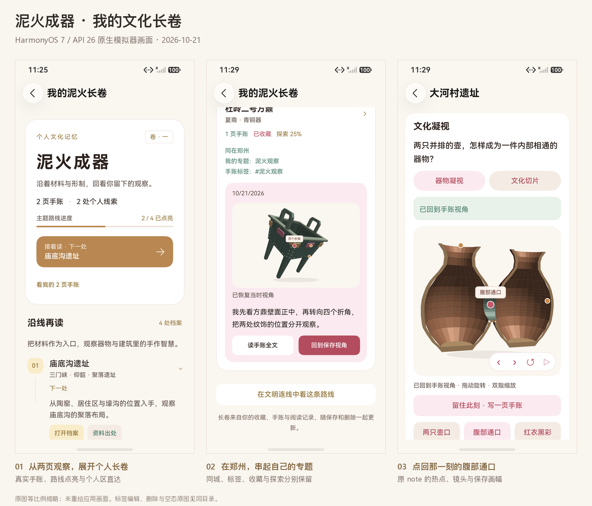

# 泥火成器 · 我的文化长卷

日期：2026-10-21。C09 首批，仅“泥火成器”一个主题。HarmonyOS 7 / API 26 原生 ArkTS / ArkUI 页面；五条正常字号离线业务路径已分别通过，包与原始结果见[测试报告第 33 节](../../TEST_REPORT.md#33-泥火成器个人长卷2026-10-21)和[机器清单](../../test-results/2026-10-21-journey-scroll.json)。

入口有两处：路线内新建手账确认保存后，详情页出现“展开我的泥火长卷”；记忆页保留同一固定入口。打开入口本身不生成手账、学习进度或经历。长卷以现有四处档案编排阅读顺序：庙底沟遗址、大河村遗址、杜岭二号方鼎、开封铁塔。

页面上方显示真实手账数量、个人线索数量与路线点亮状态。四步路线可分别展开阅读理由与已有条目来源，下一处由现有 `journeyProgress` 计算；全部点亮后进入自己的回顾。下方按城市整理真实收藏、笔记和有效探索记录，每篇画面手账复用原保存画幅；点击画面或“回到保存视角”使用原 note 的真实相机参数，点击“读手账全文”使用现有全文页。

数据由新的纯领域模块 `JourneyScroll.ts` 即时派生，先按既有版本规则合并，再排除墓碑和本主题以外的记录。普通文字笔记也可入卷，但不自动等于路线完成；旧 `opened` 记录不计学习比例。共同标签只标“我的专题”，属性理由来自现有 `connectionReasons`，不描述考古传承、技术演化或用户到访。

本轮沿用 schema、稳定档案 ID、note 元数据、镜头、来源及删除墓碑，没有新持久化字段。AI 仅显示已有手账元数据；这页不额外请求模型或生成文化事实。源码中的复杂派生与导航规则均有中文注释。

## 本轮验证范围

领域新增五项有实际语义的检查：空态与现有出处；普通笔记和路线完成语义分离；共同标签修改与墓碑重算；收藏与有效 section 进度分别保留；路线外排除、确定排序及输入不变。本地必跑脚本首次 **127/127**，报告解析 **9/9**。

原生演示验收采用独立离线测试库，经真实编辑器保存双连壶腹部通口和方鼎四个折角，核对保存后入口、共同专题、出处、真实回放、标签编辑返回刷新、删除墓碑与剩余收藏 / 探索。另一项覆盖空库固定入口及真实建议去向。当前同一 M3 主包的保存 / 读取回放绑定 T3，各 1/1；编辑 / 删除首卡 / 最终空态绑定 T4，各 1/1。两次定向清理各 1/1，旧失败保留；不是一次同测试包全套通过，不继承旧 AI / HTTPS 或全部 UI 结果。

## 首轮保留问题

空态首轮 **0/1，Failure=0、Error=1、Ignore=0，130200ms**，报告 [104354](../../test-results/2026-10-21-104354-acf60286-device.log)。测试定位大容器只露出边缘后直接等待标题，标题仍在视口下方；改为将实际标题叶节点滚入视口，原断言保留。

同次[原图](first-empty-title-failure.png)还揭露了真实排版问题：路线步骤左列使用纵向 `Blank().layoutWeight(1)` 配合 `Stretch`，在 Scroll 中把竖线拉到近一整屏。原始 layout 中该 Blank 的未裁切范围为 `[141,-283][145,1697]`。此项单独修复应用布局，测试定位修正不能代替排版修复。

首次整段主线在 M2 / T2 达到 600000ms 上限，AA [105847](../../test-results/2026-10-21-105847-3dd82e77-device.log)缺完整结束摘要，[HiLog](../../test-results/2026-10-21-journey-scroll-main-timeout-events.log)为 1 项、Error=1、Pass=0，未登记通过。超时前已完成双篇、2/4、出处与共同专题；[首次回放说明图](first-opening-replay-details.png)只显示正确档案和腹部通口说明，Canvas 与成功文案在屏外，不能单独证明画幅恢复。分段复验已补两者同屏的实际图。

M3 增加页首“看我的 X 页手账 / X 处线索”，使用原生 Scroll 直接跳到个人长卷，保存后无需逐步滚过阅读路线；标题改为“主题路线进度”，保留原点亮规则。T3 编辑删除合并段还保留一次 360000ms 超时，见 [113017](../../test-results/2026-10-21-113017-4d3a7dc6-device.log)，当轮已编辑刷新但未删除。T4 通过原 UI 还原标签后完整重做，并把已知页尾的读 / 编辑 / 删除先真实滚到页尾再定位；独立编辑 **134961ms**、删除及首卡 **69541ms**，均 1/1，没有删除断言或修改主包。

## 实际原生画面

以下为同一 M3 主包按 T3 / T4 对应阶段保存的原生手机模拟器截图，1256×2760。总览仅等比例缩略拼接，未重绘应用内容；完整原图和同名 layout 分别保留。

| 画面 | 可核对内容 | 原图与布局 |
|---|---|---|
| 两篇观察后的长卷 | 两页手账、两处线索、2/4、下一处，以及个人记录直达入口 | [PNG](two-observations.png) / [JSON](two-observations.json) |
| 展开现有出处 | 庙底沟国家文物局出处、原 URL、校审状态与紧凑四步阅读 | [PNG](reading-source.png) / [JSON](reading-source.json) |
| 郑州共同专题 | 两篇真实标签形成“我的专题”，收藏与 25% 探索分开呈现，方鼎原画幅及正文 | [PNG](zhengzhou-topic.png) / [JSON](zhengzhou-topic.json) |
| 点击双连壶原画幅后 | 实际 Canvas、腹部通口热点与“已回到手账视角”同屏 | [PNG](opening-replay.png) / [JSON](opening-replay.json) |
| 标签编辑返回 | 方鼎为 #青铜折角，共同专题消失；正文和保存画幅不变 | [PNG](edited-topic-refresh.png) / [JSON](edited-topic-refresh.json) |
| 删除方鼎手账后 | 双连壶仍在，方鼎保留收藏与 25% 探索，不再显示已删手账 | [PNG](tombstone-preserves-other-records.png) / [JSON](tombstone-preserves-other-records.json) |
| 记忆页固定入口与首卡 | 长卷入口、剩余一篇、标题 / 正文 / 主要操作均在首屏 | [PNG](memory-entry-first-card.png) / [JSON](memory-entry-first-card.json) |
| 当前包独立空态 | 真实建议、空库不生成个人经历，打开建议为庙底沟档案 | [空态 PNG](final-empty-real-suggestion.png) / [JSON](final-empty-real-suggestion.json)；[档案 PNG](final-empty-opened-archive.png) / [JSON](final-empty-opened-archive.json) |

个人区入口的实测标题范围为 `[84,388][1172,462]`，完整落在当时 Scroll `[0,332][1256,2662]` 内。回放画布范围为 `[112,1166][1144,2216]`，成功文案为 `[112,2258][1144,2307]`，同样在真实视口内；不是仅核对按钮存在。
