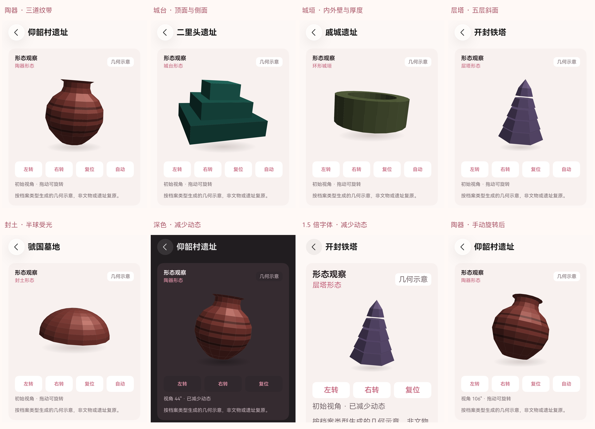
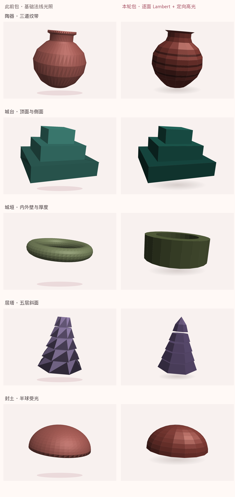

# 逐面光照真实截图

日期：2026-10-16。全部原图来自实际 HarmonyOS 7 / API 26 手机模拟器，通过 HDC / Hypium 获取。实际渲染为原生 ArkUI Canvas 的 CPU 多边形投影与光照。11 张原图对应同一对最终包，包与图片哈希、报告关系见 [阶段清单](../../test-results/2026-10-16-lighting-phases.json)。

## 与此前包的对照

左侧来自上一轮空间图集，右侧来自本轮包。仅裁剪、缩放和添加图注，没有调色或重绘截图内的模型。新旧包分别保留各自的验证记录，不把旧图计为本轮回归。

## 全屏原图

| 原图 | 内容 | 对应报告 |
|---|---|---|
| [smx-yangshao.png](smx-yangshao.png) | 陶器、三道纹带与复位后的视角 | [233843](../../test-results/2026-10-16-233843-device.log) |
| [ly-erlitou.png](ly-erlitou.png) | 三层城台的面明暗 | 同上 |
| [py-qicheng.png](py-qicheng.png) | 环形城垣内外壁与顶部厚度 | 同上 |
| [object-before-turn.png](object-before-turn.png) | 陶器转动前 | 同上 |
| [object-after-turn.png](object-after-turn.png) | 陶器主动转动后 | 同上 |
| [kf-iron-pagoda.png](kf-iron-pagoda.png) | 五层八角塔与尖顶 | [234039](../../test-results/2026-10-16-234039-device.log) |
| [smx-guoguo.png](smx-guoguo.png) | 封土弧面受光 | 同上 |
| [object-reduced-before.png](object-reduced-before.png) | 深色、减少动态的前帧 | [234200](../../test-results/2026-10-16-234200-device.log) |
| [object-reduced-after.png](object-reduced-after.png) | 等待后的后帧 | 同上 |
| [object-dark-reduced.png](object-dark-reduced.png) | 减少动态下主动转动 | 同上 |
| [object-large-reduced.png](object-large-reduced.png) | 1.5 倍字、浅色与减少动态 | 同上 |

模型区域的 [像素核对](pixel-checks.json) 显示静止前后像素完全一致，旋转前后 RGB 平均绝对差分别约为 16.15、11.81、11.29。比较区域从视口内真实可见模型定位，排除时钟、按钮、状态文字和下方插画；可见模型存在性单独检查，避免把空白当作稳定。

初始视角的 [剔除面数量](culling-counts.json) 只是绘制面统计，没有测量帧率、功耗或“效率提升 40%”。这些画面不证明 ArkGraphics3D / WebGL 已通过验收，所有形态仍为几何示意。实现见 [逐面光照说明](../../OBJECT_LIGHTING.md)，测试边界见测试报告第 16 节。
