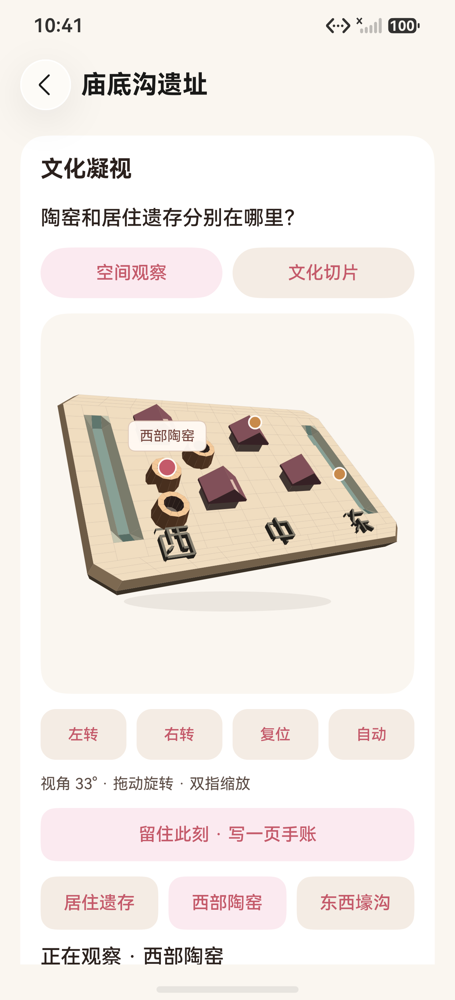
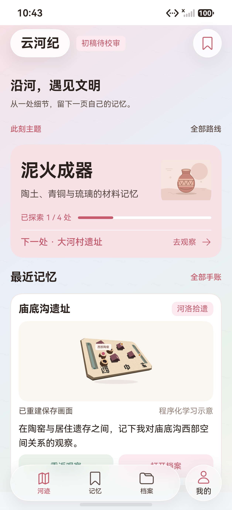
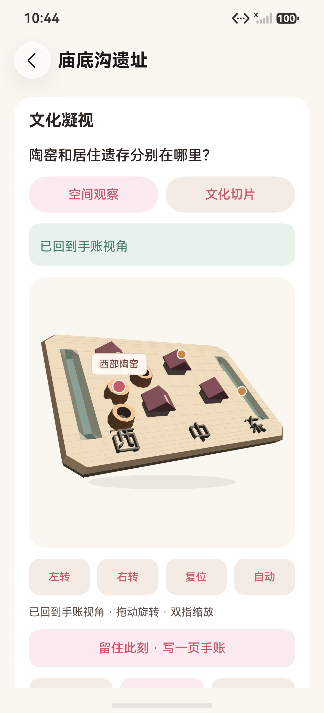

# 双端同账号手账：真实保存、接收、预览与回放

2026-10-17，HarmonyOS 7.0.0.107 / API 26，两台模拟器：A 为 `Pura 90 Pro`（HDC `127.0.0.1:5555`），B 为 `YunhejiSyncB`（HDC `127.0.0.1:5557`），均为 1256×2760、density 560。以下图片全部来自本轮同一测试包的 HDC / Hypium 直接连接截图与同次 `dumpLayout`，不是网页预览、拼图补画或合成画面。

第一张是 A 端选择“西部陶窑”并主动右转后、正式保存前的整幅 Canvas。第二张是 B 端用同一账号收到该记录后的首页 124vp 预览；预览按保存的虚拟画幅 contain，不用卡片尺寸重新取景。第三张是 B 端点击画面进入正式回放并实际绘制完成的同一画幅。

## 实际原图与布局

| 原图 | 场景 | SHA-256 | 同次布局 |
|---|---|---|---|
| [a-saved-view.png](a-saved-view.png) | A 端庙底沟“西部陶窑”、主动右转后保存前画面 | `153797A05233369C82478653E292A895645F8F0FA648CB47FE1E4BBA2C47598F` | [a-saved-view.json](a-saved-view.json) |
| [a-home-preview.png](a-home-preview.png) | A 端保存后首页最近记忆与 1/4 | `4DB92FAAA937DDCB53A2295AFE5275CC1F59428C77D901DD8D64922E7DF96414` | [a-home-preview.json](a-home-preview.json) |
| [b-home-preview.png](b-home-preview.png) | B 端同账号首页收到同一条手账与 1/4 | `9C7D1D1E13690BD1553FA8167BC8289604437AB3687D04668DFF701055849523` | [b-home-preview.json](b-home-preview.json) |
| [b-replay.png](b-replay.png) | B 端点击预览后正式回放，回到保存部位与角度 | `DF686C80E54EEBD53B28C1ADDB6101E94A0FF63FBE6E8FA1D48B6402F4354F3C` | [b-replay.json](b-replay.json) |

两张整幅 Canvas 均按同次布局中的真实边界裁切：A 为 `[112,865]–[1144,1915]`，B 为 `[112,1071]–[1144,2121]`，尺寸都是 **1032×1050**；B 因回放提示条使画布在屏幕上的位置下移，裁切仍使用实际布局而不是固定坐标。

## 跨端画面核对

- 保存前 / 正式回放整幅 Canvas：**变化像素 0**，最大通道差 **0**，平均绝对通道差 **0**；模型区域 **390753 像素**两端一致（以 `#FAF6F0` 为背景、最大通道差大于 10 计为模型区域）。
- A / B 首页 124vp 预览：两端 **0 像素差异**，不是“相似”而是按同一保存画幅重绘。
- 按保存的虚拟画幅 `294.85714285714283 × 300` contain 到 1054×434 后，与保存画面缩放重建的 RGB 相关系数为 **0.9884491801945107**，平均绝对通道差 **0.7763191645024294**；差异来自缩放重采样，不是取景变化。

差异图 [canvas-diff.png](canvas-diff.png) 全白表示 1032×1050 全部像素一致；完整数值见 [pixel-checks.json](pixel-checks.json)。核对脚本只使用同次原始 PNG 与布局边界，未用 A 端本地图片路径代替 B 端绘制。

## B 端实际收到的字段

同一 note `note:1680f34b-…:1792248130205` 在 A、B 两端的磁盘回读如下（两端日志逐字段相同）：

| 信息组 | 实测值 |
|---|---|
| 身份 | `kind=note`、`siteId=smx-miaodigou`、`updatedAt=1792248130205`、`deleted=false`；记录 `deviceId` 保留 A 的 `1680f34b-…`，B 快照自身为 `cde58b28-…` |
| 用户内容 | 正文“在陶窑与居住遗存之间，记下我对庙底沟西部空间关系的观察。”；标签“庙底沟 / 陶窑 / 空间观察 / 跨端样板1792247956642_b761c44d” |
| 摘录 | 与庙底沟“陶窑：集中于西部”事实正文完全一致 |
| 装饰 | `stampType=河洛拾遗`、`paperTheme=ochre`（均不同于该档案默认印章 / 纸色） |
| 观察选择 | `hotspotId=kilns`、`sectionId=''`、`label=西部陶窑 · 33°` |
| 相机 | `yaw=0.5726990816987241`、`pitch=0.77`、`zoom=0.99`；B 端 `MEMORY_REPLAY_FRAME` 的实际绘制值相同 |
| 场景资源 | `miaodigou_pottery / 2 / native-raster-v1` |
| 原取景 | `width=294.85714285714283`、`height=300`、`textDensity=3.5`、`dark=false` |

B 端首页由此显示真实 1/4、“下一处 · 大河村遗址”和“已重建保存画面”；点击画面后详情显示“已回到手账视角”，选中部位仍为“西部陶窑”，再右转一步得到保存角度 +45°（55°）。

## 主线排练截图

以下为 T13.1 主线排练（独立离线库，不含账号信息）中的实际页面：主题观察、对照来源展开、保存前取景、首页最新记忆与 A 端正式回放。

| 原图 | 场景 |
|---|---|
| [rehearsal-observation.png](rehearsal-observation.png) | 首页主题直达庙底沟，选择西部陶窑并右转 |
| [rehearsal-comparison.png](rehearsal-comparison.png) | 首页文明连线进入“双连壶与方鼎”，展开一处馆方依据 |
| [rehearsal-saved-view.png](rehearsal-saved-view.png) | 保存手账前的实际画布 |
| [rehearsal-home-recent.png](rehearsal-home-recent.png) | 保存后首页最新记忆与 1/4 |
| [rehearsal-replay.png](rehearsal-replay.png) | 点击首页画面后 A 端正式回放 |

## 包与验收边界

本轮主包 SHA-256：`C6CB8C4B467958E59C84460983D1DC5489548DF4108F30087FDF347313510AD2`；最终测试包：`1B1E9B548D29B9E19B2DD4B19A3582E6E0C4E32A4E3E5B9F99A772C8A59514FD`。设备结果、源码 / 测试源码哈希、原图、布局、报告与清理记录见[阶段清单](../../test-results/2026-10-17-memory-sync-phases.json)。

A 端 **1/1**、159100ms，B 端 **1/1**、104368ms，Failure / Error / Ignore 均为 0；`MemorySyncTest` 的 A 发布与 B 接收 / 预览 / 回放分开执行，结束前不清理 A 端库，B 完成后才清理本轮独立测试库。三次中间失败（账号 API 调用顺序、个人页深层状态行不可达、对照维度按钮不在滚动区）只改测试定位或读取位置，未删除业务断言，保留在[中间清单](../../test-results/2026-10-17-memory-sync-intermediate.json)。

录像未在本轮由代理录制（用户明确本轮不需要）。T13.1 操作主线排练为 **1/1**，但自动化分段合计 207663ms，含 UiTest 定位、截图和布局开销，不能当作真人三分钟计时；T13 整体仍未完成。所有模型仍为程序化学习示意，档案为“初稿待校审”，传输继续称 HTTPS 同账号同步，不称华为账号、鸿蒙分布式 KV 或多人协作。
