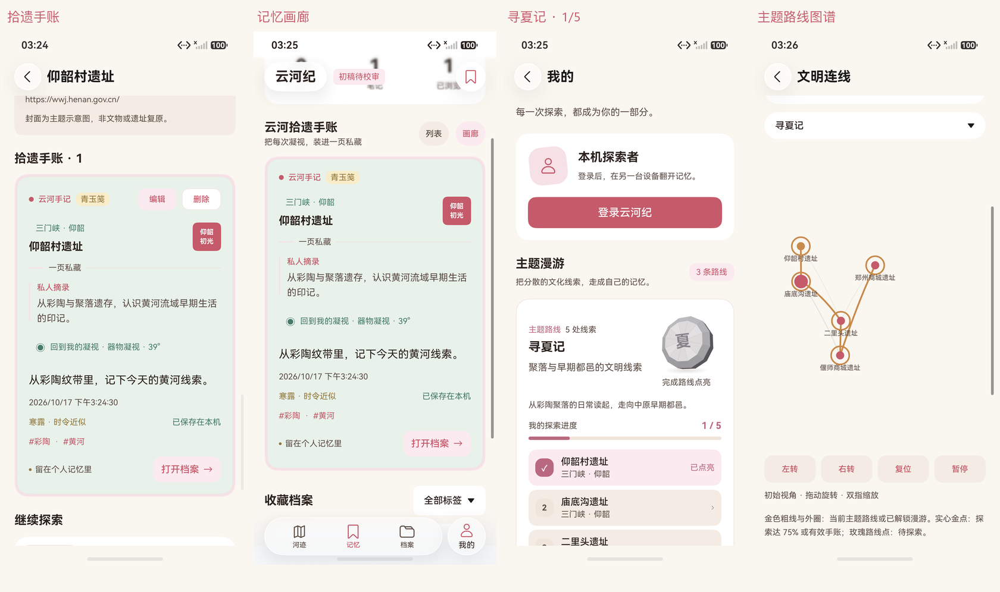

# 拾遗手账与主题漫游：实际模拟器页面

2026-10-17，HarmonyOS 7 / API 26，HDC / Hypium 直接连接模拟器。四张原图来自同一条真实核心操作路径，使用独立离线测试库，没有私人账号或预填假进度。主包 / 测试包及原始报告见 [阶段记录](../../test-results/2026-10-17-memory-phases.json)，详细范围见 [测试报告第18节](../../TEST_REPORT.md)。

保存仰韶手账后，四项新元数据从实际 Preferences 回读；画廊入口恢复了保存视角。寻夏记的第一个节点点亮为1/5，其余节点仍待探索。灰色纪念章表示尚未整条集齐，没有把单节点点亮展示成完成路线。图谱金色连线表达当前主题路线，金色实心点才表示该节点已探索。

| 原图 | SHA-256 |
|---|---|
| [detail-card.png](detail-card.png) | `CCE5A86AF7A0F3C30DF5B9B5AADF141536C35B31D4ECF36C4A1CBFF19E031382` |
| [gallery.png](gallery.png) | `DF4691306E3B2240360257E26CD4984B132362793742F0EB0E7E3BF8D2C7F3B8` |
| [route.png](route.png) | `690CEE74A14AFB0B48DEFF902A114C8D70A581DB1A23A59C40A72E47A0D3711A` |
| [route-graph.png](route-graph.png) | `79266752860B6E008A650A6983C6B7404276540C73CC1BDFA96706E56C878C73` |

当前主包：`E7E3C90A03CFEA96CAC523E46B08302A71F180134F5BE6AE4AE18F91AB5BCF93`。

当前测试包：`95F889737D4ACD027536F6C3AE4F5CA523A1C6FB6848E30D49E3DBFD63144608`。

本图集与对应手账、漫游功能一并纳入本次 Git 提交；此前版本已经以中文提交并推送为 `0bdb35d`。全部文化内容保持初稿状态，几何视口为学习示意。
