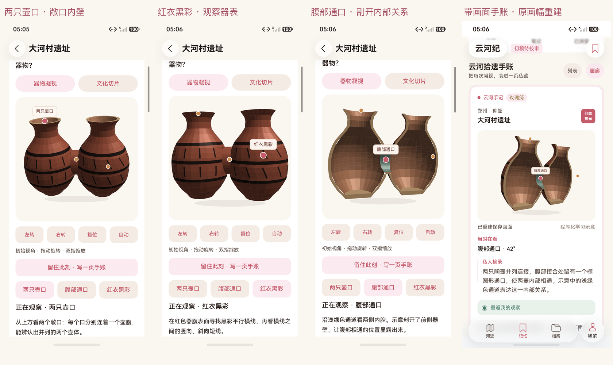
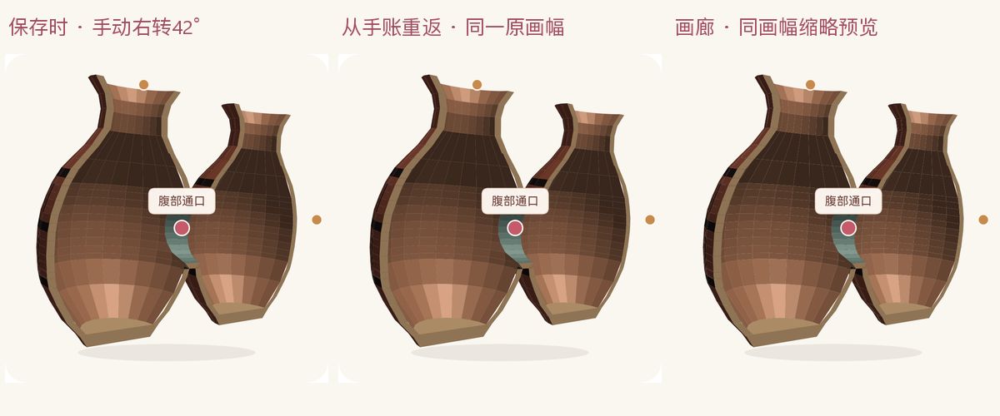
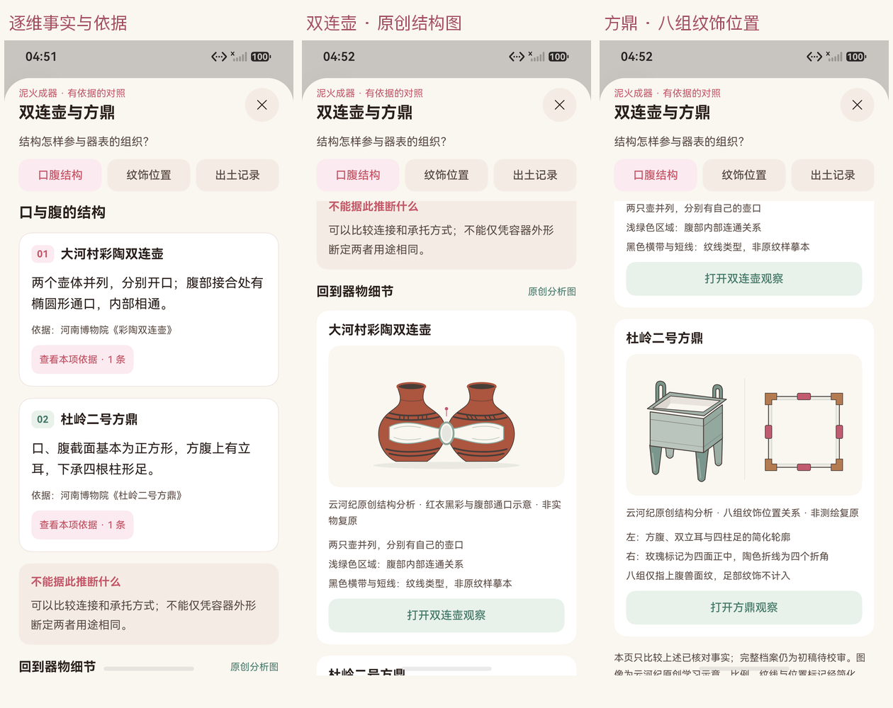

# 大河村观察、带画面手账与双连壶 / 方鼎对照

2026-10-17，HarmonyOS 7 / API 26，YunhejiSyncB。以下为通过 HDC / Hypium 直接连接模拟器所得的原生应用截图，使用独立随机库与离线浏览，不包含私人账号。

大河村样板记录 [报告](../../test-results/2026-10-17-170500-device.log) 对应的三个具体部位、主动右转后的保存、画廊与正式回放。对照页记录 [报告](../../test-results/2026-10-17-165119-device.log) 对应的三维事实、双方来源、完整原创分析图与返回详情入口。两个最终用例共 2/2，Failure / Error / Ignore 均为 0，包、源码与原图 SHA-256 绑定在[阶段记录](../../test-results/2026-10-17-observation-phases.json)。

选择“两只壶口”时看两个敞口与内壁；选择“红衣黑彩”时看横带和竖斜短线；选择“腹部通口”时示意剖开前壁，浅绿色通道表达内部相通关系。几何比例、纹线、壁厚和剖开均为学习解释，非实物照片、扫描或考古复原。选中的部位有浅底标签，其他部位保留可点击圆点。

保存角度为手动右转后的约 42°，热点为 `opening`。按真实布局裁取两次模型 Canvas，暖色模型区域逐像素一致；整片内部有 1 个背景像素在 R/G 通道各相差 1 级，位于近圆角处，原始差异与位置保留在记录中。画廊使用保存的原虚拟画幅等比重建；去除 contain 留白、对参考图等比缩放后，RGB 相关系数为 0.999190。具体边界、有效模型像素数和重采样误差见[像素记录](pixel-checks.json)。这些结果只覆盖本次模拟器与 Native 绘制配置，不代表 WebGL、真机或另一设备已验收。

三组对照为口腹结构、纹饰位置和出土记录，每项有各自事实、来源与推断边界。当前随包图像均为项目原创 SVG 学习示意，官方实物照片未取得随包许可。三处完整文化档案仍为初稿待校审。

| 原始截图 | SHA-256 |
|---|---|
| [mouth.png](mouth.png) | `C2110FC638BFEBB2490A1AAC801DA004E0D9760C1B05F46A5B32F75809669467` |
| [paint.png](paint.png) | `72C71B11124B961B0DA8E733D3CCD11E1FB7A961FF78E92D513CA4312F8584E6` |
| [opening.png](opening.png) | `76374C2358E8A05A62E5D6D194D8E18D0D899066F2F9AEB00063278AF8B64BF1` |
| [source-frame.png](source-frame.png) | `9ABEC636AE0D0C353AF70A852359B7440CC823E25B880BA8BE9B610D214DFD9A` |
| [gallery.png](gallery.png) | `43072193C324867413A4DF80A7FD8F4553B7216D668F246A4287BD7223448BC4` |
| [replay.png](replay.png) | `0C28997F3149270262E37A0FBB655B413A089DAF06C38FD532033D150B2F04DA` |
| [comparison-body.png](comparison-body.png) | `6ED61463098188F3FCDAC9D66794FE0D3913E5443622B67C90DDAD9FB07C392E` |
| [comparison-visuals-left.png](comparison-visuals-left.png) | `BF2192CA3DC7EC09461290171E5D1AAE159A3734081727B920CE5ED3DC4443AD` |
| [comparison-visuals-right.png](comparison-visuals-right.png) | `A688B4DF80F0B53881D8A4BCA4530CCBA4F86CE4BE1FEC75C9BD7DD6D7F2963D` |

原始 dumpLayout 与完整设备输出保留在本机忽略目录；布局文件哈希随阶段记录保存。上方总览只等比缩小与添加外部图注；回放对照只依据真实 Canvas 范围裁图，没有调色、重绘或替换应用画面。旧记录行为与格式边界见[实现说明](../../OBSERVATION_MEMORY.md)和[迁移说明](../../MEMORY_MIGRATION.md)。庙底沟 / 杜岭的同级精细观察、首页入口、同账号新手账双端和备用录像仍按[阶段规范](../../CORE_EXPERIENCE.md)继续。
