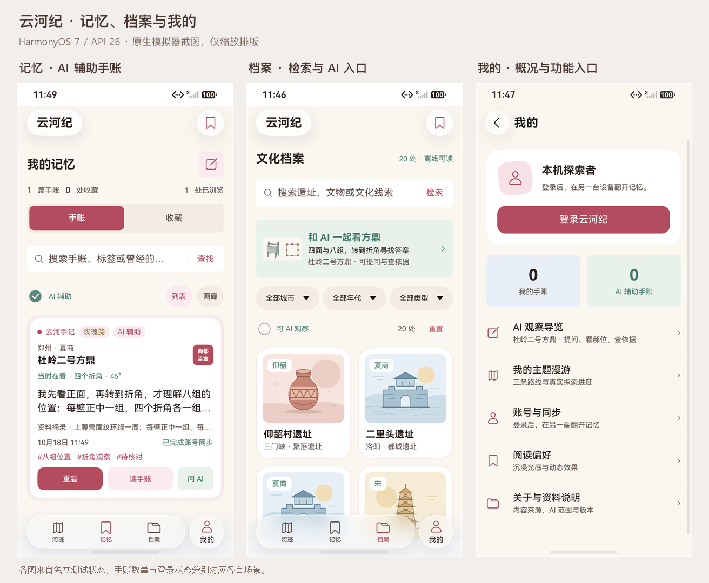
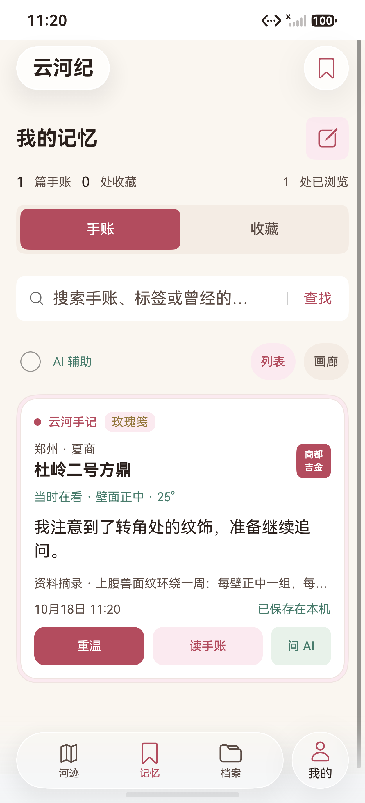
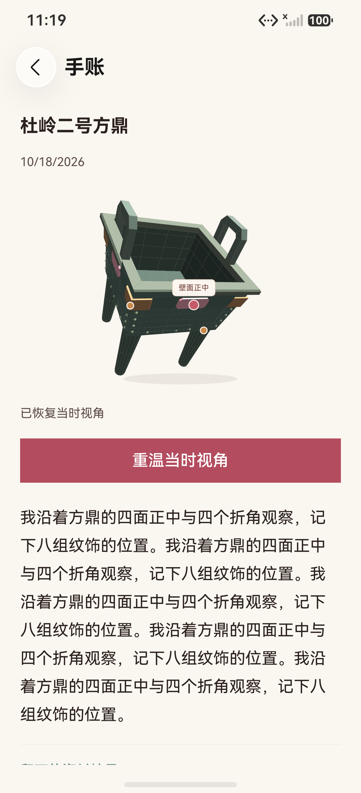
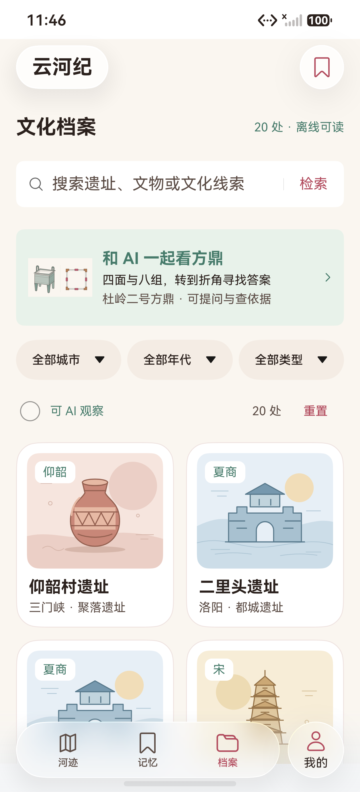
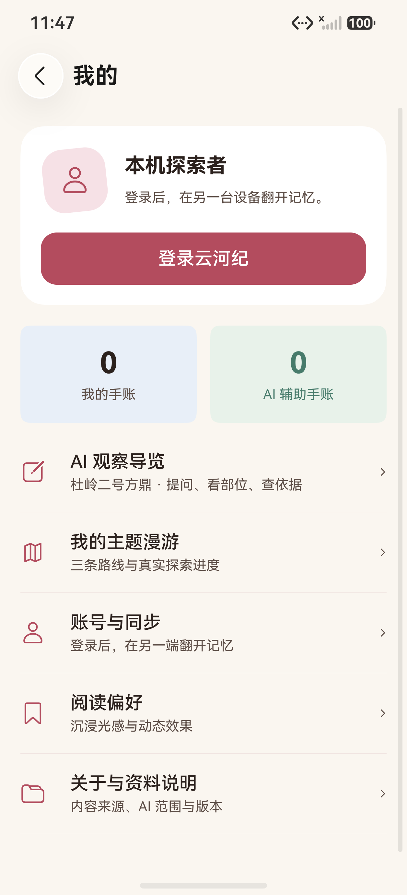
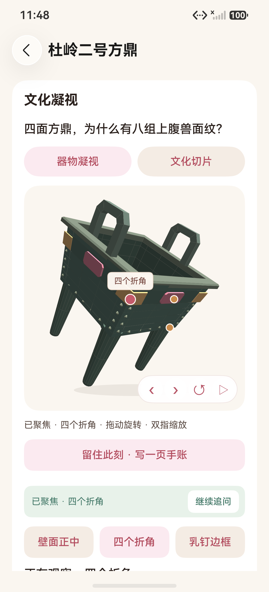
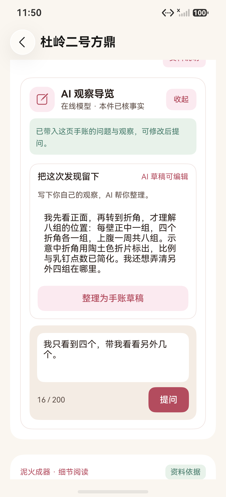

# 记忆、档案、我的与 AI 重访图集

记录日期：2026-10-18。截图来自 HarmonyOS 7.0.0.107 / API 26 手机模拟器上的原生应用，1256×2760、density 560。通过 HDC / Hypium / UiTest 获取，使用独立测试库和合成测试文字。图片没有补画页面；未采集含账号、密码或密钥的画面。

页面职责、问题与下一步任务见[页面检查与层级说明](../../PAGE_HIERARCHY.md)，逐次结果和失败记录见[测试报告第 27 节](../../TEST_REPORT.md#27-页面功能层级与-ai-重访2026-10-18)。

## 三页总览与采集版本

总览只缩放排列三张原图，并加入标题和场景说明。三图来自独立测试状态，不能根据不同页面的账号状态或手账数量推断为同一账号连续操作。

图集共 **15 张原始截图**，总览另计。其中 12 张来自最终包的 `114604` 报告；`memory-read.png`、`memory-replay.png`、`memory-list.png` 来自 `111850` 手账修复包。后者没有采集包哈希，未用最终包哈希替代。逐图哈希、所属用例、源码和包对应关系见[阶段清单](../../test-results/2026-10-18-page-hierarchy-phases.json)。

## 记忆：读自己的记录，再回到观察

手账和收藏分区；搜索正文、标签和曾经的问题；可筛选 AI 辅助手账。列表把“重温”“读手账”“问 AI”分成明确动作。已保存正文和原视角来自这次设备测试的真实保存。

手账详情展示完整正文、原视角、标签和摘录；下方提供编辑、原档案和删除。截图中的重复长正文是为了验证全文阅读而实际输入的合成文字。

| 其他画面 | 状态 |
|---|---|
| [空记忆](memory-empty.png) | 无记录时提供开始观察入口 |
| [正式重温](memory-replay.png) | 返回原档案并实际恢复手账视角 |
| [AI 手账筛选](ai-memory.png) | 用户采纳 AI 草稿后生成的真实记录；统计为 1 篇 |

## 档案：完整检索与明确的 AI 对象

关键词、城市、年代、类型和“可 AI 观察”共同筛选，结果数与空状态同步。AI 卡片明确指向杜岭二号方鼎，当前筛选出 1 处支持对象。

[组合条件没有结果](library-empty.png)展示“洛阳 + 可 AI 观察”的真实空状态；重置后恢复 20 处。

## 我的：概况与二级页面

概览只呈现身份、真实手账数和简短菜单。完整主题路线、账号同步、阅读偏好、关于和资料说明进入独立二级页。

| 二级页 | 画面 |
|---|---|
| 我的主题漫游 | [三条路线入口与真实进度](journeys.png) |
| 阅读偏好 | [关闭沉浸光感后的状态](preferences.png) |
| 关于与资料说明 | [集中说明来源、模型与 AI 范围](about.png) |

## AI：聚焦、保存与带着单篇手账重访

点击回答中的观察动作后回到当前模型，“四个折角”、高亮部位与聚焦反馈同屏。“继续追问”返回原面板并保留本次问答。

从手账进入时带入原问题与个人正文，显示预填提示，用户可修改后提交；个人观察输入框支持内部滚动。进入时不展示尚未请求的回答。

| 其他画面 | 状态 |
|---|---|
| [保存时的依据](ai-saved-evidence.png) | 在手账中展开保存时冻结的事实及来源 |
| [游客 AI 状态](ai-guest.png) | 如实提示登录后可用，手动观察与手写仍可操作 |

图片采集轮次与对应报告以测试报告为准。图集只证明图中明确展示的页面状态，不代表真机、平板、其他字体或所有历史用例均已通过。
