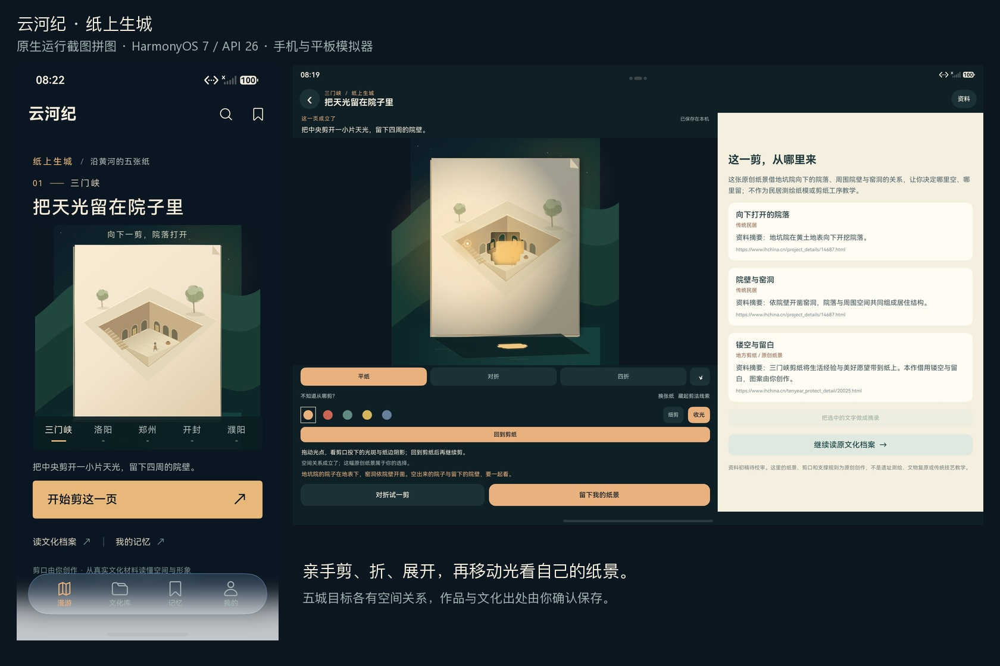

# 纸上生城：原生画面与证据索引

日期：2026-10-25。当前索引随[纸景交接](../../PAPER_JOURNEY_HANDOVER_20261025.md)建立，当前主包为本轮纸景 **M14**，最后定向测试包 **T15**；入口单例和最终原 A 接收均已各 1/1，T14 保存/分享阶段分别保留。阶段绑定、哈希和原始摘要见[机器清单](../../test-results/2026-10-25-paper-journey.json)，最新绑定已为 `m14-t15`。纸景 M12/T12 也属于本轮，不是 2026-10-23 的旧漫游 M12。M14 原图与相邻 layout 已归档，`images.json` 保留文件哈希，`overview.jpeg` 为真实截图等比拼图；图像表与公开图片检查由主任务维护。

| 画面组 | 应保留的原生内容 | 当前状态 |
|---|---|---|
| 首次四页签 | 五城新首页、文化库实景图与检索、记忆空态、我的真实数量 | 首轮通过，首次可运行包未固化 HAP 哈希。M14/T14 手机整套 1/2、Error 1 保留；M14/T15 入口单例改走真实页签后 **1/1、152598 ms**，不与 T14 保存用例拼成同次 2/2。M14 四页签原图/layout 已归档。 |
| 五城纸景 | 各城真实剪口、目标反馈、展开/透光；包含断纸可撤回的可见反馈 | 纸景 M8 阶段，停止本任务 HTTPS 服务后平板五城均由真实原生手势达成目标；[逐城 JSONL](../../test-results/2026-10-25-paper-five-city-gestures.jsonl)不是 Hypium 5/5。图库中的 M14 画面为回读先前实际作品，不称五城重新制作。 |
| 记忆收存与冷重开 | 当前作品、亲笔正文、冻结来源、原收藏保留、重开后同一 note | 首轮通过；M14/T14 保存/撤销/冷重开/旧收藏用例再次通过 101283 ms，整套另有入口 Error。达成目标不自动保存，确认后才冻结；M14 回读记忆及系统栏深字画面已归档。 |
| HTTPS A → B → 原 A | A 已存作品、B 同一 note 和续剪、A 新剪口与原冻结 note | 初轮分别为纸景 M5/T4、M6/T5、M8/T6，各 1/1；最终 M14/T15 原 A 接收另 **1/1、97001 ms**，[最终完整比较](../../test-results/2026-10-25-paper-sync-final-comparison.json) PASS，四阶段冻结 note/三条来源与新 mask 均准确。全文比较以该文件为准，图集保留 M14 实际回读画面。 |
| 独立移光 | 手指移动光位、真实 mask 投影改变、切回继续剪纸 | 纸景 M12/T12，1/1；投影区域 66,444 像素内 13,921 改变，raw/body/mask/时间戳不变。M14 实际移光画面与 layout 已归档，自动断言仍按 M12/T12 归属。 |
| 平板资料/选摘 | 真实内容宽度分栏、跨 Text 选择、摘录卡、UDMF 进入草稿、明确确认后重读 | 纸景 M12/T12，1/1；完整 292 字摘录与三条来源保存重读保持。此前真实 Sheet 遮挡正文缺陷与两次 Error 保留，修复后独立通过；选摘行为以本行原始报告/事件为证，不从 M14 记忆回读图扩大覆盖。 |
| 两张桌面卡片 | 当前纸景城市和精确 note 的冷/热 Ability 路由 | 纸景 M12/T12 自动专项 1/1。M14 平板另人工完成两张真实桌面卡的整进程强停后冷路由与热路由，共四次，分别打开已存濮阳作品与唯一三门峡 note；不计 Hypium Pass。两张本轮新卡已逐卡确认移除，其他卡保留，独立试玩库有意保留。 |
| 系统分享 | 含本次真实剪口的 PNG、系统面板和取消后的原记录保持 | 纸景 M8/T6 首轮 1/1；M14/T14 复跑 **1/1、56806 ms**，真实剪口区域 2,988 像素改变、文字区域 0 差异，取消后完整快照与 note 版本保持。实际分享行为以该次原始报告与事件为证。 |

已核对的原始报告入口：

- [手机首轮 2/2](../../test-results/2026-10-25-175839-d3c8a851-device.log)。
- [A 保存 1/1](../../test-results/2026-10-25-184037-28083ff3-device.log)。
- [B 接收续剪 1/1](../../test-results/2026-10-25-184732-911d4d70-device.log)。
- [原 A 接收 1/1](../../test-results/2026-10-25-185312-f252f99b-device.log)。

## M14 原生运行画面

以下均来自 API26 手机或真实 tablet 类型模拟器的原生窗口。手机为独立空态视觉库，平板为独立创作视觉库；平板五城作品来自本轮先前的真实剪切，M14 图集再次回读并核对完成状态。数量、完成反馈和纸景不代表用户正式账号的个人经历。全尺寸原图与同次布局成对保留，路径及 SHA-256 见 [images.json](images.json)。

`overview.jpeg` 只做原图等比拼接，没有合成控件、剪口或成功状态。

| 画面 | 原尺寸图片 | 相邻原生布局 | 可见内容 |
|---|---|---|---|
| 手机首页 | [原图](phone-home.jpeg) | [layout](phone-home.json) | 首次直接选城、纸景主视觉和主操作。 |
| 手机文化库 | [原图](phone-library.jpeg) | [layout](phone-library.json) | 22 条档案、实景图、搜索/筛选与原文入口。 |
| 手机记忆空态 | [原图](phone-memory-empty.jpeg) | [layout](phone-memory-empty.json) | 没有预填个人感想或伪造收藏。 |
| 手机我的 | [原图](phone-profile.jpeg) | [layout](phone-profile.json) | 本机数量、HTTPS 与可信通道分别表达。 |
| 平板首页 | [原图](tablet-home.jpeg) | [layout](tablet-home.json) | 宽屏文字与原创纸景并排。 |
| 三门峡 | [原图](tablet-create-smx.jpeg) | [layout](tablet-create-smx.json) | 中央敞开、周围院壁和窑洞，显示真实剪口。 |
| 洛阳 | [原图](tablet-luoyang.jpeg) | [layout](tablet-luoyang.json) | 河窗贯通，两岸仍保留。 |
| 郑州 | [原图](tablet-zhengzhou.jpeg) | [layout](tablet-zhengzhou.json) | 两道上口与下部相通的空间关系。 |
| 开封 | [原图](tablet-kaifeng.jpeg) | [layout](tablet-kaifeng.json) | 分离光窗与相连纸骨。 |
| 濮阳 | [原图](tablet-puyang.jpeg) | [layout](tablet-puyang.json) | 离散碎光与整体轮廓。 |
| 移动光源 | [原图](tablet-light.jpeg) | [layout](tablet-light.json) | 光点、纸边阴影与实际 mask 的承光面投影。 |
| 记忆草稿 | [原图](tablet-memory-draft.jpeg) | [layout](tablet-memory-draft.json) | 宽幅原生 Sheet，用户决定感想及是否保存。 |
| 记忆首页 | [原图](tablet-memory.jpeg) | [layout](tablet-memory.json) | 唯一一篇经明确确认保存的纸景。 |
| 冻结记忆详情 | [原图](tablet-memory-detail.jpeg) | [layout](tablet-memory-detail.json) | 保存时的作品、空感想说明、出处和后续补写入口。 |
| 平板文化库 | [原图](tablet-library.jpeg) | [layout](tablet-library.json) | 宽屏资料阅读；真实照片与原创纸景分别表达。 |
| 平板我的 | [原图](tablet-profile.jpeg) | [layout](tablet-profile.json) | 同一账号个人延续的状态入口。 |
| 两张本轮桌面卡 | [原图](tablet-desktop-cards.jpeg) | [layout](tablet-desktop-cards.json) | 已保存濮阳纸景与三门峡记忆，均有真实 formId。 |
| 整进程冷开纸景 | [原图](tablet-card-cold-paper.jpeg) | [layout](tablet-card-cold-paper.json) | 外部强停后点击真实卡片，打开已存濮阳作品。 |
| 热开纸景 | [原图](tablet-card-hot-paper.jpeg) | [layout](tablet-card-hot-paper.json) | onNewWant 消费同一张城市卡的路由。 |
| 整进程冷开记忆 | [原图](tablet-card-cold-memory.jpeg) | [layout](tablet-card-cold-memory.json) | 外部强停后回到唯一一篇三门峡记忆。 |
| 热开记忆 | [原图](tablet-card-hot-memory.jpeg) | [layout](tablet-card-hot-memory.json) | 真实记忆卡恢复原作品与正文页。 |

桌面四条人工定向结果见 [process 摘要](../../test-results/2026-10-25-paper-desktop-process.json)，不增加 Hypium 的 Tests/Pass。两张本轮临时卡已逐卡移除，原有卡片保留；清理后可能出现的既有卡片图不公开。视觉库有意保留以便复看，正式档案与账号库未清空。系统分享与 UDMF 的当前包通过结论按原始报告/事件核对，没有拿前一版截图作为本轮成功证据。
- [首轮分享 1/1](../../test-results/2026-10-25-185816-c2aa6b93-device.log)及[分享事件](../../test-results/2026-10-25-paper-share-events.log)。
- [移光 1/1](../../test-results/2026-10-25-193617-176248fd-device.log)及[移光事件](../../test-results/2026-10-25-paper-light-events.log)。
- [平板选摘/UDMF 1/1](../../test-results/2026-10-25-193617-3c104dc7-device.log)及[摘录事件](../../test-results/2026-10-25-paper-excerpt-events.log)。
- [桌面卡片 1/1](../../test-results/2026-10-25-193737-ade3eb47-device.log)及[路由事件](../../test-results/2026-10-25-paper-forms-events.log)。
- [M14/T14 手机整套 1/2、Error 1](../../test-results/2026-10-25-194540-78673705-device.log)：保存用例通过，入口原 Error 保留。
- [M14/T15 入口单例 1/1](../../test-results/2026-10-25-195908-50c4ff34-device.log)，152598 ms。
- [M14/T14 分享 1/1](../../test-results/2026-10-25-194541-1c838f41-device.log)及[最终分享事件](../../test-results/2026-10-25-paper-share-final-events.log)。
- [M14/T15 最终原 A 接收 1/1](../../test-results/2026-10-25-200417-ebfb8482-device.log)，97001 ms；[最终回 A 事件](../../test-results/2026-10-25-paper-sync-final-return-events.log)与[最终完整比较 PASS](../../test-results/2026-10-25-paper-sync-final-comparison.json)。
- [本任务服务停止记录](../../test-results/2026-10-25-paper-offline-service.json)：18443 监听为 0，不代表整机断开全部网络。
- [M14 桌面整进程冷/热四次人工路由及移卡摘要](../../test-results/2026-10-25-paper-desktop-process.json)：人工结果不加 Hypium Pass；独立视觉库留给用户试玩，公开图集不引用露出既有卡的清理图。
- [本机 18443 服务恢复](../../test-results/2026-10-25-paper-service-restored.json)：health 200，现有模拟器数据保留。

## 证据适用范围

本轮实际原图和 layout 已归档，公开图像表由主任务维护。M14/T14 手机整套 1/2、Error 1 和分享 1/1 保留；M14/T15 入口与最终原 A 接收分别 1/1，不与 T14 保存用例改写成同一 T15 整套 2/2。真人趣味、理解程度和实际单城时长尚未校准；旧 Word/PDF、视频和赛事 RAR 未更新。

图集按设备/方向、主包与测试包阶段、实际操作和相邻 layout 说明证据；公开图片检查由主任务维护，不公开账号、口令、token 或其他私人信息。原创纸景、真实遗址照片与考古复原的身份分别说明，纸面光影不称作系统材质。最终验证范围与保留失败见[测试报告第 35 节](../../TEST_REPORT.md#paper-journey-20261025)。
