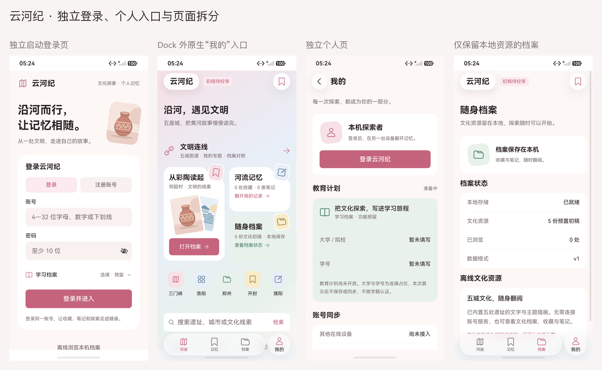
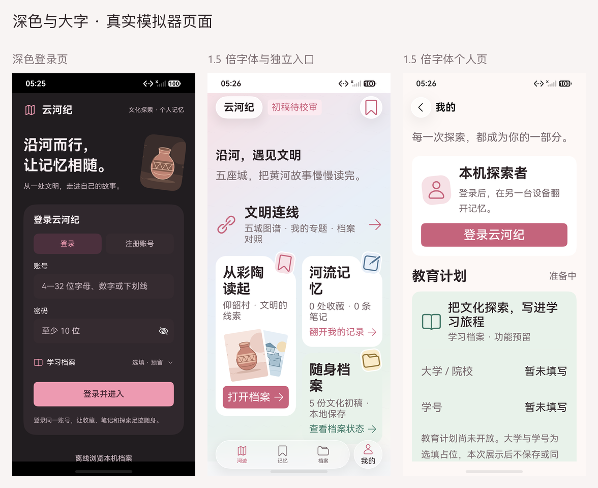
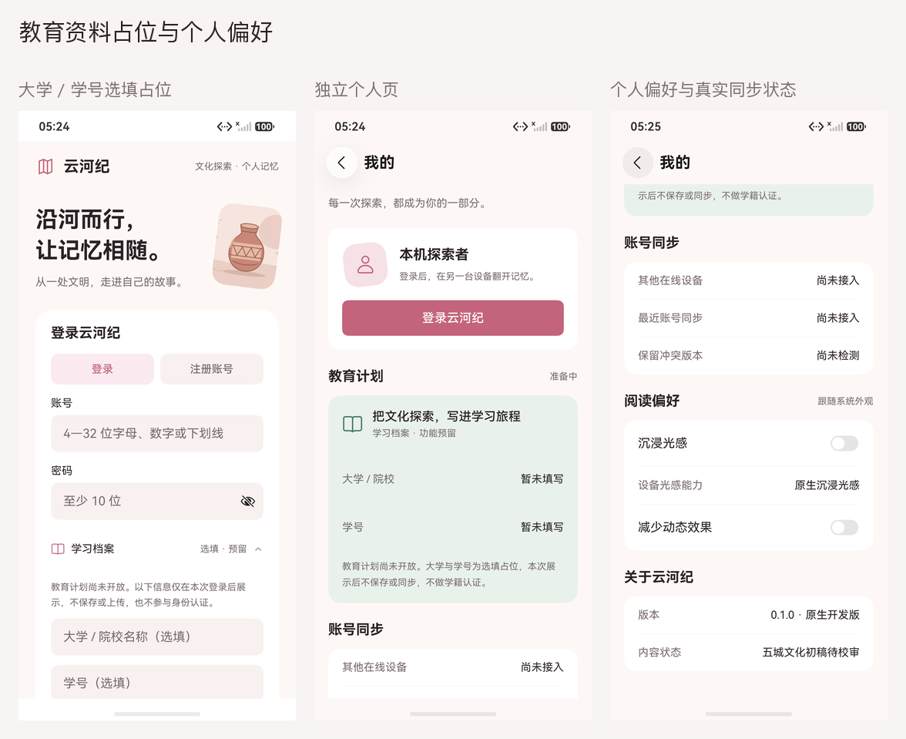

# 独立登录与“我的”：真实原生截图

日期：2026-10-16。12 张原图来自最终 `ProfileLoginTest` 4/4，原始报告为 [172404-device.log](../../test-results/2026-10-16-172404-device.log)。设备为 YunhejiSyncB，HarmonyOS 7.0.0.107 / API 26，1256×2760、density 560；恢复启动后 HDC 地址为 `127.0.0.1:5555`。

| 原图 | 实际页面 |
|---|---|
| [login.png](login.png) | 启动后独立登录页，主内容和 Dock 尚未创建 |
| [education.png](education.png) | 展开大学 / 学号选填区；内容可滚动，提交按钮在下方 |
| [home.png](home.png) | 三项原生 Dock，右侧另有独立圆形“我的”miniBar |
| [archive.png](archive.png) | 档案仅保留本地保存、资源、浏览与格式状态 |
| [mine.png](mine.png) | 独立“我的”：账号区和教育计划占位 |
| [settings.png](settings.png) | 个人页下方的真实同步状态、偏好、关于；光感开关实际关闭并已回读落盘 |
| [login-dark.png](login-dark.png) | 核对深色资源后的登录页 |
| [home-dark.png](home-dark.png) | 深色原生 Dock 与独立“我的”入口 |
| [mine-dark.png](mine-dark.png) | 深色个人页 |
| [login-large.png](login-large.png) | 实际 1.5 倍字体，滚到登录表单与提交区 |
| [home-large.png](home-large.png) | 实际 1.5 倍字体，导航标签处于独立 miniBar 内 |
| [mine-large.png](mine-large.png) | 大字个人页，正文 / 卡片高度自适应，其余内容通过滚动阅读 |

12 张最终截图已人工查看，图集只等比缩放和排列，在画面外添加页名，没有补画原生 UI。账号字段为空，“我的”为本机模式，不包含真实账号、密码、学校或学号。真实注册 / 登录测试使用随机独立账号和合成教育信息，不采集身份页截图。

大学 / 学号目前只在本次成功登录后展示，不存储、上传、参与认证或生成教育计划；学号隐藏具体内容。教育计划始终标为“准备中”。完整行为见 [页面说明](../../LOGIN_PROFILE.md)。

独立入口由官方 HDS `miniBar` 托管，三项 `TabContent` 不变，不将自绘玻璃当作原生材质。固定导航标签最高为 1.2 倍，图标为 vp；正文 / 表单仍响应系统字体。最初大字图曾挤满圆形入口，旧图留在本地忽略的 `entry/build/test-evidence/profile/initial/`，不混入最终图集。

最终主包 / 测试包、报告、原图与图集 SHA-256 见 [captures.json](captures.json)。保留的失败、一次中断、当前覆盖和未验证窗口范围见 [测试报告第 13 节](../../TEST_REPORT.md)。
