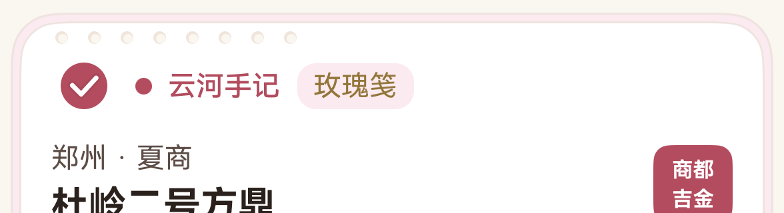

# 手账卡的局部邮票打孔

2026-10-20，HarmonyOS 7 / API 26 模拟器实拍。

## 目标

在卡片边缘**局部**呈现横向排列的邮票打孔效果，而不是把组件做成带齿孔轮廓的贴片造型：

- 只在组件排版留白处出现一串等距圆孔，其余边缘保持原样；
- 孔洞靠背景色透出与内阴影表现，不是白色填充点；
- 组件的尺寸、圆角、边框、阴影与交互一律不变。

孔串位于卡片顶部留白带内，左对齐内容起始边（距卡左 19vp），纵向位于外层纸边与首个内容行之间（距卡顶 8vp），长度 8 孔、孔径 5.4vp、孔心间距 14vp，占卡宽约 1/3。

## 孔洞的画法

每个孔由两层构成：

| 层 | 颜色 | 作用 |
|---|---|---|
| 底层整圆 | `surface_sunken` | 露出的月牙即孔壁内阴影 |
| 上层错位小圆 | `canvas` | 真正“透出”页面背景的孔洞 |

用语义色而非字面色值，深浅色主题都成立：`sunken` 在两种主题下都比卡片底色更暗，`canvas` 就是页面背景色。**未使用 `stroke`**：当前 SDK 的描边颜色只接受字符串，写死会失去主题适配。

## 不变量

- 卡片本体仍是原来的 `Column`，`padding(3)`、圆角 20 / 17、1px 描边、纸色底全部未改；打孔层是 `Stack` 中的绝对定位覆盖物，不参与布局计算。
- 覆盖层 `hitTestBehavior(HitTestMode.None)`、`accessibilityLevel('no')`：不拦截点击、滚动、长按，也不进入无障碍树。
- 像素级对比：与改动前同一画面基线相比，除孔串带（x 94–484）与状态栏时钟外**零像素差异**；卡片上边缘像素行位置完全一致（y=1847），即位置、尺寸、圆角均未变。

## 涉及文件

| 文件 | 修改点 |
|---|---|
| `entry/src/main/ets/components/PunchRow.ets` | 新增。横向等距孔串组件：`count / spacing / diameter / offsetX / offsetY` 可调，孔洞两层画法与主题适配注释 |
| `entry/src/main/ets/components/MemoryPostcardItem.ets` | 卡片根节点由 `Column` 改为 `Stack` 承载覆盖层；新增 `PunchRow` 导入与一行打孔串，置于顶部留白带 |

## 验证

| 检查 | 结果 |
|---|---|
| 本地测试 | **113/113**，报告解析 9/9 |
| 主包 / 测试包 | 均 `BUILD SUCCESSFUL` |
| 设备用例 | `PageHierarchyTest#memory_sort_tag_batch_and_profile_data` **1/1**（99.9 s，Failure / Error / Ignore 0），日志 `docs/test-results/2026-10-20-221330-device.log` |
| 像素对比 | 孔串带外零差异，卡片几何位置一致 |

## 后续可调项

- 需要更强/更弱的存在感时，改 `PunchRow` 的 `diameter` 与 `spacing`，不动宿主卡片；
- 若要在首页纸卡上复用，建议先确认该卡留白带位置——纸卡的“撕页”轮廓不是矩形，矩形孔串会压在轮廓外。
