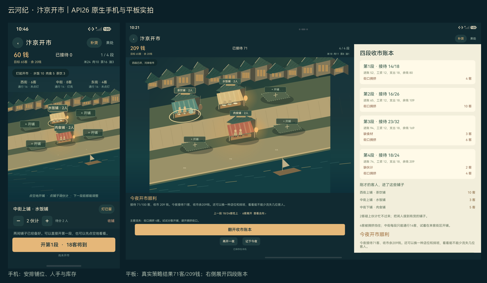

# 《汴京开市》原生画面

2026-10-25，当前产品M3、定向测试T4。以下均来自实际HarmonyOS 7 / API26模拟器，手机1256×2760，平板2880×1920、device type tablet。没有浏览器预览、重绘应用内容或预填经营结果。拼图只按比例缩小原图。

## 进入与安排

| 画面 | 实际入口 |
|---|---|
| [手机首页原图](phone-home.jpeg) | 新独立游客库，未登录、未保存经营进度。主按钮与旧纸景/档案入口在Dock上方。 |
| [手机安排原图](phone-arrange.jpeg) | 两铺起家，点铺调伙计、点空地开铺；目标、库存、三区需求和灯火同时可见。 |
| [平板首页原图](tablet-home.jpeg) | 按实际容器宽度排为文字与场景并列。 |
| [平板安排原图](tablet-arrange.jpeg) | 场景与需求/街灯资料并列，业务使用完整NavDestination宽度。 |

## 实际经营与个人记忆

| 画面 | 对应行为 |
|---|---|
| [手机策略收市](phone-strategy-final.png) | 经真实点击建茶铺、分配伙计、六次补货和街灯调整得到71客/209钱。 |
| [平板策略收市](pad-strategy-final.png) | 同一公开规则在平板实际操作，右侧四段账本分别展示流失原因。 |
| [手机记忆原图](phone-memory-final.png) | 测试亲手输入的文字，明确确认保存普通note后，结束并重开Ability，从记忆页打开同一篇全文。 |
| [平板记忆原图](pad-memory-final.png) | 同样核对正文、短引、卷次、来源及冻结的当次成绩；不是同账号接收测试。 |

## 保留问题

[首轮平板输入失败原图](first-tablet-keyboard-failure.png)显示RESIZE_ONLY时键盘遮住输入框。改为系统先平移再缩放、Scroll从顶部排起后，手机/平板真实输入保存均通过。

[确认框定位失败原图](first-alert-selector-failure.png)显示原生Alert已出现，测试却把其Text操作文案按Button类型查询。后续测试按实际AlertDialog后代匹配，产品确认逻辑未改；原始Error保留。

本轮图片只证明实际画面与操作结果。是否愿意反复游玩、真人上手耗时和实机帧率仍待试玩。实现与性能边界见[经营交接](../../RIVER_MARKET_HANDOVER_20261025.md)，原始Pass/Failure/Error和包哈希见[测试报告第36节](../../TEST_REPORT.md#river-market-20261025)。
