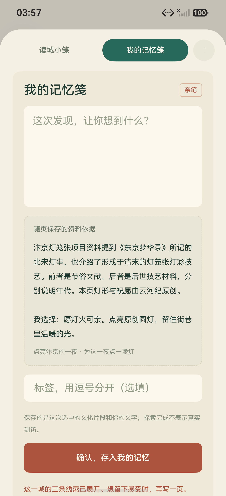
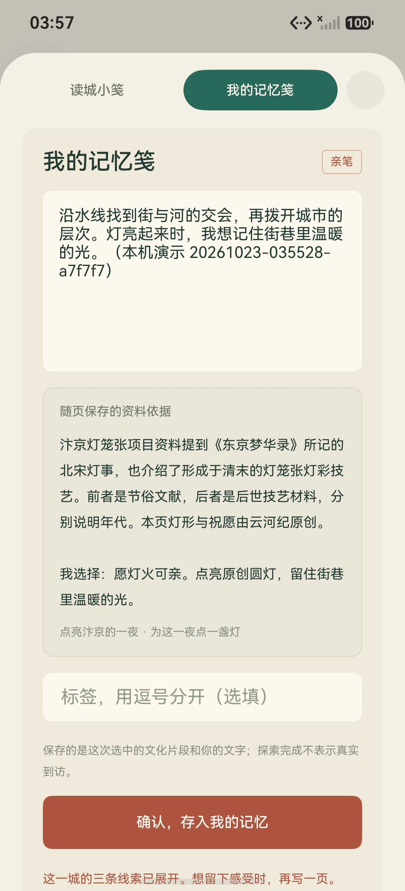
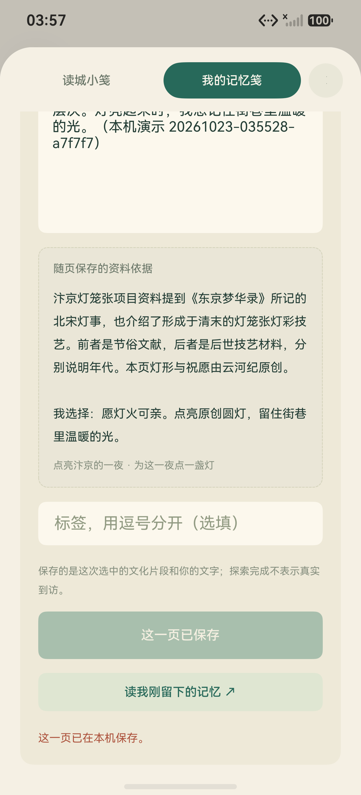
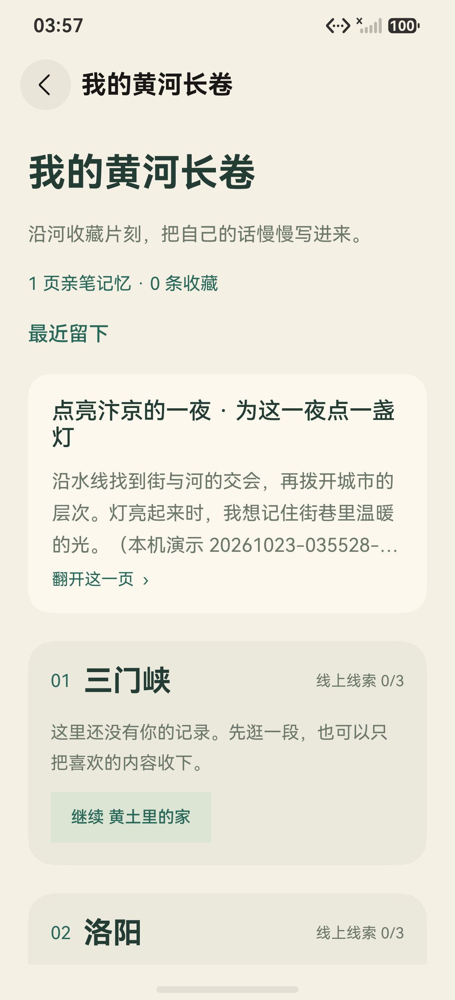
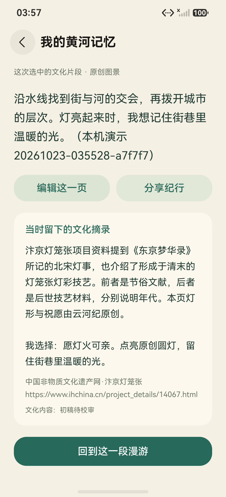
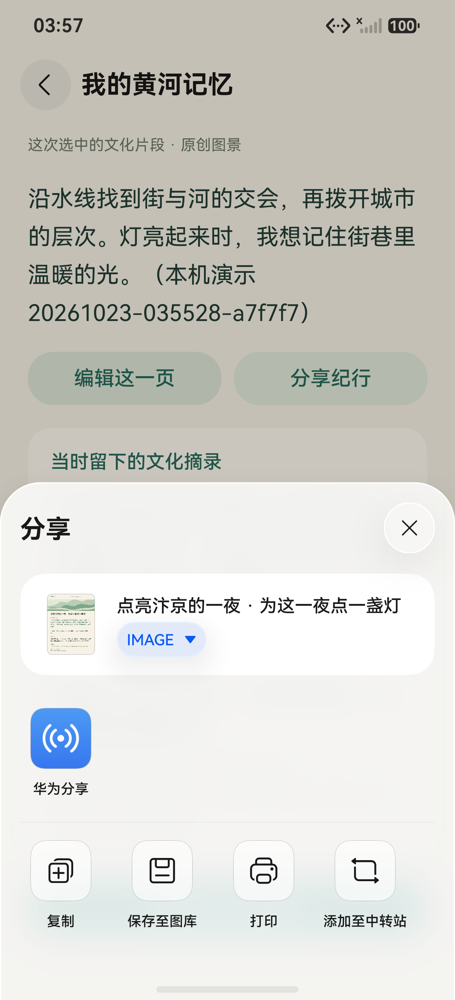
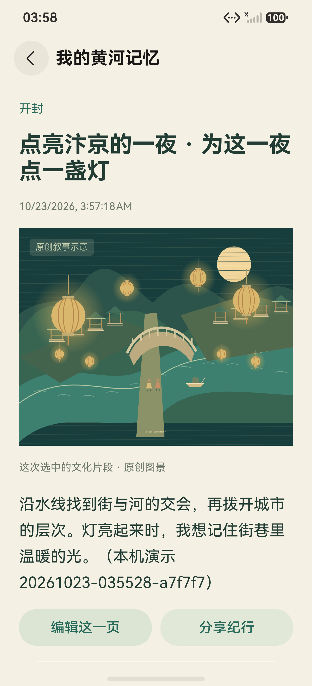

# M12 五城漫游完整原生演示

日期：2026-10-23。主线程在手机 `127.0.0.1:5555` 使用 **M12** 主包，实际执行公开的 [roaming-demo.py](../../../../tools/roaming-demo.py)，最终 [原始 result.json](result.json) 为 **`completed`**，阶段为 `native-share-cancel`，共 **383 条真实 HDC 命令**。命令包括布局读取、真实输入与点击、截图及文件传输；已核对编号连续、目标均为该手机、命令全部完成且退出码为零。

本轮走完：**原生五城题签 → 开封三条真实线索 → 空白感想 → 原生输入 → 明确确认保存 → 长卷顶部最近记忆 → 原文与出处 → 真实系统分享面板 → 取消后回读同一页**。运行、准备与停止方式见 [ROAMING_DEMO.md](../../../ROAMING_DEMO.md)。

本脚本完成开封三条线索，其他四城共 12 条线索的独立结果见[四城证据](../four-cities/README.md)。

| 项目 | 本轮实际值 |
| --- | --- |
| 运行编号 | `20261023-035528-a7f7f7` |
| 独立测试库 | `yunheji_test_ui_roaming_demo_m12_r3` |
| 主包 | M12，7629427 字节 |
| 主包 SHA-256 | `FD6E7B3C89A155528FC9166B012AF96DB029DFE8AA379EC4ED669FBECD517094` |
| 命令 | 383 条真实 HDC 命令；逐条审核信息与源日志哈希见 [evidence.json](evidence.json) |
| 原生截图 | 14 张成功阶段 PNG，均为 1256 × 2760 原图，另有 14 份对应原始应用布局 |
| 个人记录 | 先验证感想为空，再输入公开测试文字；确认后长卷显示 1 页亲笔记忆、0 条收藏 |
| 网络边界 | 全程断开该手机到任务账号服务的 `tcp:18443` HDC reverse，未关闭设备全部网络 |
| 双端接续 | 本轮不执行，原始结果 `twoDeviceSyncVerified: false` |

## 逐阶段原始文件

全部成功截图均已实际查看，布局已检查没有登录表单、账号密码或个人设置页节点。PNG 与布局逐字节复制并核对哈希，没有重绘、裁切、拼接或修改 App 内容；下方预览只按比例缩放显示原文件。

| 阶段 | 原生原图 | 对应原始布局 |
| --- | --- | --- |
| 01 原生漫游首页与五城题签 | [01-native-home.png](01-native-home.png) | [布局](01-native-home.layout.json) |
| 02 选定开封与初始目标 | [02-kaifeng-selected.png](02-kaifeng-selected.png) | [布局](02-kaifeng-selected.layout.json) |
| 03 水线滑条与街河交会选择 | [03-kaifeng-interaction.png](03-kaifeng-interaction.png) | [布局](03-kaifeng-interaction.layout.json) |
| 04 时间观察窗与桥的层次选择 | [04-kaifeng-interaction.png](04-kaifeng-interaction.png) | [布局](04-kaifeng-interaction.layout.json) |
| 05 阅读灯事短笺 | [05-lantern-reading.png](05-lantern-reading.png) | [布局](05-lantern-reading.layout.json) |
| 06 选择祝愿、真实点亮灯景 | [06-lantern-lit.png](06-lantern-lit.png) | [布局](06-lantern-lit.layout.json) |
| 07 初始空白个人感想 | [07-blank-personal-thought.png](07-blank-personal-thought.png) | [布局](07-blank-personal-thought.layout.json) |
| 08 原生输入并回读公开测试文字 | [08-personal-thought-input.png](08-personal-thought-input.png) | [布局](08-personal-thought-input.layout.json) |
| 09 明确确认保存与本机成功提示 | [09-saved-on-device.png](09-saved-on-device.png) | [布局](09-saved-on-device.layout.json) |
| 10 长卷顶部“最近留下” | [10-top-recent-note.png](10-top-recent-note.png) | [布局](10-top-recent-note.layout.json) |
| 11 同一页亲笔原文与原创图景 | [11-saved-memory-body.png](11-saved-memory-body.png) | [布局](11-saved-memory-body.layout.json) |
| 12 冻结文化摘录、来源标题与完整网址 | [12-saved-memory-source.png](12-saved-memory-source.png) | [布局](12-saved-memory-source.layout.json) |
| 13 真实系统分享面板 | [13-native-share-sheet.png](13-native-share-sheet.png) | [布局](13-native-share-sheet.layout.json) |
| 14 取消分享并返回同一页原文 | [14-share-cancelled.png](14-share-cancelled.png) | [布局](14-share-cancelled.layout.json) |

| 空白感想 | 实际输入 | 本机保存 | 顶部最近页 |
| --- | --- | --- | --- |
|  |  |  |  |

| 保存的原文 | 保存的出处 | 系统分享 | 取消后回读 |
| --- | --- | --- | --- |
|  |  |  |  |

空白感想图中的资料依据是独立摘录区域，`roam-note-body` 的文本确实为空；输入后与保存回读的正文均匹配本轮公开测试文字。长卷首卡预览会按真实 UI 省略长文本，完整原文在第 11、14 张图与对应布局中回读。

## 分享取消的整库对比

脚本完成一次系统分享展示与取消后，主线程对同一独立库另做了一次分享取消专项。整个 Preferences 文件在操作前后均为 **6705 字节**，内容逐字节一致，SHA-256 均为：

```text
D215232CB8E443D887D43E320FC6321473BF761C81FB092056FBA18D1D283A86
```

[原始安全对比 JSON](share-cancel-comparison.json) 记录 `wholePreferencesIdentical: true`。该专项不计入脚本的 383 条命令；此处公开字节数、哈希与比较结果，不公开 Preferences XML。分享面板没有选择联系人、华为分享、复制、图库、打印或中转站操作，没有向外部接收人发送。

## 保留的前次失败

| 运行 | 真实停止位置与边界 | 保留材料 |
| --- | --- | --- |
| M11，237 条命令 | 灯景已经确认，“这一城，已展开”可见；脚本在页中等待被裁出可访问布局的页首进度，未进入个人感想保存。随后改为有界滚回目标后再核对原文字。 | [失败现场原图](failures/demo-m11-lantern-failure.png) · [原始结果的安全摘要](failures/m11-offscreen.result-summary.json) |
| M12 前次，241 条命令 | 三条线索已完成，空白感想框已经聚焦；系统键盘栏被脚本误认作遮挡，尚未输入或保存。随后按已初始化输入法、焦点及关联窗口结构修复，账号页、隐私同意与未知遮挡继续阻断。 | [失败现场原图](failures/demo-m12-input-failure.png) · [原始结果的安全摘要](failures/m12-keyboard-guard.result-summary.json) |

安全摘要保留原始结果哈希、状态、阶段、命令数和未保存边界。完整失败中间帧、命令日志和键盘回归用 raw fixture 继续留在本机，不把含本机路径的日志或完整系统 fixture 复制到公共目录。成功结果没有覆盖这两次失败。

## 能力和公开范围

本次完成状态证明这条单端原生路径已经实际走通。手机到任务账号服务的 `18443` reverse 全程断开；前后映射状态的原始返回及源文件哈希记在 [evidence.json](evidence.json)，没有把服务端口隔离写成设备全网断开。

本次没有证明同账号双端同步、鸿蒙可信设备传输或华为账号能力，也没有真人三分钟计时。个人文字来自公开测试输入；文化材料继续显示“初稿待校审”，原创图景用于阅读关系，不作为历史完整复原或真实到访证明。

目录只包含已经检查的原生 PNG、应用布局、原始成功结果、安全分享对比与失败摘要，不包含私有 XML、系统 raw fixture、HAP、签名、账号事件混合日志或原始命令日志。原始证据文件与失败摘要的路径、哈希见 [evidence.json](evidence.json)。
