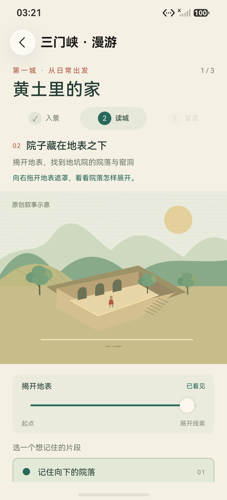
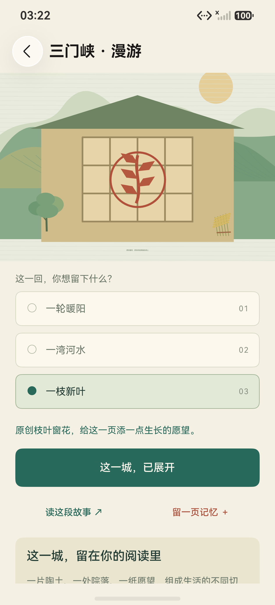
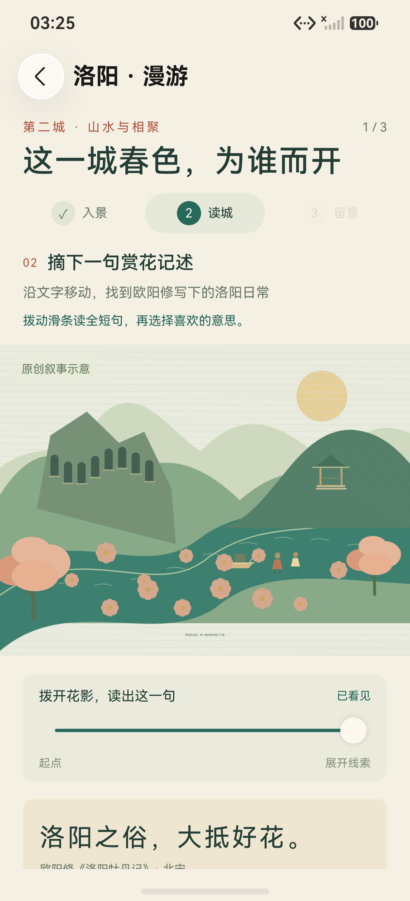
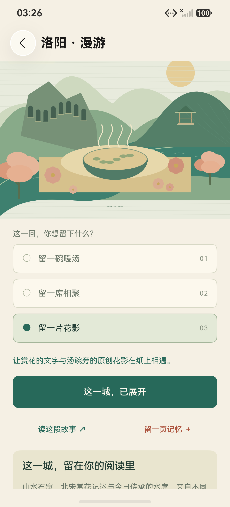
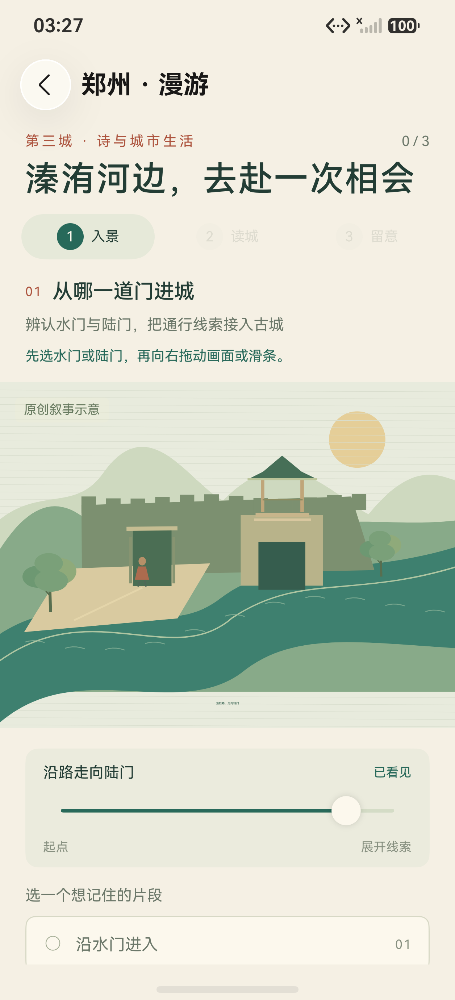
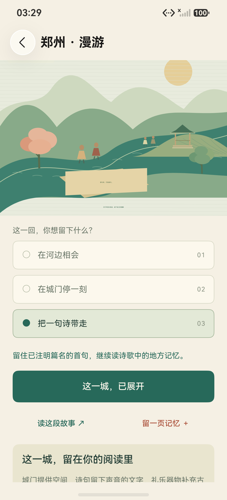
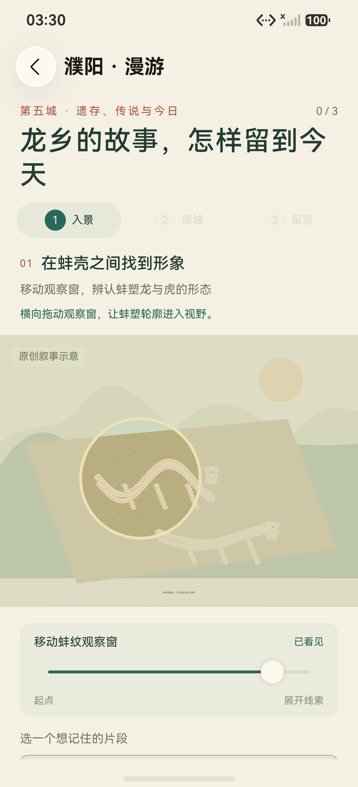
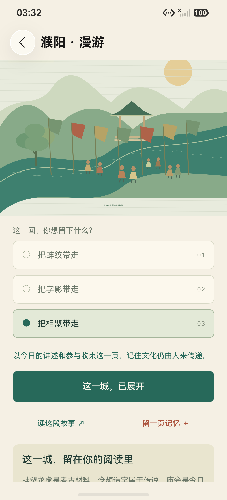

# 四城原生交互与完成反馈证据

日期：2026-10-23。本目录保存手机 `127.0.0.1:5555` 上三门峡、洛阳、郑州、濮阳四个定向用例的原始截图与布局。四例均返回 **Pass 1 / Failure 0 / Error 0 / Ignore 0**，共 **12 条真实探索线索落盘，0 条自动个人笔记、0 条自动收藏**。

四城按顺序单独执行，每例参数为 `ExpectedTests 1 / TestTimeoutMs 600000`。三门峡、洛阳、郑州使用 **M11 / T9**，濮阳使用 **M11 / T10**。T10 只调整另一项平板用例的观察步骤，本目录没有把前三城改记为 T10。

[evidence.json](evidence.json) 记录各城用例、实际落盘选择、包哈希、报告哈希、32 个原始文件的路径与哈希、选用图片及端口操作的原始返回。全部路径使用仓库相对路径，无本机开发目录、凭据或 HAP 文件。

## 原图与选用范围

本目录共有 **16 张 PNG 和 16 份对应 JSON 布局**。PNG 均为设备直接生成的 **1256 × 2760** 原图，复制后逐字节及 SHA-256 核对一致，没有重绘、裁切、拼接、覆盖文字或补画界面。每城选用的一张交互图和一张完成图均已实际查看。

下表按宽 240 像素等比显示原文件，可点击原图链接使用完整分辨率；这里的展示缩放不改变原始文件。

| 城市 | 选用交互图 | 完成反馈图 |
| --- | --- | --- |
| 三门峡 |  |  |
| 洛阳 |  |  |
| 郑州 |  |  |
| 濮阳 |  |  |

完成图可见第三段图景、当前选择、“这一城，已展开”按钮和“这一城，留在你的阅读里”收束标题。收束正文下半段仍在屏幕下方，页首 `3 / 3` 不在这些截图内，因此本目录将它们称为**完成反馈图**。完整通过与三条进度的结论同时依据各例原始测试摘要、逐条落盘标记和最终磁盘回读，不单凭截图推断。

交互图拍摄于当条线索已经观察、选择之后，正式确认保存之前；例如三门峡第二条图的页首仍是 `1 / 3`，这是拍摄时刻的真实进度。

## 每城结果与材料入口

| 城市 | 真实操作与选用画面 | 包版本 | 完整结果与原始报告 |
| --- | --- | --- | --- |
| 三门峡 | 两处生活热点 → 拖开地表观察院落 → 原创枝叶窗花。选图已查看，院落展开、滑条“已看见”和选择可见。 | M11 / T9 | 1 / 1，153682 ms；[原始报告](../../../test-results/2026-10-23-031951-3fa6e759-device.log) |
| 洛阳 | 移动山水景窗 → 展开欧阳修赏花记述 → 水席与花影尾页。选图已查看，滑条“已看见”及“洛阳之俗，大抵好花。”可见。 | M11 / T9 | 1 / 1，155725 ms；[原始报告](../../../test-results/2026-10-23-032333-d47f032d-device.log) |
| 郑州 | 先选陆门再沿路前行 → 完整展开《诗经·郑风·溱洧》首句 → 相会纸页。选图已查看，人物到达陆门与“沿路走向陆门 / 已看见”可见，选择按钮在下方。 | M11 / T9 | 1 / 1，156440 ms；[原始报告](../../../test-results/2026-10-23-032642-f1270743-device.log) |
| 濮阳 | 蚌塑轮廓观察 → 传说与纪念空间 → 当代庙会回声。选图已查看，观察窗、龙与虎的原创轮廓及“已看见”可见；篇章标题按该手机宽度换成两行。 | M11 / T10 | 1 / 1，154821 ms；[原始报告](../../../test-results/2026-10-23-032958-f5b393d9-device.log) |

每城三条线索逐步回读的完成数为 `1 → 2 → 3`。每一步的 `activeNotes` 均为 `0`；最终各城 `completedClues: 3 / activeNotes: 0 / activeFavorites: 0`，且其他城市的完成数保持为零。探索记录通过真实原生交互写入本轮独立测试库，没有用预填 Preferences 生成完成状态。

用于最终材料的原图链接：

| 城市 | scene 原图 | closing 原图 | 配套布局 |
| --- | --- | --- | --- |
| 三门峡 | [揭开院落](sanmenxia/roaming-smx-home-clue-2-observed.png) | [枝叶窗花完成反馈](sanmenxia/roaming-smx-home-completed-no-note.png) | [scene JSON](sanmenxia/roaming-smx-home-clue-2-observed.json) · [closing JSON](sanmenxia/roaming-smx-home-completed-no-note.json) |
| 洛阳 | [花影与记述](luoyang/roaming-ly-spring-clue-2-observed.png) | [水席花影完成反馈](luoyang/roaming-ly-spring-completed-no-note.png) | [scene JSON](luoyang/roaming-ly-spring-clue-2-observed.json) · [closing JSON](luoyang/roaming-ly-spring-completed-no-note.json) |
| 郑州 | [沿路到陆门](zhengzhou/roaming-zz-meeting-clue-1-observed.png) | [相会纸页完成反馈](zhengzhou/roaming-zz-meeting-completed-no-note.png) | [scene JSON](zhengzhou/roaming-zz-meeting-clue-1-observed.json) · [closing JSON](zhengzhou/roaming-zz-meeting-completed-no-note.json) |
| 濮阳 | [蚌塑轮廓观察](puyang/roaming-py-memory-clue-1-observed.png) | [庙会回声完成反馈](puyang/roaming-py-memory-completed-no-note.png) | [scene JSON](puyang/roaming-py-memory-clue-1-observed.json) · [closing JSON](puyang/roaming-py-memory-completed-no-note.json) |

每城另保留第一、第二、第三条线索的全部 `clue-*-observed.png/.json`，便于核对连续交互；`evidence.json` 列出完整文件清单。

## 包与结果的对应关系

| 包 | 字节数 | SHA-256 | 本目录使用范围 |
| --- | ---: | --- | --- |
| M11 主包 | 7625477 | `E5C170AE1393E15DD2D4A77F638E583BCE5E23FADB4405A56FC6EE03499A5338` | 四城共用 |
| T9 测试包 | 7008942 | `459E17E9DC8980556647A4D84637D23FEDF4078D1BACAF1D70ADD12D92F49039` | 三门峡、洛阳、郑州 |
| T10 测试包 | 7010748 | `7EAC6C1F72F530D5D54750073A39BB2AA95A4BB45AF3C824E8AACE87F29355C2` | 濮阳 |

本目录只公开哈希和实际画面、布局、报告链接，不包含安装包、签名、私有配置或账号资料。截图均为本轮游客独立库的文化探索页面；16 份布局已检查，没有登录表单、账号密码输入或个人设置页节点。

## 账号服务端口隔离与恢复

本轮临时移除手机 `127.0.0.1:5555` 的 `tcp:18443 → tcp:18443 [Reverse]`，断开手机经 HDC 访问本机回环账号服务的通路。**这不是整机断网测试**，没有据此声明互联网、局域网或系统其他网络能力不可用。四城所需内容随包提供，本轮没有登录、请求 AI 或执行账号同步。

原本手机与平板 `127.0.0.1:5557` 都有同端口 reverse。执行带 `-t 127.0.0.1:5555` 的 `fport rm tcp:18443 tcp:18443` 后，HDC 实际全局删除了同端口规则，列表变成 `[Empty]`。发现后立即恢复平板原 reverse，核对只剩平板规则，随后才开始四城手机用例。主线程确认平板当时执行纯游客选摘测试，没有网络断言，该短暂中断不影响其当时用例。

四城结束后恢复手机原 reverse，最终再次确认手机、平板两条原规则均存在。`evidence.json` 保留初始列表、全局删除返回、空列表、平板立即恢复、仅手机断开状态、手机最终恢复及最终列表的原始输出与源日志哈希。手机专用 `ROAMING_` 业务标记读取进程已停止，手机已交回主线程。

## 结论边界

本组证据覆盖四城核心原生交互、线索进度保存及没有自动创作个人记忆。它不替代开封个人感想 CRUD、公开演示脚本完整链路、双端账号同步、鸿蒙可信设备传输或其他设备能力的独立结果。图景为应用内原创阅读示意，文化内容继续保持“初稿待校审”，不作为完整历史复原或真实到访证明。
