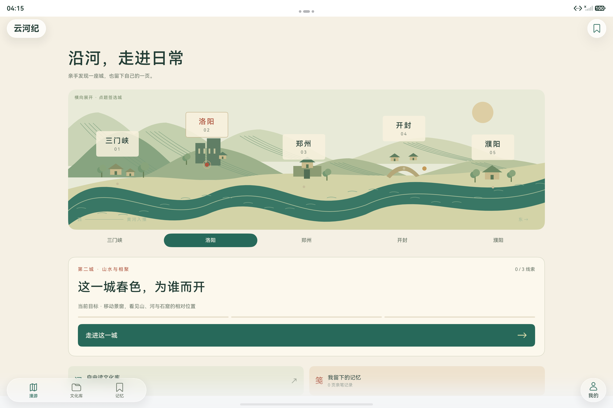

# M12五城河流首页与文化库

2026-10-23，API26 tablet模拟器，2880×1920，产品M12。以下为HDC实际原生定向检查和只读存储核对，**不计为Hypium新增用例**。

首页原图实际显示五城河流、当前城市题签、目标和开始入口，拍于设备时间04:15，已经等待启动页结束；早先同名近似的本机`tablet-home-m12.png`是启动图，不用作首页证据。

文化库实操：搜索“牡丹”找到独立内容`roam-ly-peony`，自由展开第二条全文与来源，收藏并从记忆的收藏分区把分类设为“研究资料”。没有完成前置第一条，依然能阅读文化资料。只读落盘核对为收藏1、标签研究资料、个人笔记0、已完成线索0，见[library-result.json](library-result.json)。

- [牡丹关键词与文化条目](tablet-library-peony-m12.png)。
- [收藏分类设为研究资料](tablet-culture-favorite-tagged-m12.png)。
- [未通关仍可阅读第二条](tablet-library-free-second-clue-m12.png)。

四张图均实际查看，无账号或凭据；图像与原始布局保留原字节。八个原文件的大小、SHA256及检查范围见[evidence.json](evidence.json)。截图中搜索容器本身的text为空，真实SearchField子节点和过滤结果为“牡丹”，不把包装节点误读成检索失败。

五城实操与完成画面另见[四城图集](../four-cities/README.md)和[开封完整演示](../demo/README.md)，平板三列与旋转见[平板图集](../tablet/README.md)。
