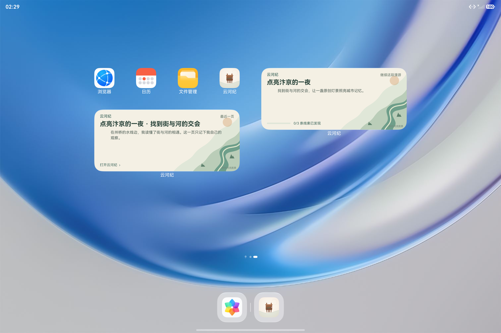
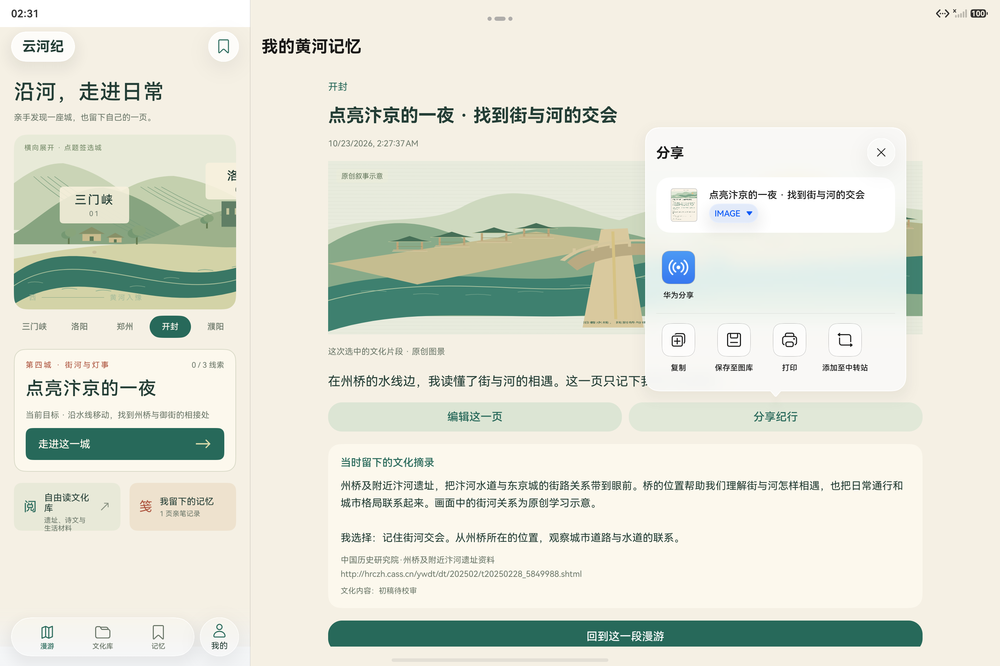

# 普通桌面卡片与原生分享的实际证据

日期：2026-10-23。本目录来自 API 26 平板模拟器的 HDC 原生界面定向验证，**不是 Hypium 用例统计**。[evidence.json](evidence.json) 保留 11 条操作记录：10 条通过记录，以及 1 条在 M6 暴露、随后由 M8 修复并复验的空卡目的页错误。它们不合并成“11 项全部通过”。

M6 上实际添加了“继续这段漫游”和“最近一页”两张普通 2×4 桌面卡片；继续卡和记忆卡的冷、热启动四条路径均到达对应篇章或同一篇记忆。M8 再验证删除最后一页后的空记忆卡冷、热启动，均回到记忆空态。各包完整字节数、SHA-256 与范围见机器清单和[接口与原始操作说明](../../../research/roaming-native-system-20261023.md)。本目录保留实际旧包边界，不把 M6/M8 的结果改记为最终主包。

ShareKit 实际打开了系统分享面板。点击来自用户已确认保存的纪行；没有选择外部接收者。原生生成的 [PNG 明信片](native-postcard-m6.png) 为 1080×1365、245,441 字节，SHA-256 为 `186B4FDF675133710EBB1143573C12B77EC9A7752975551A8A2DA0645ED441BB`。

取消分享后，精确独立测试 Preferences 的全部 3,374 字节与取消前一致。[record-comparison.json](record-comparison.json) 同时记录后续正式删除操作保留原 note 的墓碑、冻结依据、正文、装饰和其他进度。原始 Preferences XML 留在本机，不作为公开材料分发；不能把系统面板出现或取消解释为第三方已收到内容。

截图和布局按原字节复制。公开命令日志只替换开发机目录为占位符，机器清单分别记录原始与公开文件哈希；未公开完整系统噪声日志、私有开发脚本或原始档案 XML。当前截图来自独立游客测试库，选用的桌面和分享原图已实际查看，没有账号或联系人内容。

这组结果仅证明列出的设备、版本和动作。华为账号、原生可信设备传输和系统应用接续仍未完成；自建账号 HTTPS 的双端结果由本轮独立网络设备测试记录。
