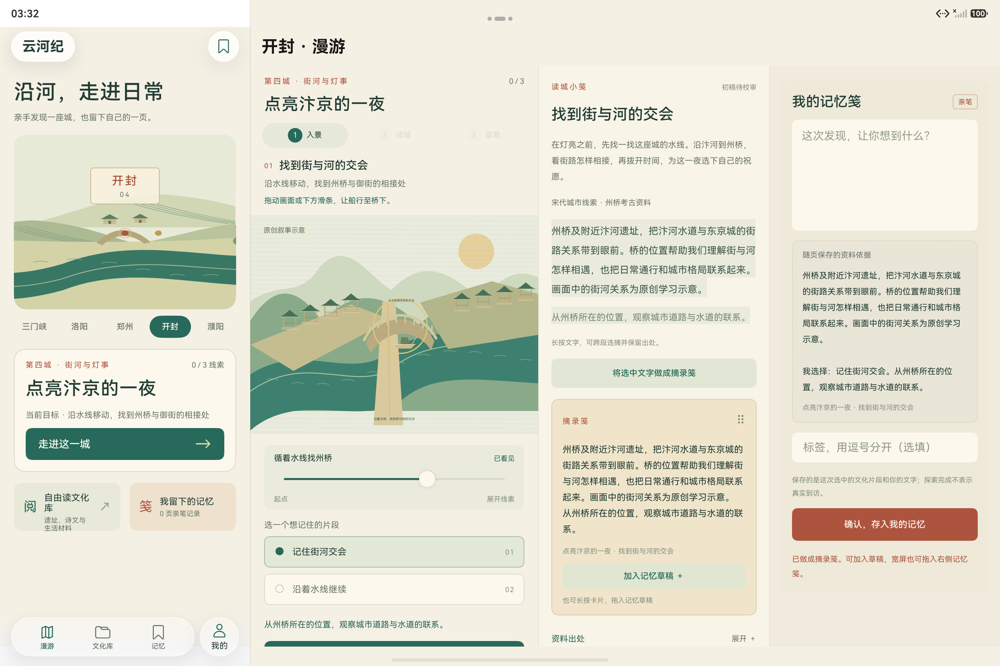
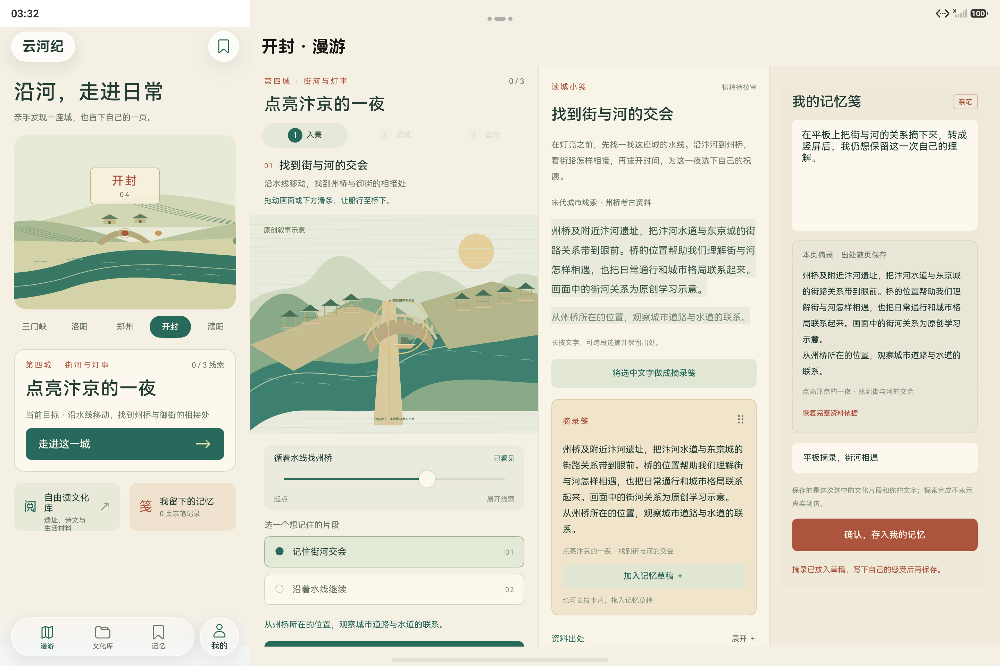
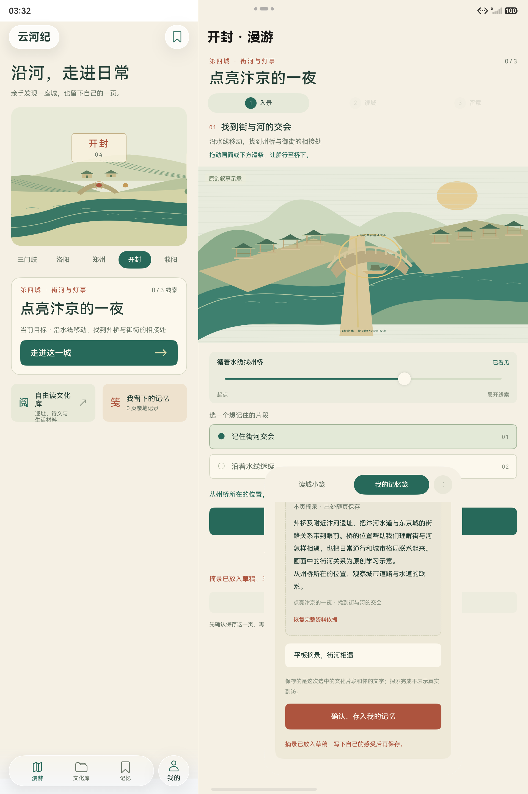
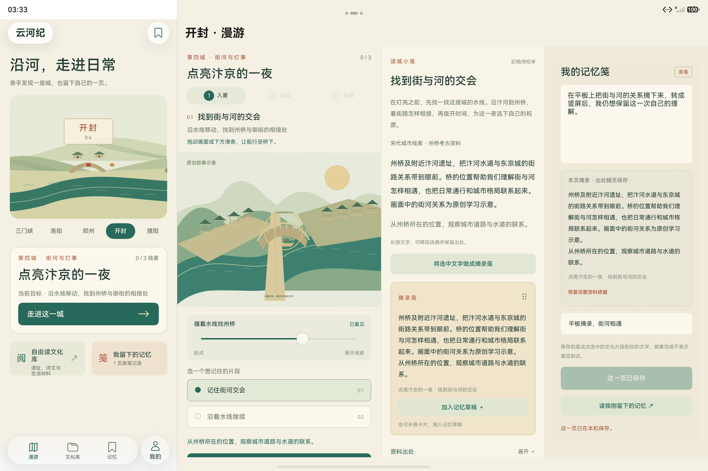
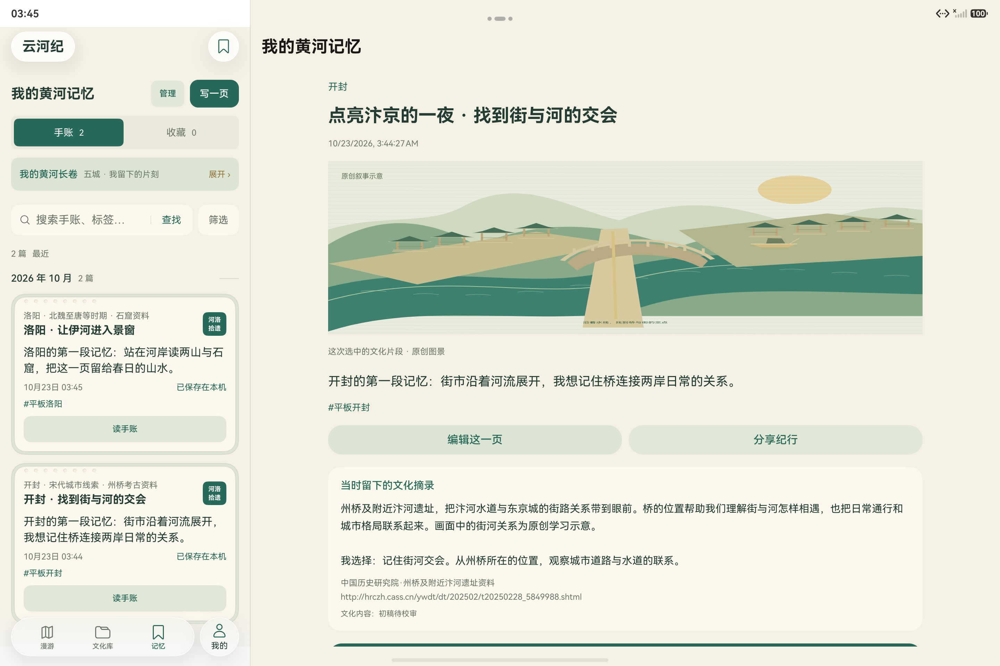
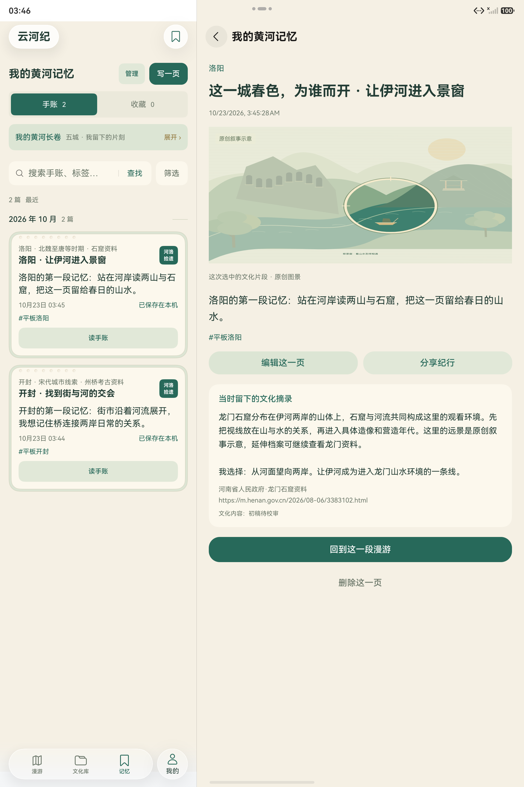
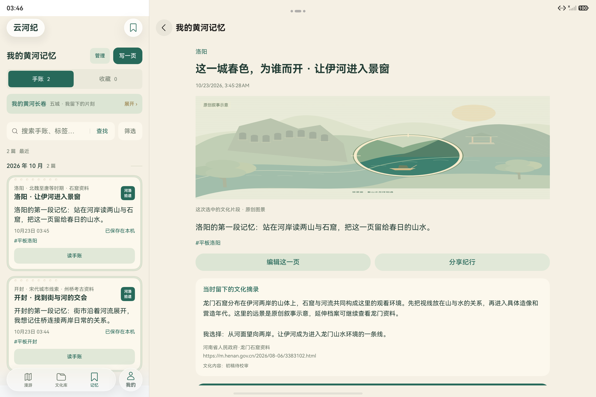

# 原生平板摘录、旋转与记忆目录证据

日期：2026-10-23。本目录保存两条已完成的平板原生定向用例，共 **11 张 PNG 原图、11 份对应 UiTest JSON 布局**。摘录用例在 **M11 / T11** 上通过，目录用例在 **M12 / T12** 上通过；两项各为 **Pass 1 / Failure 0 / Error 0 / Ignore 0**。这两个结果属于不同包版本，不登记为“M12 上两项全部通过”。

| 定向用例 | 实际包 | 耗时 | 原始报告 |
| --- | --- | --- | --- |
| `RoamingTabletTest#native_excerpt_drag_survives_portrait_and_landscape_before_save` | M11 / T11 | 113514 ms | [摘录成功报告](../../../test-results/2026-10-23-033111-9a3c9460-device.log) |
| `RoamingTabletTest#native_memory_directory_keeps_selected_note_after_orientation_changes` | M12 / T12 | 209582 ms | [目录成功报告](../../../test-results/2026-10-23-034327-a4e2774e-device.log) |

两项均独立执行，参数为 `ExpectedTests=1`、`TestTimeoutMs=600000`，通过正式 EntryAbility 和 `yunheji_test_ui_*` 游客库操作，不注入通关、笔记或账号资料。报告包含完整结束摘要；`aa test` 退出码不作为通过依据。测试源码见 [RoamingTablet.test.ets](../../../../entry/src/ohosTest/ets/test/RoamingTablet.test.ets)。

[evidence.json](evidence.json) 按成功会话分别记录原始报告哈希、主包／测试包哈希、22 个原始文件的字节数与 SHA-256、实际窗口方向、冻结摘录和两条记忆的保存前后版本。JSON 中的路径均以仓库根目录为基准。图像和布局按原字节复制并核对一致，没有重绘、裁切、拼接或覆盖界面；目录不发布 HAP、身份资料或完整混合事件日志。

## 跨 Text 原生选摘、拖放与保存

摘录会话只解析成功的 `ROAMING_TEST_STORE`、`ROAMING_TABLET_STEP`、`ROAMING_TABLET_ORIENTATION`、`ROAMING_TABLET_CHAPTER_BOUNDS`、`ROAMING_TABLET_NOTE` 和 `ROAMING_TABLET_RESULT`。失败重试及随后账号同步会话不混入该会话的结果。

实际路径为：横屏选择开封首条片段，长按 SelectionContainer 中的正文，使用系统“全选”和“做成摘录笺”，再以 `Component.dragTo` 将生成的卡片拖入右侧草稿。拖入后的 `roam-draft-excerpt` 由默认资料依据变为两个 Text 的连续选区；最后磁盘读回的 `roamingContext.excerpt` 与此完全一致：

```text
州桥及附近汴河遗址，把汴河水道与东京城的街路关系带到眼前。桥的位置帮助我们理解街与河怎样相遇，也把日常通行和城市格局联系起来。画面中的街河关系为原创学习示意。
从州桥所在的位置，观察城市道路与水道的联系。
```

亲笔正文为“在平板上把街与河的关系摘下来，转成竖屏后，我仍想保留这一次自己的理解。”，标签为“平板摘录”“街河相遇”。最终记录冻结 `roam-kf-night / roam-kf-crossing / kf-street-river`、上下文版本 1、图景修订 1、资料修订 1，以及州桥资料来源对象；没有制造旧器物 pose 或 AI 内容。

| 阶段 | 原图预览 | 对应布局 |
| --- | --- | --- |
| 系统跨段选摘后、真实拖拽前 |  | [JSON](excerpt/excerpt-before-native-drag.json) |
| 拖入并填写亲笔文字、标签后 |  | [JSON](excerpt/excerpt-landscape-draft.json) |
| 竖屏写作 Sheet |  | [JSON](excerpt/excerpt-portrait-writing-sheet.json) |
| 回到横屏的同一份草稿 |  | [JSON](excerpt/excerpt-landscape-restored-draft.json) |
| 用户确认后的真实保存状态 |  | [JSON](excerpt/excerpt-landscape-saved.json) |

上述五张图均已实际查看。竖屏图的 Sheet 已滚动至摘录和标签，亲笔输入框位于更上方；正文保留由同轮输入控件断言、回横屏画面和最终磁盘记录共同证明。静态截图不表示抓取了拖拽中的每一帧，真实拖放由同轮 `NATIVE_DRAG` 步骤、`Component.dragTo` 后的草稿变化及成功报告相互印证。保存图的 `roam-save-note` 为“这一页已保存”且 `enabled=false`，同轮磁盘实际读回一条 note。

## 左目录切换与旋转后选中记录

目录用例在 M12 / T12 上通过正常 UI 分别创建开封、洛阳首条片段的亲笔记忆，再从左侧目录依次点击两条“读手账”。开封详情显示州桥图景、开封正文和州桥冻结来源；洛阳详情显示两岸图景、洛阳正文和龙门冻结来源。两张选用切换图均已实际查看，左栏两条记录显示“已保存在本机”。

| 开封详情 | 洛阳详情 |
| --- | --- |
|  |  |
| [开封布局](memory/directory-kaifeng-selected.json) · [开封来源原图](memory/directory-kaifeng-selected-sources.png) · [来源布局](memory/directory-kaifeng-selected-sources.json) | [洛阳布局](memory/directory-luoyang-selected.json) · [洛阳来源原图](memory/directory-luoyang-selected-sources.png) · [来源布局](memory/directory-luoyang-selected-sources.json) |

旋转前选中洛阳；之后不再次点击洛阳，实际转为竖屏再回横屏，右侧仍保持同一条洛阳正文、摘录和来源。下面两张方向图也已实际查看。

| 竖屏保留洛阳 | 回横屏仍为洛阳 |
| --- | --- |
|  |  |
| [竖屏布局](memory/directory-portrait-luoyang-retained.json) | [横屏布局](memory/directory-landscape-luoyang-retained.json) |

两条实际保存记录与旋转后的 `directory-final-disk` 分别重组日志分片后比较：开封 `updatedAt=1792698267142`，洛阳 `updatedAt=1792698328599`，ID、正文、标签、版本信封和完整 `roamingContext` 均未改变，原始记录 JSON 逐字相同。最终 `ROAMING_TABLET_RESULT` 为 `activeNotes=2`、`rotations=2`、`recordsUnchanged=true`，选中 ID 是这条洛阳记忆。完整初始／最终记录及内容哈希保存在 [evidence.json](evidence.json)，没有以界面预览替代磁盘回读。

## 真实窗口方向与包版本

两个用例均使用实际 EntryAbility 窗口的 `setPreferredOrientation`，等待真实窗口尺寸和页面分支后继续，不修改页面宽度模拟旋转。

| 会话 | 初始横屏 | 第一次实际旋转 | 第二次实际旋转 |
| --- | --- | --- | --- |
| 摘录 M11 / T11 | 03:31:17.465，2880 × 1920 | 03:32:23.093，1920 × 2880 | 03:32:45.314，2880 × 1920 |
| 目录 M12 / T12 | 03:43:33.025，2880 × 1920 | 03:46:20.265，1920 × 2880 | 03:46:37.021，2880 × 1920 |

横屏漫游目的页实际 bounds 为 `[721,86][2880,1920]`，左侧为系统导航内容；摘录例出现场景、阅读、写作三栏，竖屏时出现真实写作 Sheet。所有原图保留设备输出分辨率：横屏 2880 × 1920、竖屏 1920 × 2880。上文展示宽度只缩放文档中的预览，不改变 PNG 文件。

| 包 | 字节数 | SHA-256 |
| --- | --- | --- |
| M11 | 7625477 | `E5C170AE1393E15DD2D4A77F638E583BCE5E23FADB4405A56FC6EE03499A5338` |
| T11 | 7011271 | `3E4A471529E95EAC157D22D69BA79760BF1C86AB6DF042672CC8908648A7DBAA` |
| M12 | 7629427 | `FD6E7B3C89A155528FC9166B012AF96DB029DFE8AA379EC4ED669FBECD517094` |
| T12 | 7011271 | `80414E8A33898028010BA17D50EA1EB5DECB58303A57B6B1796037D87FDF0E32` |

四个哈希均重新读取本机已留存 HAP 字节核对，与各包哈希清单一致；本目录只公开摘要，不复制二进制包。摘录结果继续归属 M11 / T11，目录结果归属修复返回行为后的 M12 / T12。

## 旧失败与范围限制

| 旧批次 | 实际问题与处理 |
| --- | --- |
| 摘录 R1 | 锁屏导致启动中断，没有完整结束摘要，不能记作通过。 |
| 摘录 R2 | 测试尚未执行所需滑动，却使用已观察状态作为前提；修正真实操作步骤后重跑。 |
| 摘录 R3 | 输入正文后软键盘遮住标签，修正为真实收起键盘后再定位标签。 |
| 目录首轮 M11 | 保存开封记忆后，默认系统 Back 退出 App，未回到漫游首页；M12 改为目的页明确调用同一 `NavPathStack.pop()` 并返回 `true` 消费事件，M12 / T12 目录用例随后通过。没有把此现象归因为已证实的 HdsTabs 焦点问题。 |

旧失败的原始报告、逐次包版本和整体统计统一见 [TEST_REPORT.md](../../../TEST_REPORT.md) 第 34 节；本目录保留成功证据的明确版本归属，不用后续通过覆盖原失败。

本目录证明上述两条原生平板定向路径及其本机保存结果，不扩展为全应用、全部平板、华为账号、鸿蒙原生 KV 跨端或同一 M12 包上全部用例通过。文化资料与画面仍显示“初稿待校审”“原创叙事示意”，探索完成不表示真实到访。
