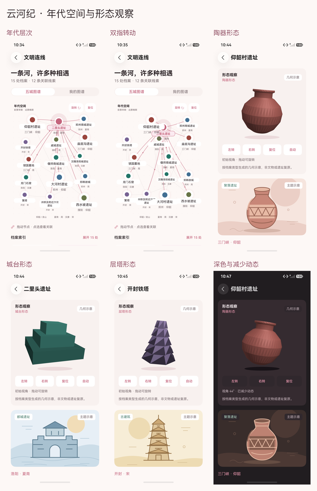

# 年代空间与形态观察真实截图

日期：2026-10-16。全部来自实际 HarmonyOS 7 / API 26 手机模拟器，经 HDC / Hypium 获取。当前图谱为 ArkUI Canvas，形态为同一程序化三维网格的原生 Canvas 兼容绘制；这些图片不证明 ArkGraphics3D / WebGL GPU 已验收。

图谱两项图片对应取景调整前包；形态、个人专题和外观图片对应最终包。逐图报告与两包 SHA-256 见 [captures.json](captures.json)，七份最终场景报告见 [阶段清单](../../test-results/2026-10-16-spatial-phases.json)。

| 图片 | 内容 | 设备报告 |
|---|---|---|
| [graph-depth.png](graph-depth.png) | 年代层次 | [2026-10-16-223430-device.log](../../test-results/2026-10-16-223430-device.log) |
| [graph-turned.png](graph-turned.png) | 按钮旋转 | [2026-10-16-223430-device.log](../../test-results/2026-10-16-223430-device.log) |
| [graph-two-finger.png](graph-two-finger.png) | 双指转动 | [2026-10-16-223430-device.log](../../test-results/2026-10-16-223430-device.log) |
| [graph-drag.png](graph-drag.png) | 节点拖动 | [2026-10-16-223430-device.log](../../test-results/2026-10-16-223430-device.log) |
| [graph-reduced.png](graph-reduced.png) | 图谱减少动态 | [2026-10-16-223535-device.log](../../test-results/2026-10-16-223535-device.log) |
| [object-before-turn.png](object-before-turn.png) | 陶器转动前 | [2026-10-16-224302-device.log](../../test-results/2026-10-16-224302-device.log) |
| [object-after-turn.png](object-after-turn.png) | 陶器转动后 | [2026-10-16-224302-device.log](../../test-results/2026-10-16-224302-device.log) |
| [pottery.png](pottery.png) | 陶器形态 | [2026-10-16-224302-device.log](../../test-results/2026-10-16-224302-device.log) |
| [terraces.png](terraces.png) | 城台形态 | [2026-10-16-224302-device.log](../../test-results/2026-10-16-224302-device.log) |
| [ring.png](ring.png) | 环形城垣 | [2026-10-16-224302-device.log](../../test-results/2026-10-16-224302-device.log) |
| [tower.png](tower.png) | 层塔形态 | [2026-10-16-224504-device.log](../../test-results/2026-10-16-224504-device.log) |
| [mound.png](mound.png) | 封土形态 | [2026-10-16-224504-device.log](../../test-results/2026-10-16-224504-device.log) |
| [object-dark.png](object-dark.png) | 深色与减少动态 | [2026-10-16-224630-device.log](../../test-results/2026-10-16-224630-device.log) |
| [object-large.png](object-large.png) | 大字形态视口 | [2026-10-16-224630-device.log](../../test-results/2026-10-16-224630-device.log) |
| [object-reduced-before.png](object-reduced-before.png) | 静止视口前帧 | [2026-10-16-224630-device.log](../../test-results/2026-10-16-224630-device.log) |
| [object-reduced-after.png](object-reduced-after.png) | 静止视口后帧 | [2026-10-16-224630-device.log](../../test-results/2026-10-16-224630-device.log) |
| [home.png](home.png) | 首页入口 | [2026-10-16-224839-device.log](../../test-results/2026-10-16-224839-device.log) |
| [compare.png](compare.png) | 档案对照 | [2026-10-16-224839-device.log](../../test-results/2026-10-16-224839-device.log) |
| [personal.png](personal.png) | 真实个人专题 | [2026-10-16-224839-device.log](../../test-results/2026-10-16-224839-device.log) |
| [personal-compare.png](personal-compare.png) | 个人专题对照 | [2026-10-16-224839-device.log](../../test-results/2026-10-16-224839-device.log) |
| [graph-dark.png](graph-dark.png) | 图谱深色 | [2026-10-16-225155-device.log](../../test-results/2026-10-16-225155-device.log) |
| [graph-large.png](graph-large.png) | 图谱大字 | [2026-10-16-225155-device.log](../../test-results/2026-10-16-225155-device.log) |

程序化形态均为类型示意，非文物或遗址复原。原图中自动定位的陶器模型区域在减少动态时前后帧完全一致，转动前后模型区域像素变化，详见 [像素核对](pixel-checks.json)。当前正常网络账号双端、GPU 性能、平板 / 横屏 / 分屏未在本轮重验。
