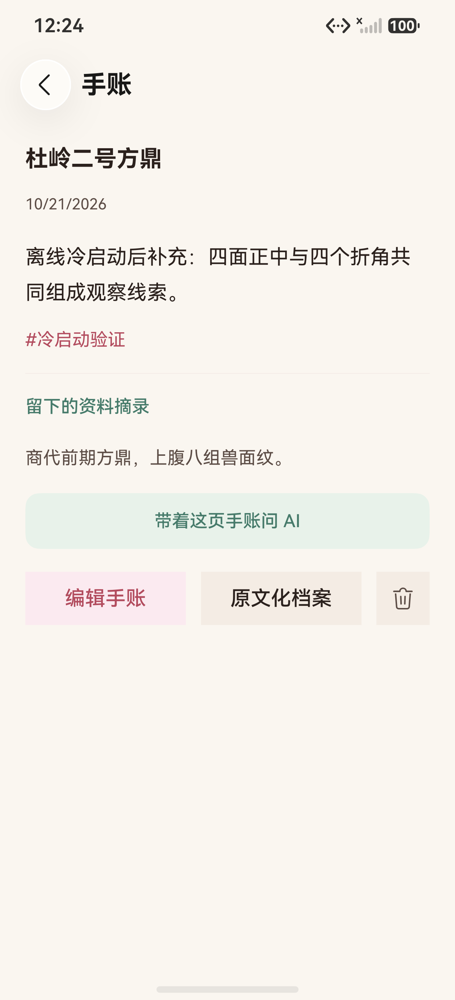
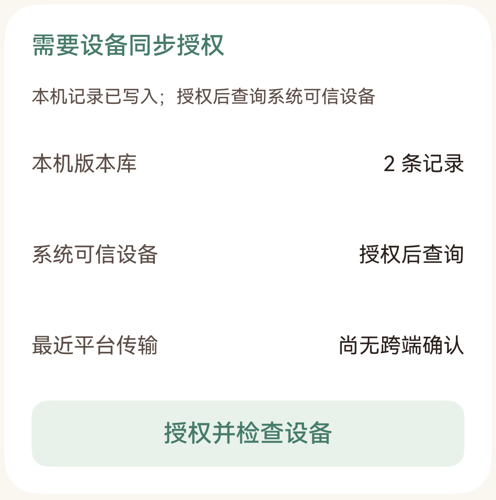
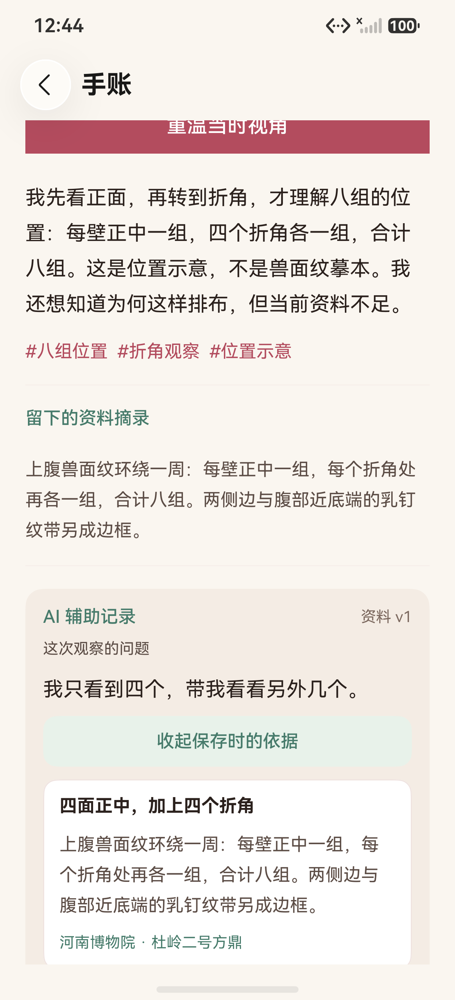

# 账号离线冷启动与原生通道：原生设备画面

日期：2026-10-21。来自两台 HarmonyOS 7.0.0.107 / API 26 手机模拟器，原图 1256×2760。主包 SHA-256 为 `9AF0483A63AA0425B70253A33B02EC832E8C1B3BABB66B8E42ABF9F5B7AB6AD6`。

这些是实际 ArkUI 页面截图。第一、二、四张保留整屏原图，第三张从实际截图裁出原生状态卡，裁片范围为原图 `(53,1390,1150,1160)`，去除上方合成测试账号资料，不补画文字或状态。

| 画面 | 证明范围 | 原始报告 |
|---|---|---|
| [01 · A 离线冷启动编辑](01-offline-memory.png) | 服务不可达、进程关闭后重新启动，打开原账号同一篇普通手账并保存新正文；正文、记录 ID 已读盘核对。本篇未主动保存观察视角 | [002337](../../test-results/2026-10-21-002337-2eeda69c-device.log) |
| [02 · B 接收修改全文](02-other-device-memory.png) | 服务恢复后，另一台模拟器经同账号 HTTPS 收到该条修改并显示全文 | [002503](../../test-results/2026-10-21-002503-ab751608-device.log) |
| [03 · 原生状态卡裁片](03-native-status-crop.png) | A 当时尚未授权：本机 KV 中 2 条逻辑记录、可信设备待查询、尚无平台跨端确认 | [002438](../../test-results/2026-10-21-002438-5d092c91-device.log) |
| [04 · AI 手账保存时依据](04-ai-saved-evidence.png) | 真实模型草稿经用户确认保存后，在手账正文中展开当时冻结的资料事实、原问题及来源；截图是向下滚动后的证据区域 | [003649](../../test-results/2026-10-21-003649-7eca4082-device.log) |

第三张是在本轮 A 端首次授权前截取；随后实际授予权限并查询系统列表的结果以[测试报告第 30 节](../../TEST_REPORT.md#30-账号离线冷启动与原生分布式通道基础2026-10-21)为准，不能用该旧时点画面说明授权后仍未授权。HTTPS 接收不代表原生分布式传输。

