# UI/UX 改版图集

记录日期：2026-10-18。设备：Pura 90 Pro 模拟器，HarmonyOS 7.0.0.107 / API 26，1256×2760，density 560。截图来自实际安装的原生 HAP，不是网页预览或设计稿；账号为一次性测试账号，图中不包含密码或密钥。

本轮针对用户反馈“首页臃肿、其他页面毛坯、开发文案多、视角按钮多余、五城沙盘粗糙且点击无反馈”做了一轮结构性整理，不是只换颜色。

## 1. 登录

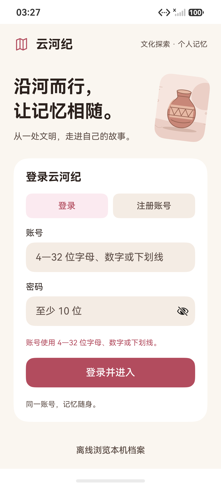

移除了“学习档案 / 选填·预留 / 教育计划尚未开放”整段占位，登录页只保留账号、密码、登录 / 注册和离线浏览。卡片内只保留一句“同一账号，记忆随身”。不收集学校或学号，也不再展示未实现的预留字段。

## 2. 首页首屏

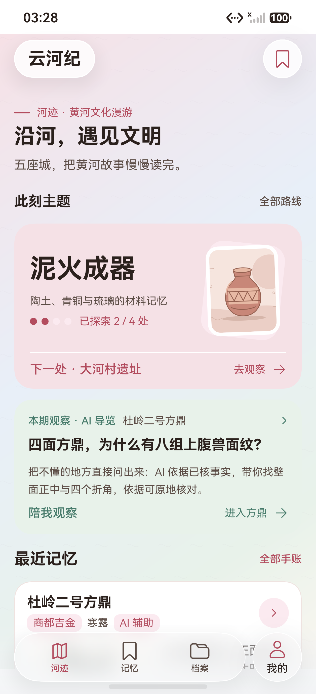

- 顶部去掉常驻“初稿待校审”徽标；内容状态移到“我的 > 资料说明”，不每页重复。
- 保留主题卡和 AI 观察入口，但把说明压到一句；原路线、最近记忆和 Dock 不变。
- 保留三张纸片入口（从彩陶读起 / 河流记忆 / 随身档案）与贴纸；原先的“循迹而行”推荐列表从首页移除。

## 3. 最近记忆

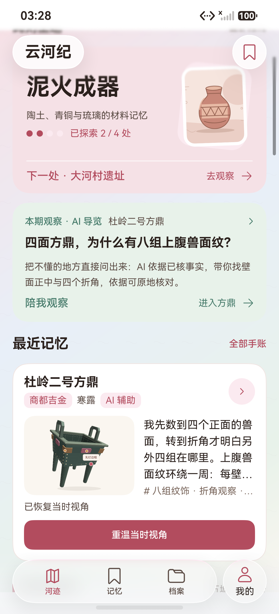

首页最近记忆改为横向摘要：左侧 142vp 缩略画面，右侧正文、标签和 AI 辅助标记，只保留一个“重温当时视角”主操作。旧文字手记不再显示空白画面占位。

## 4. 五城河洛

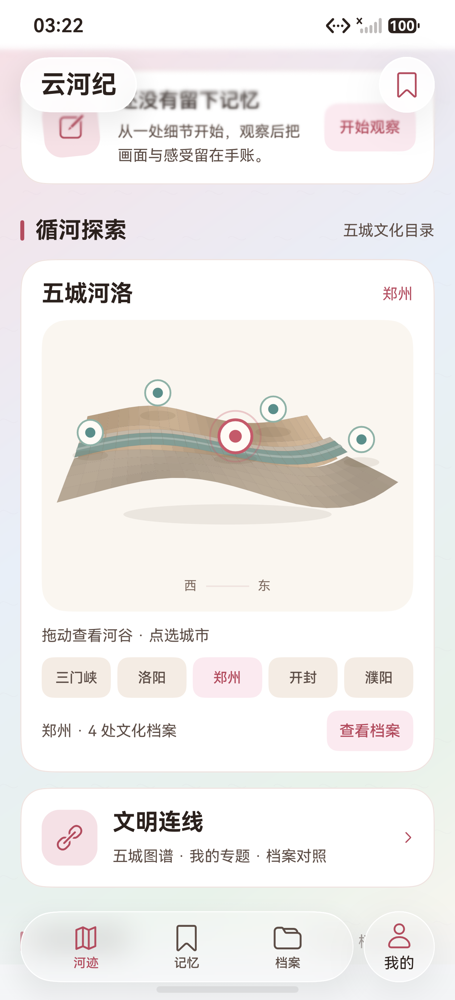

- 地形从 36×8 网格降到 24×4 + 24×2，并去掉五根城市细柱；河谷改为两层缓坡、水带、水线和河岸，默认不自动重绘。
- 画布不再排五块文字签；城市选择改为下方五个原生按钮，避免标签互相遮挡。
- 点击城市后：标题变为城市名、选中圆点放大变玫瑰色、按钮高亮、出现“郑州 · 4 处文化档案”和“查看档案”入口，并显示轻提示。点击不再“没有反应”。
- 沙盘完全不再放左转、右转、复位、自动按钮；拖动和双指缩放是唯一视角操作。详情页仍保留小图标胶囊，因为热点注释需要精确转角和复位。画布底部加一条很轻的“西—东”方位线，提示河谷走向，也让空场不显得空。

## 5. 首页下半段

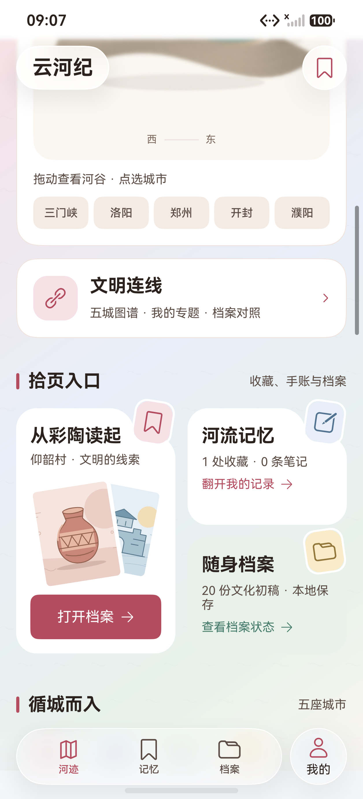

按用户要求把“拾页入口”改回三张纸片 + 贴纸：从彩陶读起保留双图叠放与“打开档案”，河流记忆显示真实收藏 / 笔记数，随身档案显示 20 处文化档案（不再在首页写“初稿”）。五城索引仍保留；检索、筛选和档案网格收在一张卡里。整页仍有内容，但去掉了“循迹而行”推荐列表和重复入口。

## 6. 方鼎详情

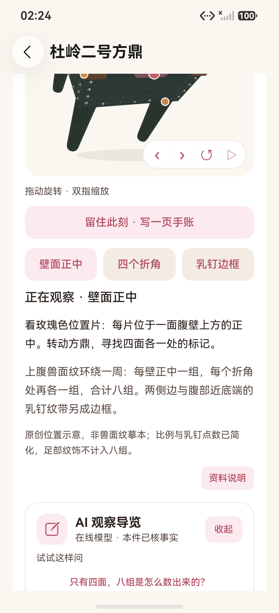

- 视角按钮改为画布右下角小胶囊，不再占据整行。
- 初始提示只保留“拖动旋转 · 双指缩放”，不再显示“初始视角”等调试口径。
- 位置关系说明缩短为一句；完整图注、资料边界和审核状态收进“资料说明”行内卡片，不弹第二个 Sheet（避免与手账编辑器冲突）。
- 游客看到的 AI 面板默认收起，只露出入口。

## 7. AI 回答

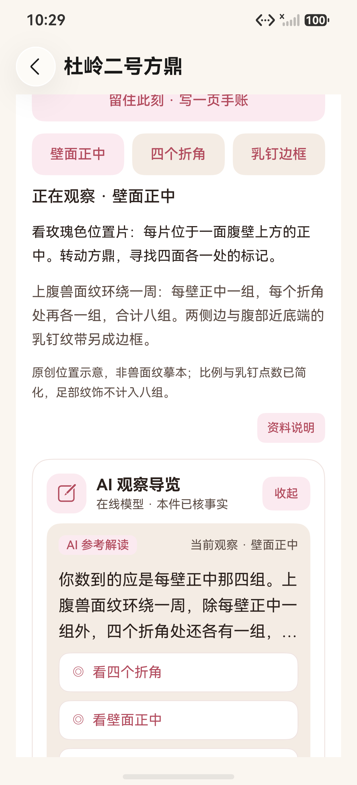

回答默认只显示三行结论，观察动作紧跟其后；“展开完整解释”和“查看依据”按需展开。有 `show_evidence` 动作时不再显示重复的“查看本次依据”按钮；底部长免责声明移到资料说明。

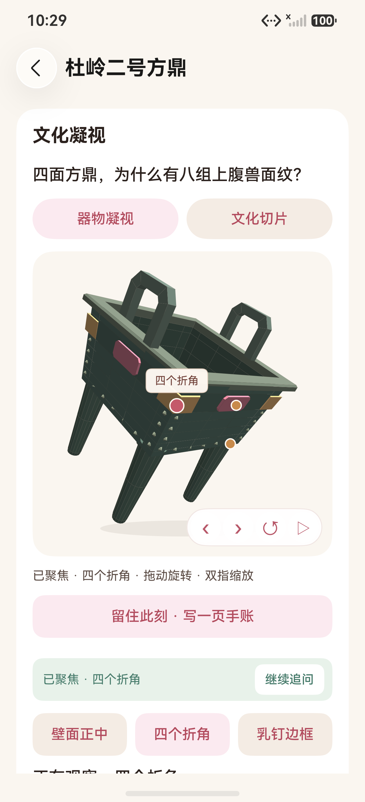

点“看四个折角”会先收起键盘，再把详情滚回模型：选中折角标签、旋转后的方鼎和“已聚焦 · 四个折角”同屏出现。模型下方保留“继续追问”，回答、问题和输入都没有被清空。

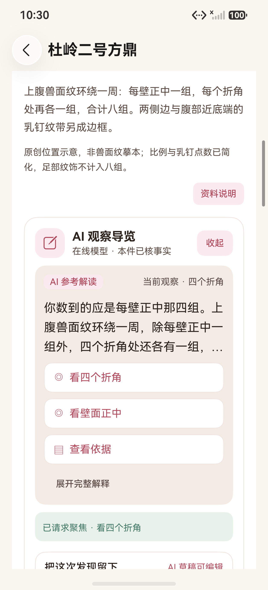

“继续追问”滚回原回答并聚焦输入框，接着追问即可；不会重置会话。

## 8. 记忆页

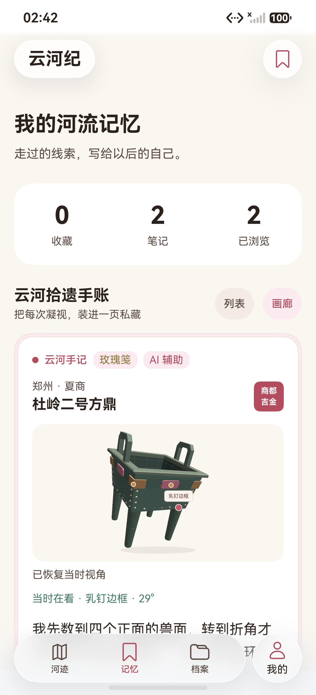

截图是画廊视图。默认改为更紧凑的列表：列表只保留标题、视角标签、正文摘要和操作，不再重复一张大图；画廊才重建大画面。手账卡去掉了“这页保留文字记忆 / 这张手账未记录观察视角 / 留在个人记忆里”等开发占位，AI 辅助缩成标题旁的小标记，正文、资料摘录和日期各最多一行到两行。旧文字笔记直接显示正文，不再画空预览。

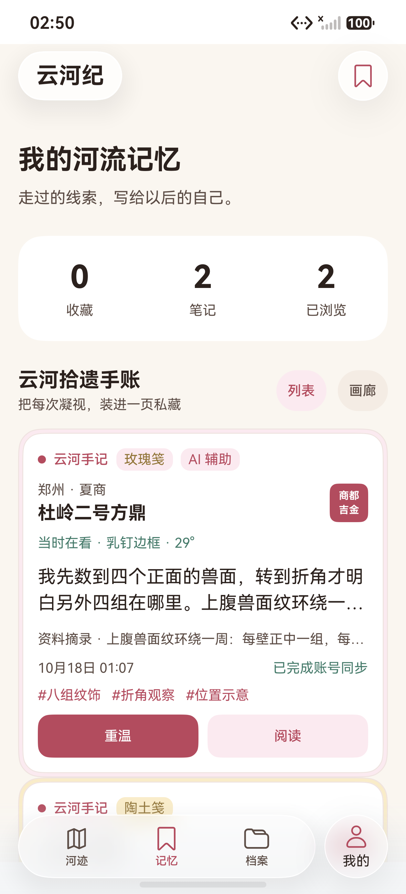

列表把同一张手账压到一屏可见：标题、当时在看、两行正文、一行资料摘录、日期 / 同步状态、标签和“重温 / 阅读”两个动作。要看画面再切“画廊”。

## 9. 档案页

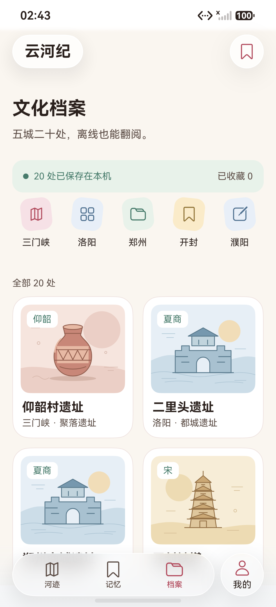

“档案”从本地存储 / 数据格式 / 已浏览的技术状态页改成真正的文化档案库：本机离线状态、城市筛选、20 处档案网格。技术状态移到“我的”，不再占据用户主路径。

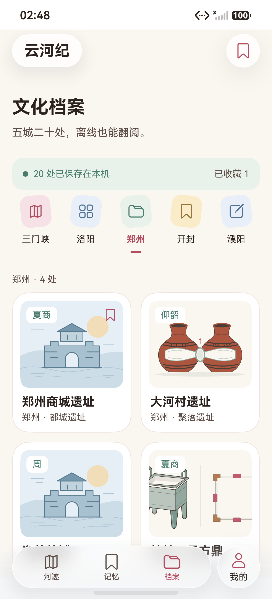

城市按钮可直接筛选；选中城市后显示该城档案数量，再点一次取消筛选。五城沙盘与档案库共用同一个城市状态。

## 10. 我的

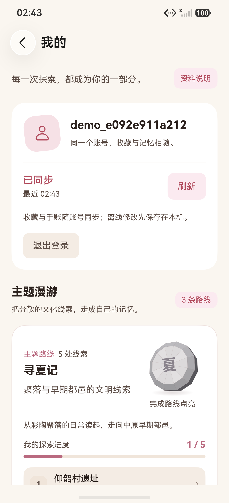

- 账号卡保留真实同步状态，但文案缩短为“已同步 / 最近 02:20”和一句“收藏与手账随账号同步”。
- 顶部的“资料说明”入口可随时打开统一说明。
- 去掉了“保留冲突版本 / 设备光感能力 / 原生开发版 / 内容状态初稿待校审”等面向开发者的行；保留同步与显示相关的必要状态。

## 11. 资料说明

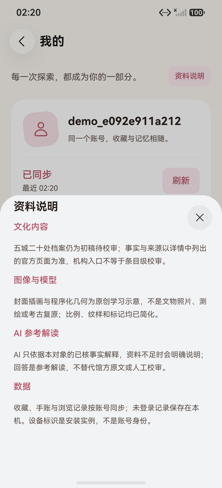

把文化内容、图像与模型、AI 参考解读、数据边界集中到一张说明里。主页面不再到处重复“初稿待校审 / 主题示意 / 非实物复原”等小字，但关键边界仍可随时查看。

## 12. 验证与边界

- 本地：**103/103**，报告解析 **9/9**；主包与测试包 `BUILD SUCCESSFUL`。
- 首页核心回归 `HomeExperienceTest#native_home_theme_recent_memory_route_replay` **1/1**，Failure / Error / Ignore 0，**233042ms**，原始报告 `docs/test-results/2026-10-18-085335-device.log`。
- 方鼎原观察 / 保存 / 回放回归 `ExpandedObservationTest#native_duling_observe_save_gallery_replay` **1/1**，Failure / Error / Ignore 0，**190017ms**，原始报告 `docs/test-results/2026-10-18-085741-device.log`。
- 这两项是在“纸片入口、AI 动作回模型”修改前的主包上通过；未重跑完整 UI 套件，不能把这两条结果说成全量复验。
- 2026-10-18 10:30 追加 AI 动作修改：回答默认三行、动作前置；“看四个折角”收键盘并滚回模型，模型下方出现“继续追问”；继续追问滚回回答并聚焦原输入框。该版主包 SHA-256 `86F9B2DF3189B23136463A8C97B9C216CEA95422DBB645CA8468509485BB71B1`，只做了构建和手工设备操作核对，未再跑长回归。
- 2026-10-18 12:25 追加文案清理：17 条无诗文的档案不再渲染“诗文索引 / 暂未收录”空卡；机构首页链接改标“机构入口”，并在详情中说明尚未对应到条目级出处；“待第二轮补充”改为面向用户的“尚待条目级校审，本页暂不展开”；首页纸片改为“20 处文化档案 · 离线可读”；关于页补充 AI 提问会发送到在线模型的提示。本地 103/103、报告解析 9/9、主包构建成功，新的主包 SHA-256 `317ADA8732AB9C1882BF19EF6C60BAC3939C05EC7C8EDD6B5EF9ED28E8D186AE`；在二里头详情实机核对空卡已消失、来源说明正常显示，未重跑长 UI 回归。
- 2026-10-18 12:45 追加档案内容补齐：17 条骨架档案按国家文物局、省市文物部门、博物馆、中国社会科学院公开页面重写；20 条均有条目级来源，五城选中状态增加简介，档案卡增加摘要；16 条接入 Wikimedia Commons 授权实景图并标注作者 / 许可，4 条保留原创插画。当前主包 SHA-256 `EF9FCADB10275DE2438486D6766B8E88FB68B17523EA17C60165649D53488F84`，本地 103/103、报告解析 9/9；实机核对二里头照片卡、城市简介和档案卡摘要，未重跑长 UI 回归。来源与许可见[图片与内容来源](../../IMAGE_CREDITS.md)。
- 未完成：我的页三张路线卡仍然很长；详情事实正文仍占较多纵向空间；20 条内容仍需逐条馆方校审，戚城、州桥、西坡、单拐 4 条尚无授权实景图；档案页城市筛选和大字 / 深色 / 真机矩阵未重跑；个人页同步状态仍有少量技术词。后续按实际演示设备再定向压缩。

主包与测试包最终哈希见[测试报告第 26 节](../TEST_REPORT.md)；改版前的首页 / 双端证据仍保留在历史图集，不混算。
